# 飞书文档界面核验记录

## 2026-11-09（第五轮，收尾）：块级评论、表格列宽跟随、分割线与全量走查——文档页外观对齐完成

- 块级评论：图片、附件、表格、视频、网页卡片、公式、流程图可整块评论。沿用现有评论 REST 模型：`block` 为块 ID、`startChar`/`endChar` 为空即块级锚点，引用显示「[图片] 图注/文件名」；**无需服务端迁移，不改协同协议**。图片悬停工具栏「评论」与块菜单「评论」均已接通（含只读/仅评论读者）；有评论的块显示黄色描边与评论气泡，激活线程时高亮并可从评论面板定位。浏览器验证：图片评论发送后面板显示引用、块出现气泡；附件块菜单评论打开带「[附件] 产品路线图-Q4.pdf」的草稿。
- 表格列宽：插入/删除/移动列时 `tableWidths` 同步平移（新列为自动宽度），与 `tableData`/`tableMerges` 在同一事务、同一步撤销；列/行菜单新增「左移一列/右移一列」「上移一行/下移一行」（跨越合并块时禁用）。浏览器验证：把「内容」列拖宽到 210px 后在其左侧插列、右移、删除，宽度始终跟随该列；四次 Ctrl+Z 逐步恢复（修复了此前列宽拖拽与随后结构操作被合并为同一步撤销的问题）。
- 分割线：飞书文档分割线只有默认实线（无虚线等样式选项），改为 1px `#DEE0E3` 细线，编辑与只读一致；`---` 与 /fgx 插入保持可用。
- 走查修复：空引用行回车退出引用（此前会无限新增引用行）；`**粗体**`、`` `代码` `` 等行内 Markdown 转换后继续输入不再沿用该格式；块级公式居中；表格与正文左对齐（握把移到正文左侧留白）；只读表格空行保持 38px 行高；窄屏隐藏无效的「页面宽度」。
- 走查覆盖：新建合成文档「飞书对齐验收样例」，含 H2、正文（粗体/行内代码）、无序/有序列表、待办（已完成/未完成）、引用、分割线、高亮块、代码块、表格、图片、附件、公式、流程图、网页卡片、分栏；在 1440×900、1920×1000 与 390×844 视口检查编辑、阅读模式、块菜单、斜杠菜单、更多菜单、评论面板。

**文档页外观对齐至此完成。** 有意延后：未在用户登录的真实飞书中逐像素比对（所有对照基于公开帮助文档与既有截图）；图片块菜单不提供「复制/剪切」图片本身；默认表格为带「列 1…」表头的 3×2（飞书为空 3×3）；分栏为简单文本栏；网页卡片不抓取标题/图标。前端 111 个测试文件 643 项、协同模块 173 项、TypeScript、生产构建与 Go 测试通过。

## 2026-11-09（第四轮）：本地对象存储、图片块、@成员名片、表格行列与合并、真实鼠标拖动、附件卡片、选区色、页面宽度

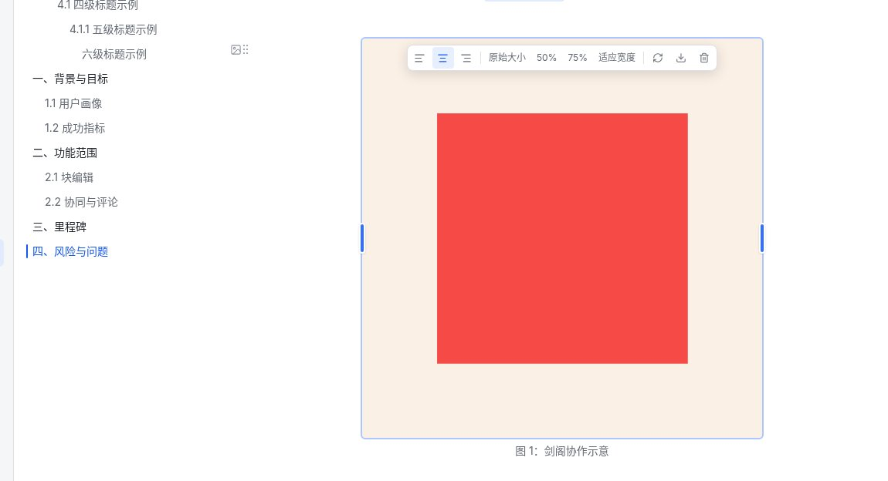

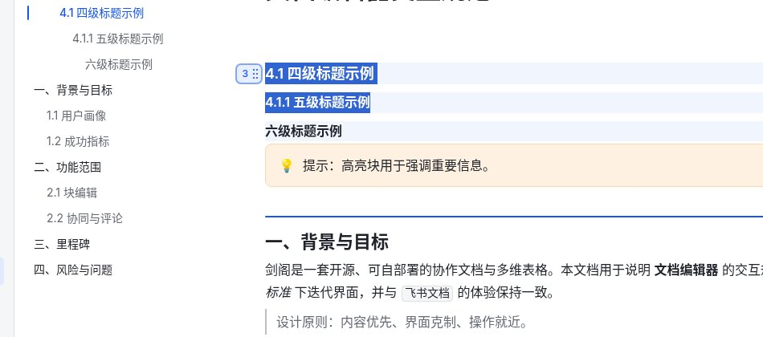

环境：1440×900 无头 Chromium（全宽演示用 1920×1000）、合成账号、临时 PostgreSQL 16 + Go 服务，本轮新增本地 MinIO（127.0.0.1:9000，服务端配置 `JIANGE_S3_ENDPOINT/ACCESS_KEY/SECRET_KEY`），图片与附件为真实上传到 MinIO。已在浏览器验证：

- 图片块：悬停工具栏（左/中/右对齐、原始大小/50%/75%/适应宽度、替换、下载、删除），左右拖拽手柄改宽度，图注失焦/回车写入 `caption` 属性；替换与插入时显示上传占位和进度（以 40KB/s 节流截到 21%/26%）；删除走确认框。图片「评论」暂未接入（评论锚定文字，图片无文字锚点）。
- @成员：悬停提及显示名片（头像、姓名、邮箱、所有者/协作者、发邮件、复制邮箱，本人显示「我」）。
- 表格：首行/首列灰色握把选中整列/整行，菜单含 在上/下方插入行、在左/右侧插入列、清空、删除（最后一行/列禁用）；Shift+点击选区后「合并单元格」，合并单元格内「拆分单元格」。合并信息存于新块属性 `tableMerges`，表格结构变化与合并在同一事务写入 `tableData`+`tableMerges`，**未改协同线协议**；插入行、合并、拆分三步 Ctrl+Z 依次恢复，表格内容复原。只读页同步渲染合并。
- 拖动：用 Playwright `mouse.down/move/up` 驱动真实拖动时发现块手柄 `mousedown` 的 `preventDefault` 会阻止 Chromium 发起原生拖放（真实用户同样受影响）；去掉后单块与 3 块选区均能用真实鼠标拖动，撤销恢复，块选区与菜单不受影响。
- 附件卡片：按类型着色图标（PDF 红/DOC 蓝/XLS 绿/PPT 橙/压缩包紫等）、「大小 · 类型」、悬停「预览/下载」，只读页共用。
- 选区色：编辑区与只读页改为飞书浅蓝底并保留原文字颜色。
- 页面宽度：「更多」菜单新增「页面宽度 标准/全宽」，按用户+文档记在本地，刷新保持。

前端 110 个测试文件 636 项、协同模块 173 项、TypeScript、生产构建与 Go 测试通过。仍**未**在用户登录的飞书中逐像素对照；分隔线样式、表格插入/删除列时列宽不随之平移、图片评论尚未实现。

## 2026-11-09（第三轮）：顶栏元信息、多块拖动、只读手柄、高亮块/代码块/表格、链接卡片、评论卡片

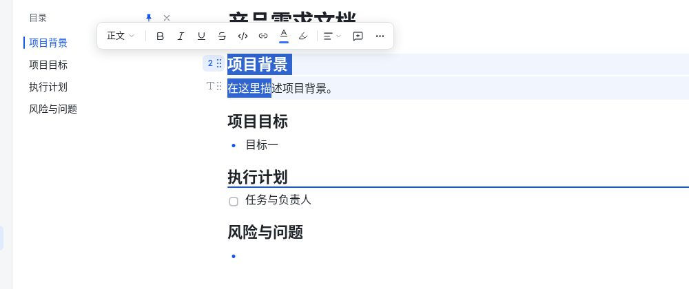

环境同前（1440×900 无头 Chromium、合成账号、临时 PostgreSQL 16 + Go 服务，无 MinIO）。已在浏览器验证：打开文档时顶栏显示「最近修改：今天 16:19」，输入后变为「已经保存到云端」；选中 2 个块后用合成 DragEvent 拖到「执行计划」之后，两块按原顺序整体移动，Ctrl+Z 一次恢复（Playwright 原生拖放在无头环境不触发，单块拖动同样受限）；以只读读者身份打开块菜单仅有 复制/复制链接/评论，三者均生效；高亮块切换为蓝色与 🚀 后恢复；代码块复制得到原文并显示「已复制」，搜索「go」回车切换语言，自动换行开关往返；表格悬停增行、增列后两次撤销恢复；链接卡片复制、编辑地址、取消链接；文档提及卡片「打开文档」跳转；评论卡片回复后显示两层头像头部。前端 105 个测试文件 616 项、协同模块 173 项、TypeScript、生产构建与 Go 测试通过。仍**未**在用户登录的飞书中逐像素对照。

## 2026-11-09（第二轮）：块菜单、多块选择、目录形态、工具栏对齐

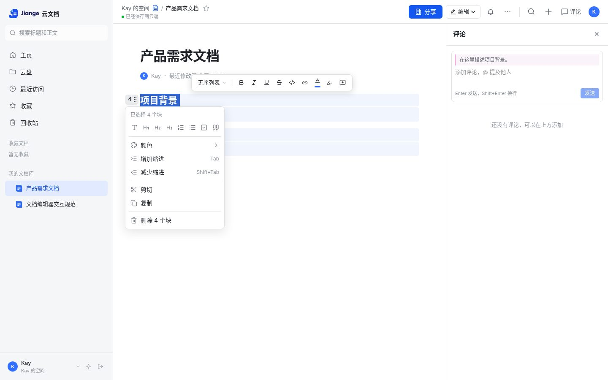

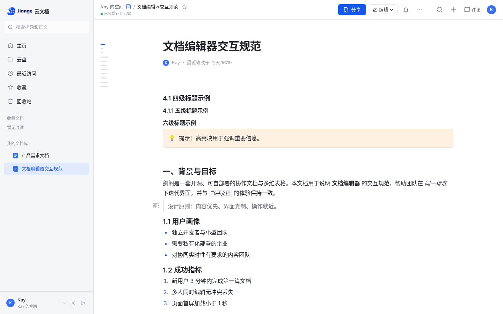

环境同上一轮（1440×900 无头 Chromium、合成账号、临时 PostgreSQL 16 + Go 服务，无 MinIO）。已在浏览器验证：块菜单设置字体色并恢复默认、缩进 24px 后减少缩进、复制写入剪贴板并提示「已复制」、复制链接得到 `#/doc/1?block=…` 且新开页面高亮目标块、评论打开评论面板；拖选 4 个块后只出现一个显示「4」的手柄，批量增加/减少缩进作用于 4 个块；斜杠网格 → 再 ↓ 从「正文」移动到「H6」；目录折叠子标题、取消固定后悬停展开；工具栏居中对齐后恢复左对齐、清除格式去掉加粗、复制段落链接。前端 100 个测试文件 596 项、协同模块 173 项、TypeScript、生产构建与 Go 测试通过。仍**未**在用户登录的飞书中逐像素对照。

## 2026-11-09：文档页外观（目录、块手柄、斜杠菜单、侧面板、顶栏星标）

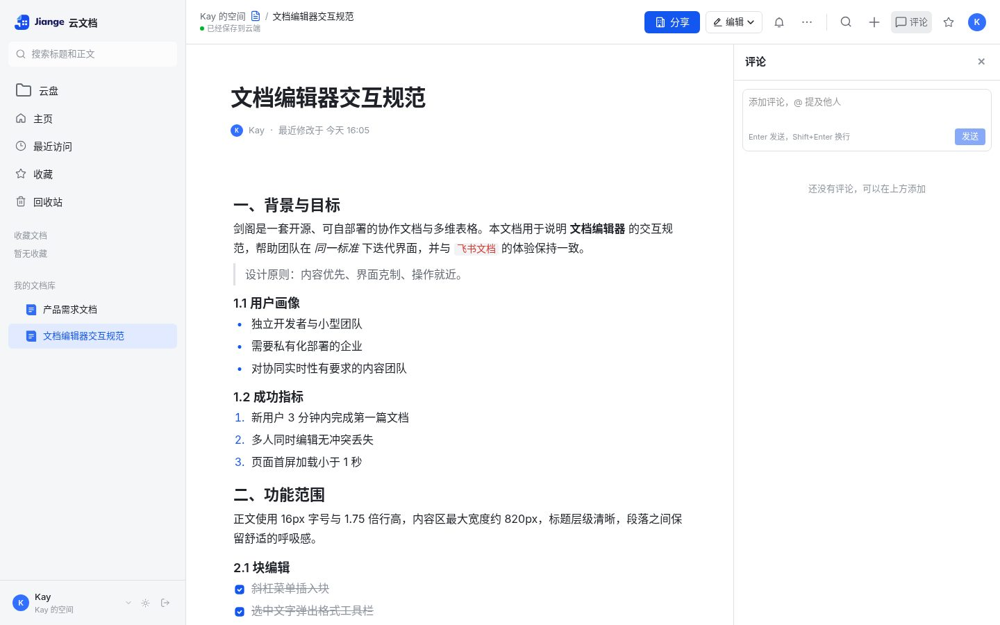

环境：1440×900 无头 Chromium，合成账号与文档，隔离的临时 PostgreSQL 16 与 Go 服务（未配置 MinIO，附件/封面上传未覆盖）。参考为飞书公开帮助与开放平台文档组件配置，**未**在用户登录的飞书中逐像素对照。已在浏览器验证：目录随滚动高亮、点击跳转；块菜单转换 H2→H3 并撤销恢复；斜杠菜单方向键高亮与拼音搜索回落为列表；评论面板不再遮挡顶栏且正文重排；星标切换收藏。390×844 模拟移动视口下目录不默认展开、正文无横向溢出。前端 98 个测试文件 582 项、协同模块 173 项、TypeScript 与 Go 测试通过（Go 未连接一次性 PostgreSQL 集成库）。

## 2026-11-07：封面与全局搜索

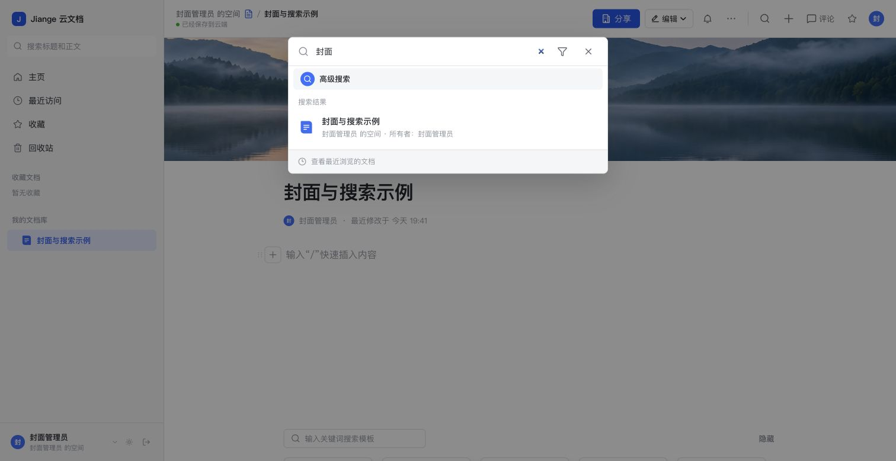

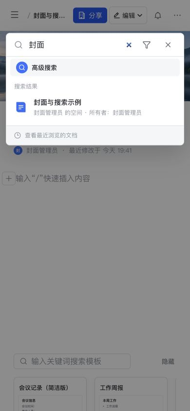

参考[飞书封面说明](https://www.feishu.cn/hc/zh-CN/articles/230455566106-%E8%AE%BE%E7%BD%AE%E6%96%87%E6%A1%A3%E5%B0%81%E9%9D%A2)及实际飞书全局搜索界面；截图来自合成文档、隔离 PostgreSQL 和 Go 服务。已验证原创图库封面添加、位置调整、移除和刷新保留，以及标题搜索与方向键选择。上传使用仅本机的内存 S3 替身，不验证真实 S3/MinIO、系统文件选择器或真实手机。移动图为 390×844 浏览器模拟视口。

目前只有一张原创图库图，未包含飞书官方图库；上传完成但绑定失败或离开页面可能留下未引用对象。全局搜索的高级筛选仅支持当前结果的类型与所有者，不代表完整飞书高级搜索。

干净快照通过前端 503 项测试、TypeScript、生产构建和 PostgreSQL 下的 Go 全量测试；最终封面组件另通过定向测试。构建仍提示部分资源包较大。

## 2026-11-07：文档图标

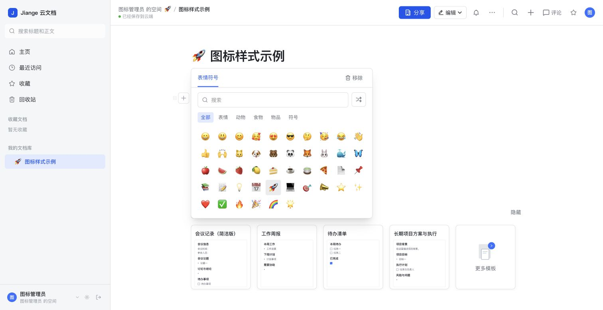

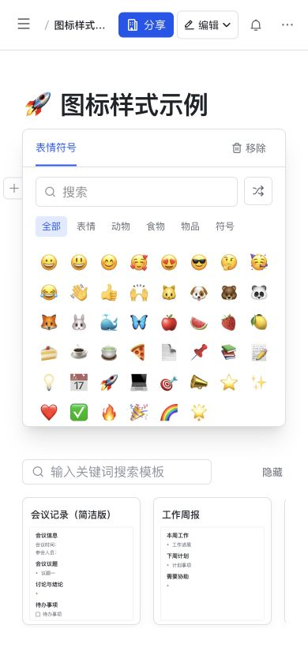

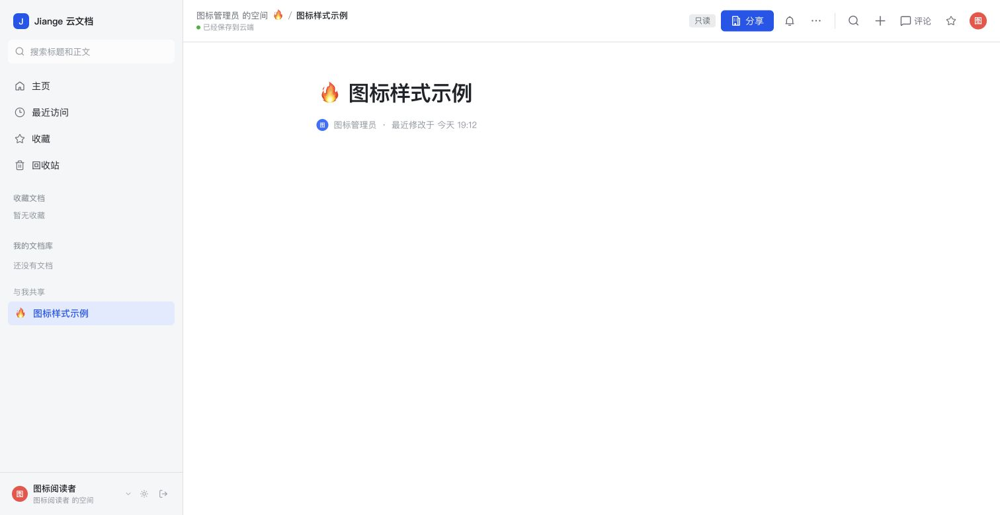

已对照用户登录的飞书文档：添加图标会先生成表情，并在标题、面包屑和侧栏显示。隔离 PostgreSQL、Go 服务和合成账号下验证了添加、更换、移除、刷新后保留，以及阅读者可查看但没有更改入口。移动截图为 390×844 浏览器模拟视口；尚未验证真实手机。当前选择器只包含部分 Unicode 表情，尚缺飞书完整表情和专有图标库；匿名公开页、复制文档及历史版本的图标行为也尚未对齐验证。

本次干净提交快照通过前端 494 项测试、TypeScript、生产构建和隔离 PostgreSQL 下的 Go 全量测试。构建仍提示部分资源包较大。

## 2026-11-07：评论权限与草稿

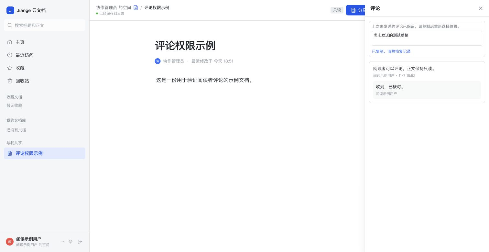

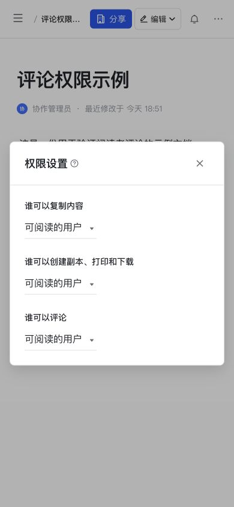

在用户登录的飞书文档中核对了评论权限的「可阅读的用户 / 可编辑的用户」两档。隔离 PostgreSQL 与 Go 服务中，合成管理员将测试文档设为阅读者可评论；合成阅读者发送评论及回复，并验证正文仍只读。管理员改为仅编辑者可评论后，阅读者的未发送草稿保留且发送入口关闭。移动截图为 390×844 浏览器模拟视口，尚未验证真实手机和系统输入法。

干净提交快照通过前端 484 项、协同模块 137 项测试、TypeScript、生产构建与隔离 PostgreSQL 下的 Go 全量测试。匿名公开评论仍未实现，正文提及仍可能先于协同操作确认发出通知；评论和通知分别提交，进程中断可能漏通知。PostgreSQL 为保护旧跨文档回复数据在删除评论时使用表级锁，性能尚需评估。

## 2026-11-07：分项角色权限

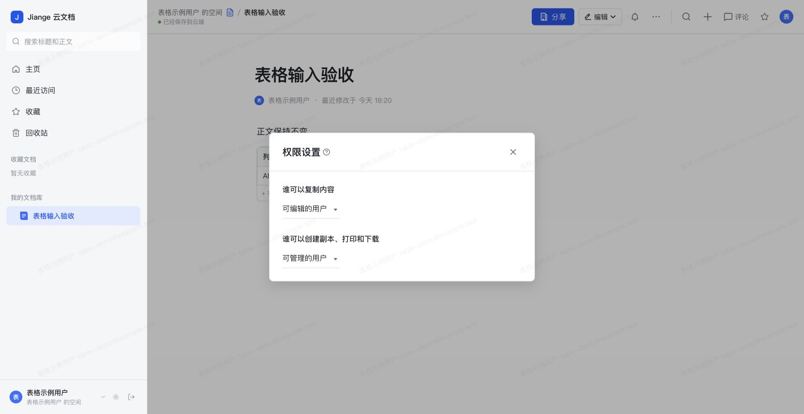

截图使用隔离 PostgreSQL、Go 服务和合成账号，实际将正文复制设置为编辑者、下载和创建副本设置为管理者，刷新后两项仍分别保留。移动图为 390×844 浏览器模拟视口；尚未验证真实手机或系统打印预览。飞书的评论、对外分享等其他权限选项仍未实现。界面复制、打印和媒体限制不能阻止阅读者提取已经接收的数据；升级前须排空旧版本服务。

干净快照通过前端 476 项、协同模块 137 项测试、TypeScript、生产构建和隔离 PostgreSQL 下的 Go 全量测试。构建仍有大资源包提示。

## 2026-11-07：文档表格输入

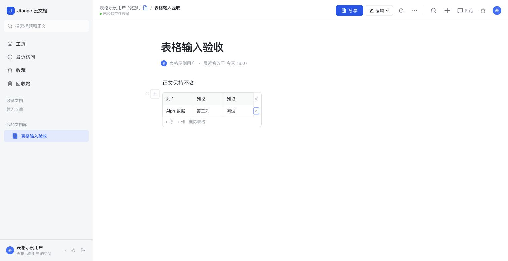

使用隔离 PostgreSQL、Go 服务和合成文档，验证了表格单元格键入、退格、粘贴、Tab、撤销和重做，以及刷新后内容保留。也验证了焦点回到正文后撤销最近的表格编辑。移动图是 390×844 的浏览器模拟视口；没有使用真实手机或系统中文输入法。表格数据仍以整表存储，多人并发编辑不同单元格仍可能相互覆盖。

## 2026-11-07：文档权限设置

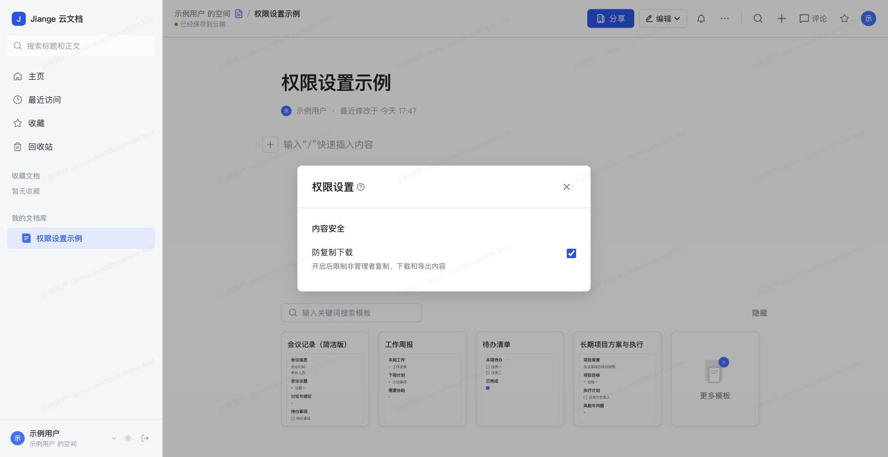

通过用户登录的飞书文档核对了权限设置入口和弹窗。项目现在提供独立弹窗，可设置现有的合并型防复制、下载及导出开关；在隔离 PostgreSQL、Go 服务和合成文档中验证了开启、刷新和重新打开后的状态，并检查了 Tab 焦点循环及返回分享后的焦点。截图仅包含合成账号，移动端为 390×844 浏览器模拟视口，未在真实手机上验证。飞书将复制、下载、评论等按角色分别配置，项目目前仍只有合并型设置，界面和能力尚未完全对齐。

本次提交的干净快照通过前端 447 项测试、TypeScript、生产构建以及使用隔离 PostgreSQL 的 Go 全量测试；构建仍提示部分资源包大于 500 kB。

## 2026-11-07：多维表格截图核验

使用隔离真实 Go 服务、PostgreSQL 和合成任务数据，查看了桌面表格、字段弹层、看板、日历及 390px 模拟视口；表格中主字段显示锁标识。各图均为单次浏览器截图，未使用拼接；移动表格需要横向滚动查看其他字段。

本轮截图由浏览器工具直接显示，未能保存为本地图片文件；因此本节没有图片附件。截图展示当前实现，并不能证明与飞书逐像素一致；实际手机及系统输入法尚未验证。

本轮暂存代码的前端 395 项测试、TypeScript 和生产构建通过；Go 全量测试使用隔离 PostgreSQL。主字段及一致性快照的并发回归单独执行；公式求值的实验实现因跨端语义差异未接入生产。

## 2026-11-07：多维表格视图与收集表

使用隔离真实 Go、PostgreSQL 和合成数据，在浏览器中查看了桌面表格、字段弹层、视图菜单、日历及 390px 表格。另验证了视图重命名、复制和移动，8 行粘贴覆盖并新增记录，以及收集表字段选择、必填、发布、匿名提交和关闭。界面仍与飞书存在差异；这不是逐像素对齐证明。

本轮截图只通过浏览器工具显示，未能保存为本地截图文件。移动端为模拟视口；文件选择器、原生剪贴板读回、甘特和日历的浏览器拖拽未完成验收。

## 2026-11-07：多维表格

已在登录后的飞书空白多维表格中对照桌面布局；本项目使用隔离的真实 Go 服务、PostgreSQL 和合成数据验证。桌面和 390px 模拟视口检查了字段添加弹层、筛选及日历；新建表的“文本”“表格”和 5 条记录来自真实后端。80 行长多选项在窄屏滚动后仍能打开正确记录；受限用户的只读提示、轮询更新、断网重试及撤权隐藏也已验证。

本轮截图在浏览器工具中目视检查，但未能保存为本地文件，本节没有附新的截图文件。390px 为浏览器模拟视口，附件和关联字段的长值、真实手机及拖拽尚未完整验证。界面和功能仍与飞书有差距；CSV 导入暂时停用，原因见[对标调查](FEISHU_DOCS_GAP_ANALYSIS.md)。

本轮前端 318 项测试、TypeScript 和生产构建通过；Go 全量测试包含隔离 PostgreSQL，相关权限和初始化并发测试通过。一次包含性能烟测的 `-race` 运行中，1 万行查询耗时 451ms，超过 200ms 阈值；普通全量测试通过，功能性 `-race` 回归单独通过，不能据此宣称并发检测模式下性能达标。

## 2026-11-07：公式、分栏评论与名称检查

使用合成文档与隔离浏览器进行了界面检查：分栏评论的高亮、重叠计数、面板定位、解决，以及 390px 模拟视口中的入口；已有评论面板时再次划词评论，输入焦点不会落回正文。多次关闭面板可保留多份草稿；通过拦截评论请求模拟连续 403，验证了停止重试及手动验证后的草稿恢复。上述评论与名称检查使用真实 Go 服务和隔离 PostgreSQL；名称检查可展示两份标题，且不修改它们。

公式验证使用真实前端编辑器和模拟协同数据：测试了公式前后输入、复制相邻公式、删除其中一个及撤销。它不等同于真实双端协作或系统输入法验收；旧公式无独立标识时的边界仍有歧义。

本轮截图在浏览器工具中目视检查，但未能保存为本地文件，故本节没有新的截图文件。390px 是浏览器模拟视口，并非真实手机。

## 2026-11-07：模板与分栏查找

在隔离的真实编辑器、Go 服务和 PostgreSQL 中，用合成数据验证了模板搜索与插入；桌面和 390px 浏览器视口下检查了空白文档的插入按钮。分栏文字的查找、高亮、导航、单项与全部替换及撤销也已验证。390px 是浏览器模拟视口，未覆盖真实手机或系统输入法。

这轮浏览器截图已目视检查，但当前截图接口没有提供可用的本地保存方式，因而本节没有附新截图；不能把目视检查当作已保存的截图证据。模板预览基于本项目实际内容，与飞书参考中的照片封面仍有差异。公式附近的编辑风险仍未解决，详见[对标调查](FEISHU_DOCS_GAP_ANALYSIS.md)。

## 2026-11-07：主页最近访问

截图来自隔离的真实前端、Go 服务和 PostgreSQL，文档与账号均为合成测试数据。已验证空状态、访问排序、再次访问置顶、与最近更新区分以及搜索入口；390px 是桌面浏览器模拟视口，不是真机。截图展示当前实现，不代表与飞书逐像素一致。

## 2026-11-07：附件与粘贴保护

在真实编辑器、Go 服务、隔离 PostgreSQL 和临时内存 S3 替身中，验证了取消文件选择后保留命令、合成附件上传插入、无效内部剪贴板保留选中文字，以及回退纯文本时保留 `#`、`-` 前缀。图中的提示和 `/file` 是刻意触发取消与异常粘贴后留下的验证状态；文件选择通过浏览器调试接口注入，粘贴使用合成事件，未覆盖系统原生对话框和剪贴板。

## 2026-11-07：分栏编辑

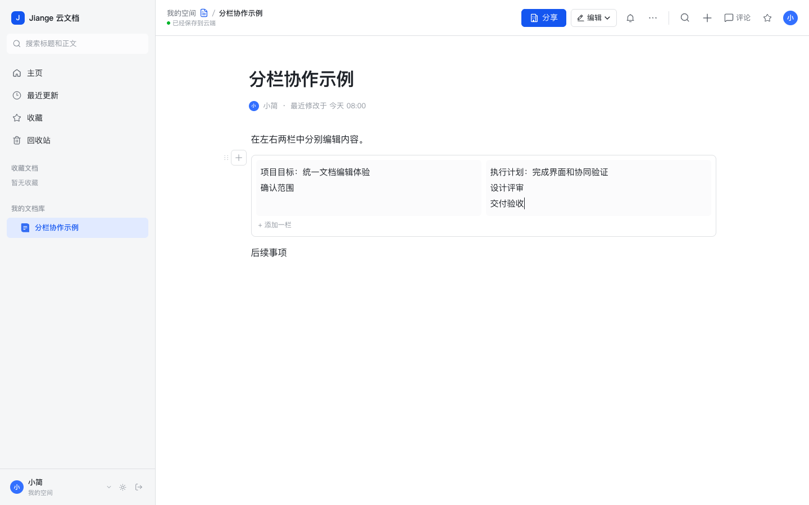

截图来自真实前端编辑器和隔离的模拟协同数据。桌面浏览器中验证了首次点击各栏后输入、栏内换行、多行粘贴、撤销，以及阅读模式不能编辑；390px 为浏览器模拟视口，并非真实手机。栏内块类型/斜杠插入、跨栏编辑与安全删除仍未完全对齐。

## 2026-11-07：匿名分享自动刷新

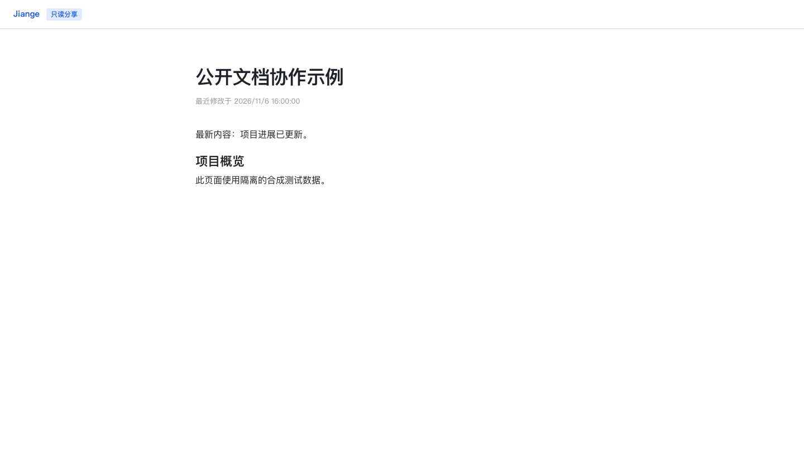

使用独立浏览器和合成内容验证：页面在前台定期更新；链接切换为需登录或关闭后不再显示旧正文；临时网络错误显示提示，恢复后更新内容。此项使用可控的本地服务替身，不能替代真实 Go 服务的权限测试。

日期：2026-11-06。截图均为隔离测试内容，不包含用户真实文档。它们用于核验当前项目界面和操作，不能证明已与飞书逐像素一致。

## 匿名分享中的图片和附件

截图来自隔离的真实前端与 Go 服务，使用内存文件存储。图片和附件接口均返回成功；示例附件为合成占位数据。自动测试覆盖无效链接、链接降级和撤销、其他文档与未引用的文件、防下载设置、文件类型伪装及部分请求中途变更权限的情况。图片预览字节仍可被浏览器读取，防下载并不是完整的防泄漏能力。

## 文档内查找与替换

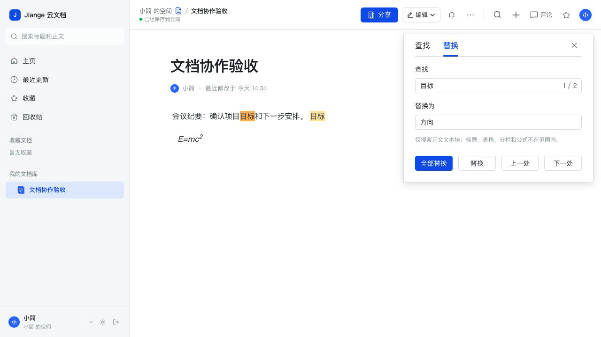

在隔离 PostgreSQL 和 Go 服务中验证了正文高亮、上一处/下一处、单项及全部替换和一次撤销。目前只搜索正文文本块，标题、表格、分栏与公式仍待覆盖；大规模高密度替换受到性能限制。

## 命令效果

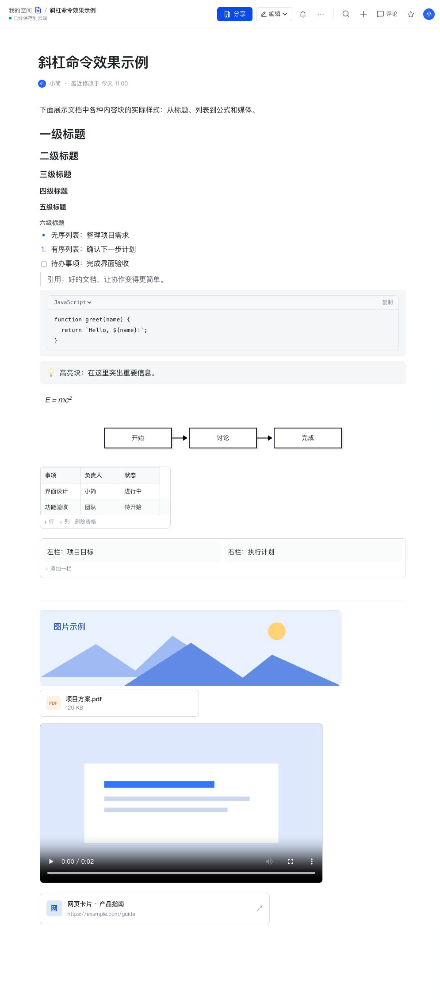

示例使用合成数据，由实际编辑器渲染；长图拼接自同一文档连续滚动的四次截图。图片和视频为本地示例，附件是占位卡；此图展示命令对应的块，不代表每条插入、上传和协作流程均已验收。

## 验证范围

2026-11-07 的 Go 全量测试包含隔离 PostgreSQL，前端 Vitest 共 177 项、协同模块 125 项；TypeScript、`go vet` 与生产构建通过。分栏的输入法和粘贴验收使用合成事件，尚未覆盖真实系统输入法及网络双端。与飞书的未完成差距和同步协议风险记录在 [对标调查](FEISHU_DOCS_GAP_ANALYSIS.md) 中。

本轮后续复测：前端 222 项、协同模块 137 项通过；协同输入延迟测试此前两次超过 16ms，后续整套测试通过，仍需建立稳定的大文档性能基线。Go 全量测试使用隔离 PostgreSQL，TypeScript、`go vet` 与前端生产构建通过。
# 2026-11-07：文档和分享面板

截图来自本地真实前端、Go 服务与隔离 PostgreSQL，账号、文档内容和二维码均为一次性测试数据。桌面图为 1512×779；移动端为浏览器模拟的 390×844 视口，并非真机。已通过界面插入会议记录模板、开启需要登录的阅读链接并显示二维码；尚未使用手机扫码，不能据此证明扫码链路已验收。截图反映当前实现，不能证明与飞书逐像素一致。

本次提交的干净快照通过前端 428 项和协同模块 137 项测试、TypeScript 检查、生产构建及使用隔离 PostgreSQL 的 Go 全量测试。生产构建仍提示部分资源包大于 500 kB。原工作区的多维表格未提交改动使该工作区的表格行高测试失败，未包含在本次快照中。

# 2026-11-08：云盘和幻灯片

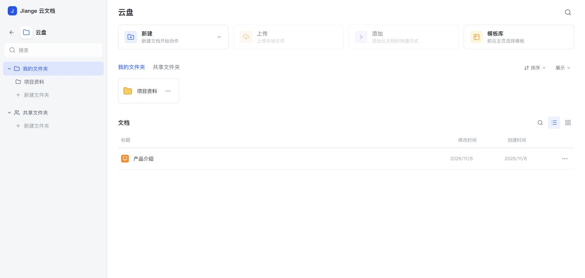

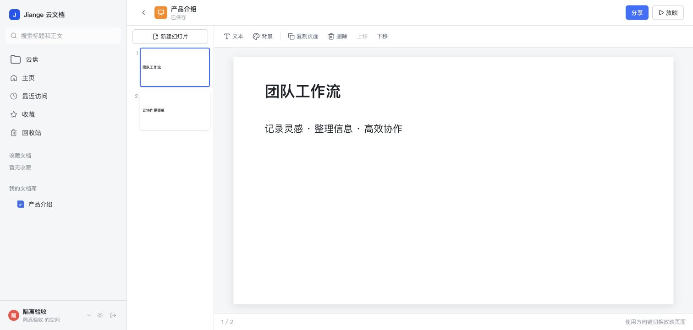

截图来自独立端口上的本地前端、Go 服务与隔离 PostgreSQL，使用合成账号和测试内容。桌面使用浏览器默认视口；移动端是 390×844 浏览器模拟视口，不代表真机验收。已通过界面验证新建文件夹、创建幻灯片、连续输入并刷新、移动幻灯片页面后刷新，移动端工具栏可横向滚动。截图展示当前实现，不代表与飞书逐像素一致。

截至上次截图，云盘上传和添加快捷方式尚未实现；幻灯片仅支持标题、正文、背景、页面管理与简单放映。保存冲突或网络结果不明时，未保存的内容只保留在当前页面内，离开前应手动复制。幻灯片保存协议增加版本号，需要更新服务端和前端并执行迁移 0038；旧客户端必须刷新到新版。

## 2026-11-08：云盘 Markdown 导入与演示者备注

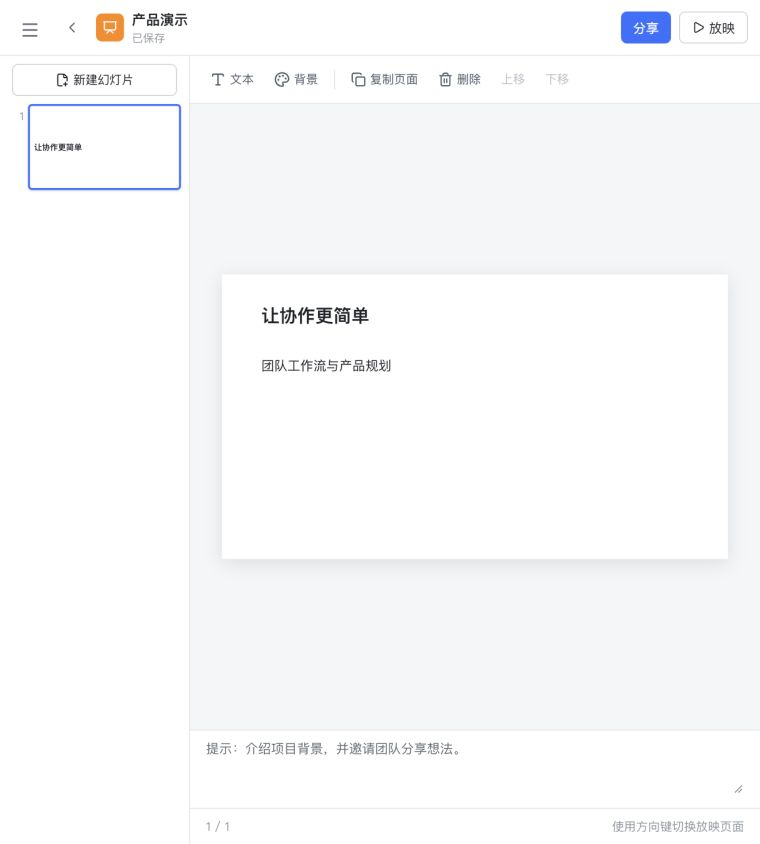

使用独立端口、测试账号和隔离 PostgreSQL 验证：云盘上传 Markdown 后创建文档，确认导入后刷新仍可看到正文；幻灯片备注输入后刷新仍保留。新文档原先缺少协同初始操作，导致正文无法初始化，本次同时修复；此前已产生的空文档不会自动修复。导入完成后的原文仍暂存在标签页中，需手动清除，避免错误判断服务器是否接收操作。截图来自浏览器模拟视口，不代表与飞书逐像素一致。

当前仅支持不含图片的 Markdown 文档导入，并非任意文件上传；快捷方式仍不可用。幻灯片新增演示者备注；服务端需要运行迁移 0039，旧客户端不传备注时服务端保留原备注。

## 2026-11-08：幻灯片图形与云盘内部链接

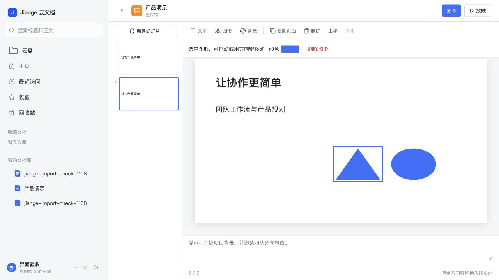

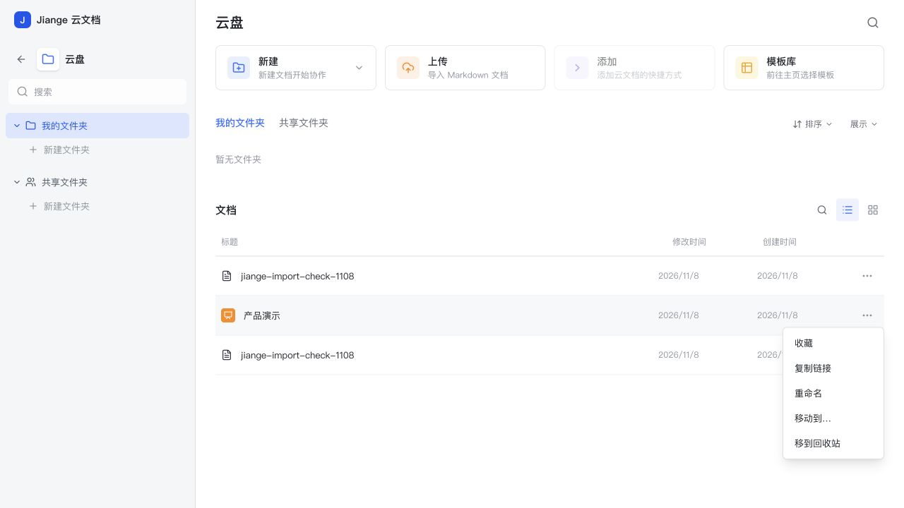

在隔离前端、Go 服务和 PostgreSQL 中验证了插入圆形和三角形、用方向键移动并刷新、复制页面保留图形、放映画面显示图形、云盘复制内部链接。移动端截图为模拟视口；触屏拖动、颜色选择器和真实设备尚未验收。该轮的图形支持矩形、圆形和三角形，可拖动、键盘移动、改色和删除。放映支持按钮和方向键翻页。云盘复制的是受现有权限约束的内部地址，不会开启公开分享。

服务端需要运行迁移 0040。图形随页面内容的版本一起保存，旧客户端不传图形数据时会保留它们；图片、动画、复杂版式和多人实时协作仍未实现，界面尚非飞书逐像素复刻。

## 2026-11-08：图形格式与文件夹模板库

在隔离前端、Go 服务和 PostgreSQL 中，验证旧图形默认尺寸兼容、连续修改宽高与角度、刷新后保留，以及在文件夹内选择会议记录模板，确认导入后刷新仍有正文。图形旋转后的可见边缘目前可能超出画布；尺寸和角度通过滑块操作，尚无画布上的缩放手柄。云盘模板内容需在新文档中再次确认导入，原文会暂存在当前标签页。移动端与触屏本轮未单独复测。

## 2026-11-08：文档协同协议首连

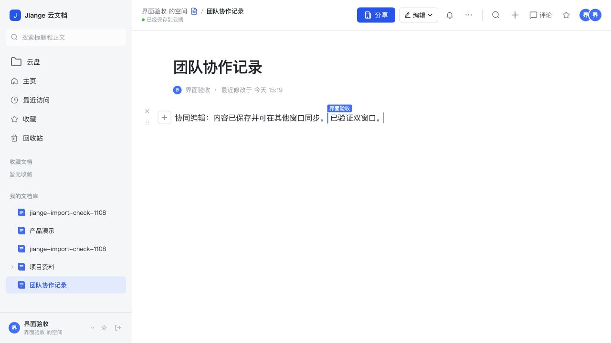

截图来自隔离本地前端、Go 服务和 PostgreSQL，两个标签页使用同一测试账号；一个页面输入后，另一个页面显示了相同修改。另用真实 TypeScript 协同客户端和 Go 服务验证 v2 首连、写入确认及 epoch 变化后断线重连；服务端 WebSocket 测试覆盖旧协议和含表格文档的新版首连。该截图不构成不同账号、移动端、断网冲突或在线数据库回滚的完整验收。

## 2026-11-08：文档附件复制

截图来自隔离前端、Go 服务、PostgreSQL 和内存对象存储：通过界面上传合成测试附件并创建文档副本。并发安全另由 PostgreSQL 集成测试验证：复制事务停在提交前时，源附件删除等待，提交后副本附件仍可通过 HTTP 读取；删除先完成时复制失败。旧实现运行同一并发测试会失败。该截图本身不证明并发行为，也不覆盖 S3、跨实例混版或移动端。

## 2026-11-08：云盘普通文件

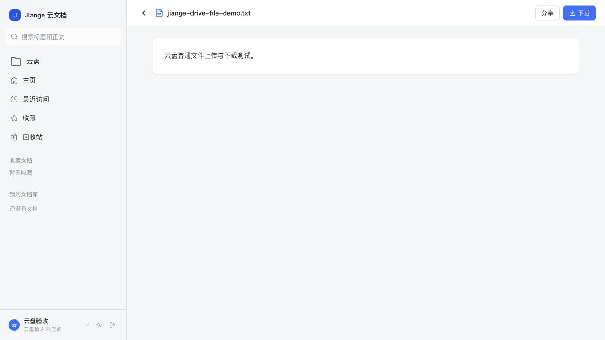

使用独立端口的前端、Go 服务、隔离 PostgreSQL 和内存对象存储，验证上传合成文本文件、在线预览与浏览器下载，下载文件与原文件字节一致；移动端为浏览器模拟视口。顶部操作卡片、图标、上传菜单和列表显示设置参考了实际飞书页面，尚未逐像素验收。内存和 PostgreSQL 接口测试覆盖目录列表、搜索、分享和撤权、重命名、移动、回收、恢复与永久删除。截图不证明 S3、跨浏览器或真机体验。

当时仅支持单文件上传；图片和 1 MB 以内纯文本可预览，其他类型可下载。数据库迁移 0041 引入独立文件节点，上线应先排空旧服务并刷新旧客户端；上传过程中数据库结果不明确时保留对象以避免误删，尚需后台清理无引用对象。

## 2026-11-08：批量及文件夹上传

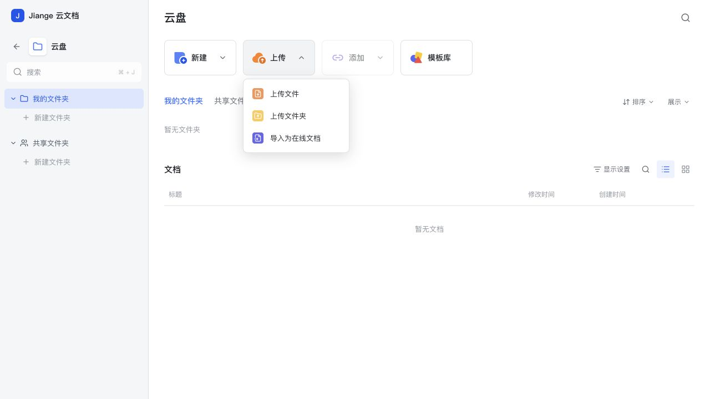

在隔离前端、Go 服务、PostgreSQL 与内存对象存储中，通过浏览器选择含两层目录的合成文件夹，确认两个文件上传、目录层级及子文件正文；另验证同目录多文件上传。移动端截图为 390×844 浏览器模拟视口。上传前校验路径与大小，完成后不会覆盖同名条目；网络结果不明或停止时不自动重试。测试覆盖了账号绑定请求的拒绝、路径校验、部分失败与取消，未在真实浏览器中模拟账号切换或弱网。

当时每批最多 1000 个文件及 1000 个目录、单文件最多 20 MB；兼容目录选择器不提供空文件夹。上传进度仅保留在当前登录会话，刷新页面不会续传；尚无断点续传、文件夹合并/覆盖和真实设备验收。批量接口需要新版服务端；旧服务端不支持时会拒绝而不是静默降级。

## 2026-11-08：空文件夹上传

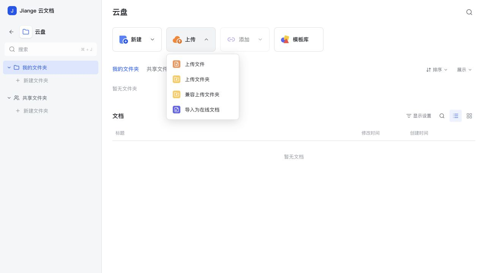

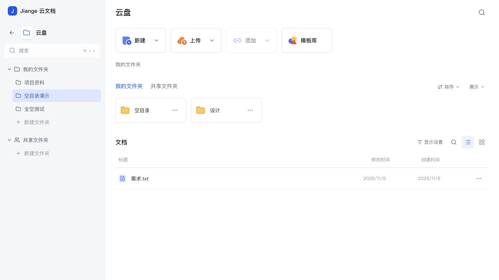

支持原生目录读取的安全环境可枚举空目录；不支持时可使用兼容入口，后者无法读取空目录。选择后的目录会先完整扫描和校验，再开始云端写入；扫描期间可停止。单元测试覆盖空根目录、嵌套空目录、读取失败和扫描取消；使用合成目录句柄连接真实 Go 服务和隔离 PostgreSQL，验证了空根目录、空子目录和文件层级。浏览器兼容入口已实际选择文件夹并验证非空内容；该验收浏览器未完成系统原生选择器选择，因此尚未证明真实系统选择器的端到端体验。移动端为模拟视口，尚未真机验收。

当时上传菜单多出“兼容上传文件夹”入口，上传进度面板也尚未逐项比照真实飞书；这些截图只能证明当时实现的布局和合成数据结果，不能作为与飞书一比一一致的证明。目录选择结果若在用户重新打开上传菜单或切换目录后才返回，将被忽略，避免意外启动旧上传。

## 2026-11-08：云盘上传菜单对照

参照已登录飞书云盘，上传菜单保留“上传文件”“上传文件夹”“导入为在线文档”三项；目录选择器无法使用或一直没有返回时，从同一文件夹入口进入兼容选择，并提示兼容模式不会上传空文件夹。验证浏览器中实际选择测试目录后，两个文件和非空目录上传完成；原生选择器仍未完成真实系统选择的端到端验证。已在桌面端验证 Escape 关闭菜单，390×844 模拟视口验证弹层不超出屏幕。截图使用隔离数据库和合成文件；图标、进度面板以及云盘其他功能仍需继续与飞书逐项对照，不能据此认定整体一比一一致。

## 2026-11-08：云盘布局、排序与展示规则

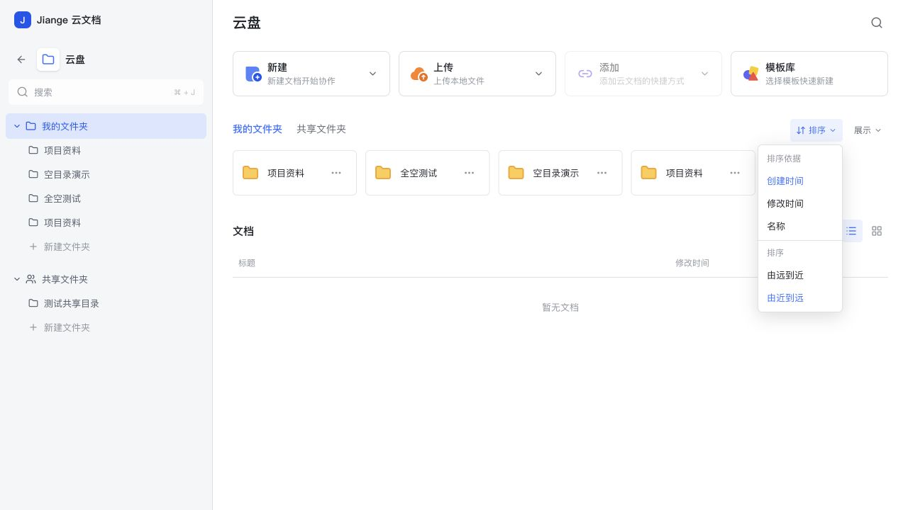

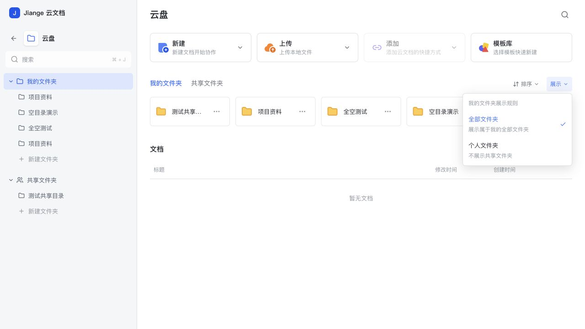

对照已登录飞书云盘，桌面操作卡片改为四列和说明文字；文件夹排序提供创建时间、修改时间、名称及方向。展示菜单提供全部／个人文件夹；在隔离 PostgreSQL 和真实服务中创建测试共享目录，验证全部模式显示该目录、个人模式隐藏、再次切换后恢复，文档列表／网格切换保持独立。移动端是 390×844 模拟视口。截图来自隔离服务和合成数据，不证明逐像素一致。

当前“属于我的共享文件夹”按节点创建者判断，仅覆盖共享空间的顶层目录，不支持所有权转移后的归属；展示规则在共享空间和子目录暂不可用。排序与展示偏好目前仅在当前页面会话中保留，刷新不会持久化；名称方向文字及完整键盘交互尚未逐项对照飞书。添加快捷方式、真实设备和其他浏览器仍需验收。

## 2026-11-08：云盘文档表头与显示设置

参照飞书云盘表头，文档列表可按标题、修改时间、创建时间分别选择排序方向，排序与文件夹顺序独立；显示设置可控制两个时间列。文档默认图标改为蓝色图标，并保留自定义文档图标。隔离前端、Go 服务和 PostgreSQL 中创建两份合成文档，验证标题升降序以及创建时间的隐藏和恢复；时间排序与日期格式另有单元测试。移动端为 390×844 模拟视口，启用的时间显示在标题下方。

当时所有者、修改者的名称数据和列展示尚未实现，设置面板中的这两项不可操作；列顺序拖动也尚未实现，跨设备设置同步和真机验收仍未完成。截图中的菜单和图标是本项目实现，不代表云盘整体已与飞书逐像素一致。

## 2026-11-08：文档列顺序与本机保存

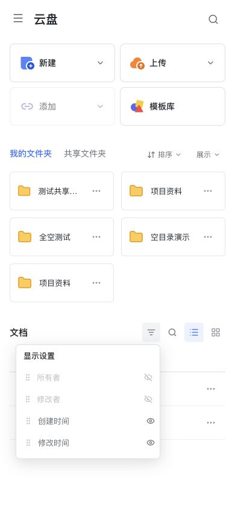

“修改时间”和“创建时间”可在显示设置中拖动手柄排序；也可使用上下方向键或点击手柄调整，列表表头、行内容和窄屏时间信息随之变化。列可见性和顺序按账号保存在当前浏览器，存储不可用时提示刷新会恢复默认。隔离浏览器中验证了鼠标拖动、键盘调整、移动视口点击、隐藏列后刷新以及顺序和可见性保留；单元测试覆盖账号隔离、损坏数据和存储失败。移动端为模拟视口，未在真实触屏设备验收。

当时仅支持两个时间列排序，所有者、修改者仍不可用；设置不跨浏览器或设备同步。截图来自隔离服务与合成数据，未证明整体界面一比一一致。

## 2026-11-08：云盘所有者列

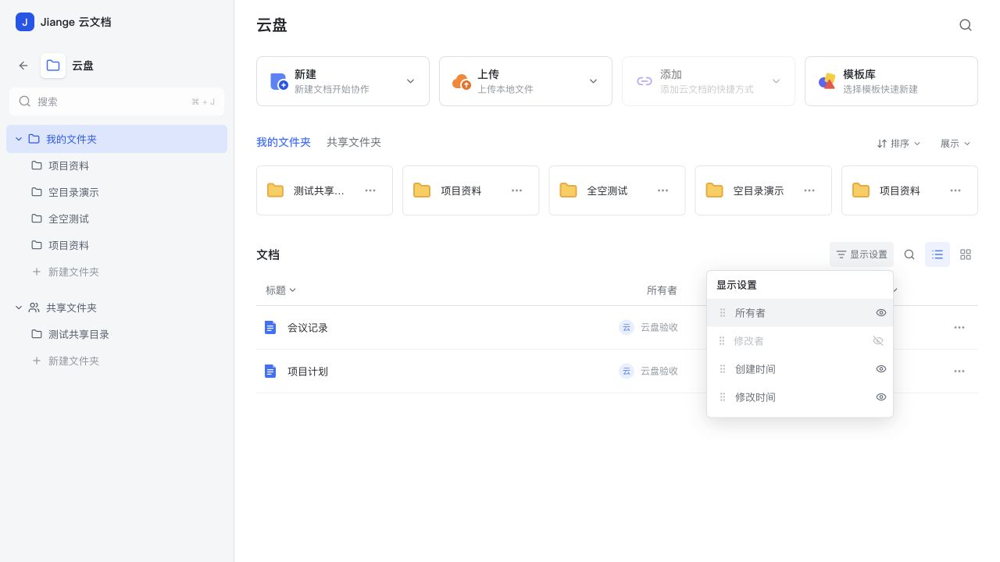

云盘目录接口为有权访问的条目返回创建者名称；显示设置可显示、隐藏和调整“所有者”列，旧版时间列设置会迁移并保留原有顺序和可见性。隔离浏览器中验证了所有者显示、键盘调整及刷新保留；内存和隔离 PostgreSQL 测试覆盖创建文件夹、文档、文件、重命名，以及查看他人创建的共享文件夹。截图使用合成账号和数据，移动端为模拟视口。

当前所有者按节点创建者确定，本项目还没有独立所有权转移模型。接口未返回名称时显示“—”，部署需同时更新前后端。当时“修改者”列尚不可用；与飞书的完整功能和逐像素界面仍有差距。

## 2026-11-08：文档协同修改者

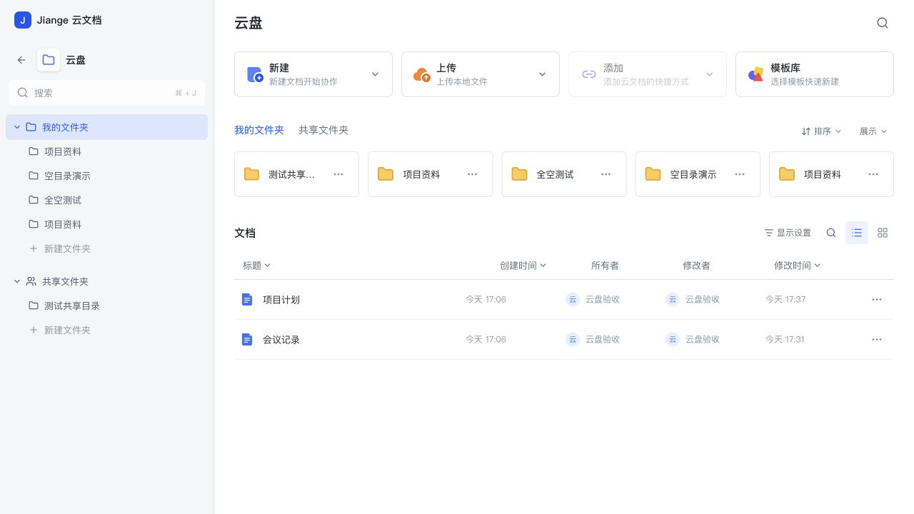

文档协同操作和历史恢复会在内容提交的同一事务内记录经认证的操作者；云盘列表可显示、隐藏和调整“修改者”列。未记录、旧数据或无法确认的写入显示“—”，不会猜测为创建者。数据库修订号使未覆盖的节点写入失效旧记录，操作日志插入也会清除旧记录，旧版列设置会迁移。隔离前端、Go 服务与 PostgreSQL 中通过实际协同连接编辑合成文档，验证列表显示操作者和未记录文档显示“—”；内存及 PostgreSQL 测试覆盖重复重试、过期版本、历史恢复、无归属写入、重命名、时间戳未变化时的修订号失效，以及旧写入直接追加操作而不更新节点的情况。两个测试用户通过 WebSocket 依次编辑的服务端测试也验证了修改者切换，该测试使用测试身份头，不代表真实双账号浏览器验收。移动端为 390×844 模拟视口。

部署前须应用迁移 0042；当时旧服务及封面、图标、重命名等未覆盖写入会使修改者变为未知。多维表格、幻灯片和普通文件的修改者仍未实现，历史数据不会回填；跨设备设置同步和真机验收仍未完成。截图不是整体逐像素对齐证明。

## 2026-11-08：文档元数据修改者

云文档的标题、图标、封面以及现有文档移动接口现在也记录操作者；仅变更权限不会覆盖修改者。内存与隔离 PostgreSQL 测试覆盖不同用户、版本冲突、权限撤销和会话在写入中失效，验证失败操作不会改变归属；另通过登录后的 HTTP 标题更新测试确认使用请求账号。隔离浏览器中为合成文档添加图标后，云盘列表显示该测试账号；移动端为 390×844 模拟视口。

当时普通标题和移动接口沿用写入前权限检查，检查与持久化间仍有竞态；未覆盖的写入继续显示未知。多维表格、幻灯片、普通文件和历史数据的修改者仍未补齐，真机及整体 UI 对齐仍需验证。

## 2026-11-08：文档标题与移动的事务保护

普通文档元数据接口在同一事务内复核会话、当前权限及移动目标；标题和移动一起提交，失败时不留下部分修改。若提交后权限或会话失效，接口返回无正文成功响应，前端重新获取数据。内存测试覆盖提交前、提交后的撤权与会话失效；隔离 PostgreSQL 测试实际观察到权限、会话及目标目录授权撤销时的锁等待，并验证写入被拒绝，另验证协同写入与元数据更新的加锁顺序。浏览器中编辑合成文档标题、刷新并返回云盘，确认标题和修改者显示；移动端为模拟视口。

旧服务仍走旧写入路径，升级时需先排空旧服务；涉及云盘文件夹的移动继续使用带版本号的云盘接口。该测试不证明协同连接的权限检查与操作持久化之间不存在竞态，也不代表整体 UI 已一比一对齐。

## 2026-11-08：协同写入权限复核

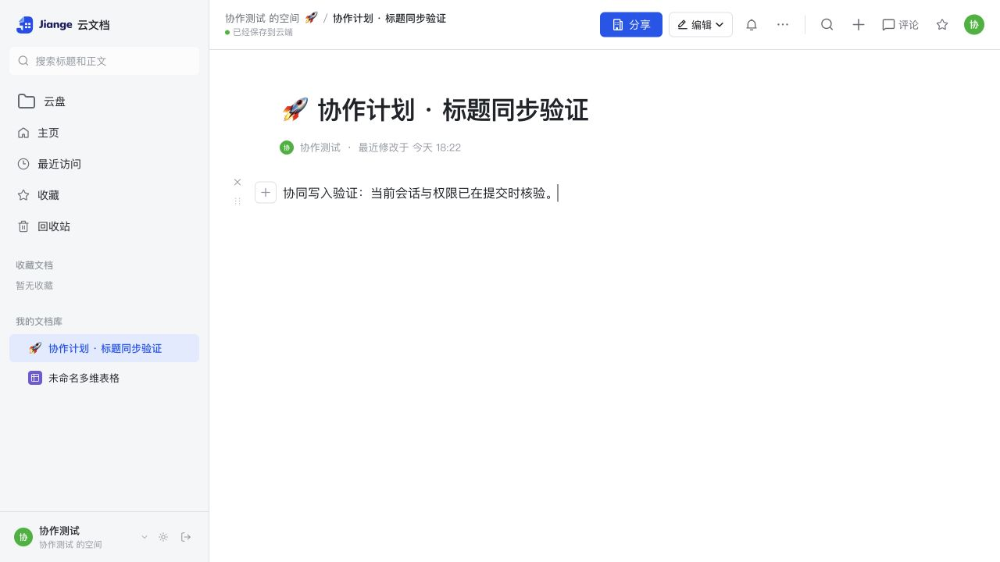

协同写入在操作日志事务内复核连接的原始会话、当前编辑权限、继承授权和文档状态；拒绝的写入不会重置其他协作者的房间。测试在 WebSocket 帧通过初次检查后撤销权限或会话，验证操作未提交、其他用户仍可编辑；隔离 PostgreSQL 测试覆盖会话、直接授权、祖先授权和成员资格的并发撤销及重复操作重试。多实例压力回归重复五次，出现的一次重试耗尽问题已加入有界错峰重试后复测通过。

浏览器在隔离服务中编辑合成文档并刷新，正文保留。窄屏验收发现窗口宽度改变后长标题可能被裁切，现会随可用宽度重新计算高度；图为 390×844 模拟视口。截图不能证明撤权竞态，权限结论来自上述测试；真实手机未验收。

升级时需应用迁移 0042 并排空旧服务。输出帧从权限检查到网络发送仍有竞态；数据库回滚后的活跃房间和历史代际隔离未完成，不应将本轮写入保护视为协同协议整体验收。

## 2026-11-08：Jiange 品牌标识

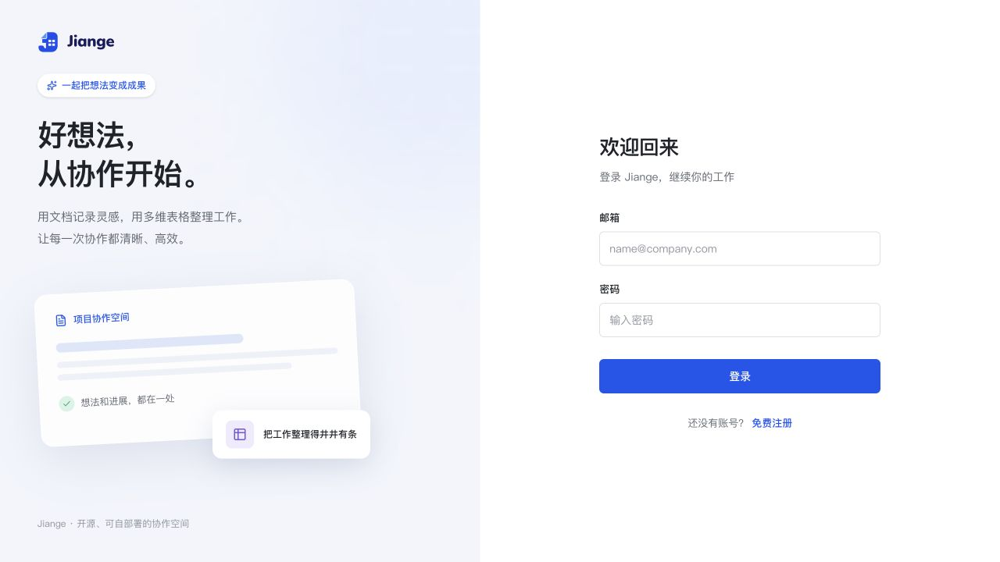

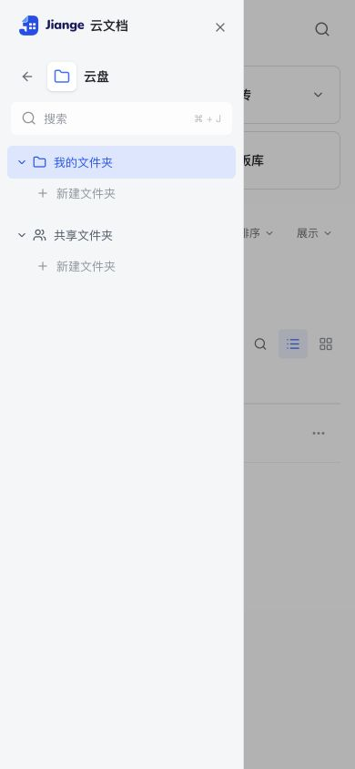

标志依据项目概念图重新绘制为 SVG，并分别提供图形、字标和组合版，以及浅色／深色背景版本和透明 PNG。登录页、文档与云盘侧栏、公开文档、公开表单及浏览器图标使用新标识；截图来自隔离服务和合成数据，移动端为 390×844 浏览器模拟视口。公开文档检查的是无效链接状态的页头；公开表单使用隔离环境的测试表单。尚未进行真实手机或全部浏览器验收。

补充：浏览器提供 PNG 图标回退，添加到手机主屏幕时使用 180×180 白底图标。图形、文字和组合标志均可从 `apps/web/public/brand/` 单独获取。

## 2026-11-08：幻灯片画布与缩略图

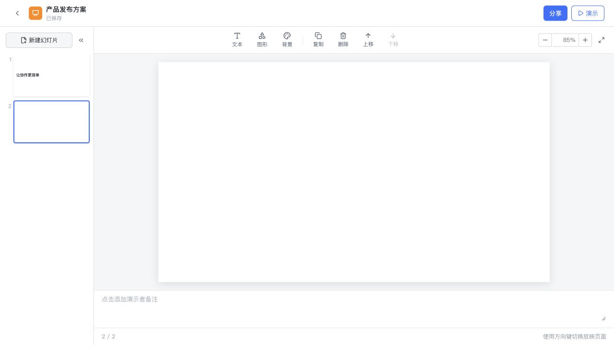

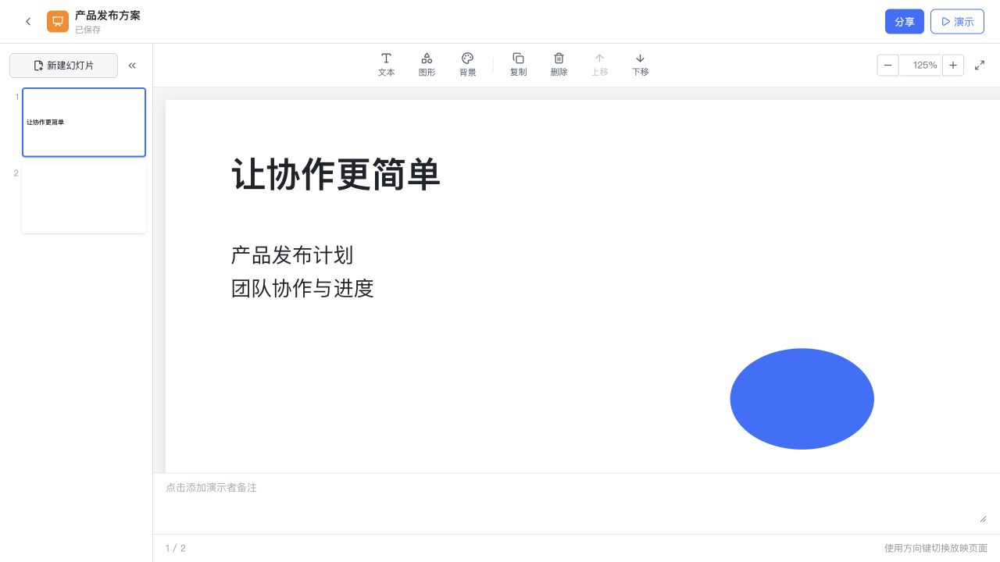

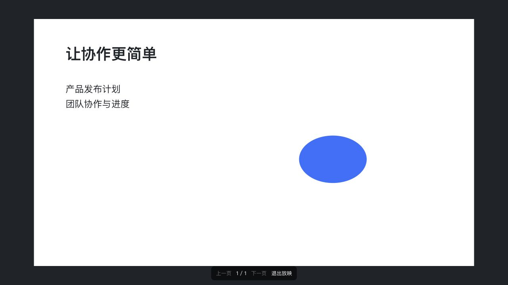

新建幻灯片文件在同一事务中创建首张空白页；旧的空文件不自动补页。编辑器去掉全局侧栏，支持缩放、适合屏幕和收起缩略图栏，缩略图展示当前标题、正文和图形。125% 截图中画布大于视口，可滚动查看。隔离 Go/PostgreSQL 服务中验证了新建、缩放、图形拖动与刷新后保存、演示及缩略图；移动端截图为 390×844 模拟视口，不代表真机验收。

当前仍缺图片、图表、动画、自由文本框和实时协作等能力，界面与操作尚未完全对齐飞书。离开页面时未保存草稿的保护也仍需完善。

## 2026-11-08：幻灯片图形直接缩放

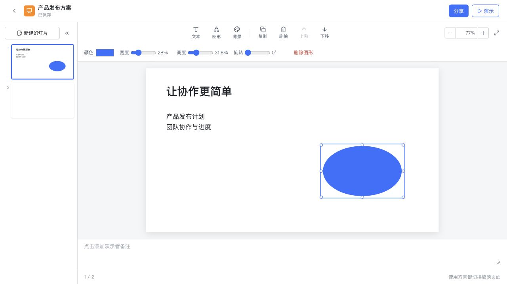

选中图形后可拖动四角和四边控制点调整尺寸，控制点支持键盘方向键；尺寸受画布边界和最小尺寸约束，旋转时沿图形自身方向缩放。隔离 Go/PostgreSQL 环境中验证了桌面拖拽、方向键、刷新后尺寸保留，以及 390×844 模拟视口中的鼠标拖拽；旋转和边界计算有单元测试，未做真机触摸验收。截图使用合成测试数据，不能据此认定整体界面或全部功能已对齐。

## 2026-11-08：幻灯片内容撤销与重做

标题、正文、备注、背景和图形编辑支持当前页的撤销、重做；连续输入按时间合并，快捷键和工具栏均可使用。保存进行中撤销会等待前一写入完成再按新修订保存；结果未知或发生冲突时保留本地内容，不自动重放。单元测试覆盖上述保存边界；隔离 Go/PostgreSQL 环境中验证了标题快捷键撤销、图形插入的撤销重做和刷新后的最终内容，移动端为 390×844 模拟视口中的按钮操作。

历史仅保留在当前编辑会话中，刷新后清空；页面创建、删除和重排不在撤销范围内。未进行真机及多用户实时编辑验收，整体界面和功能仍未完全对齐飞书。

## 2026-11-08：幻灯片独立文本框

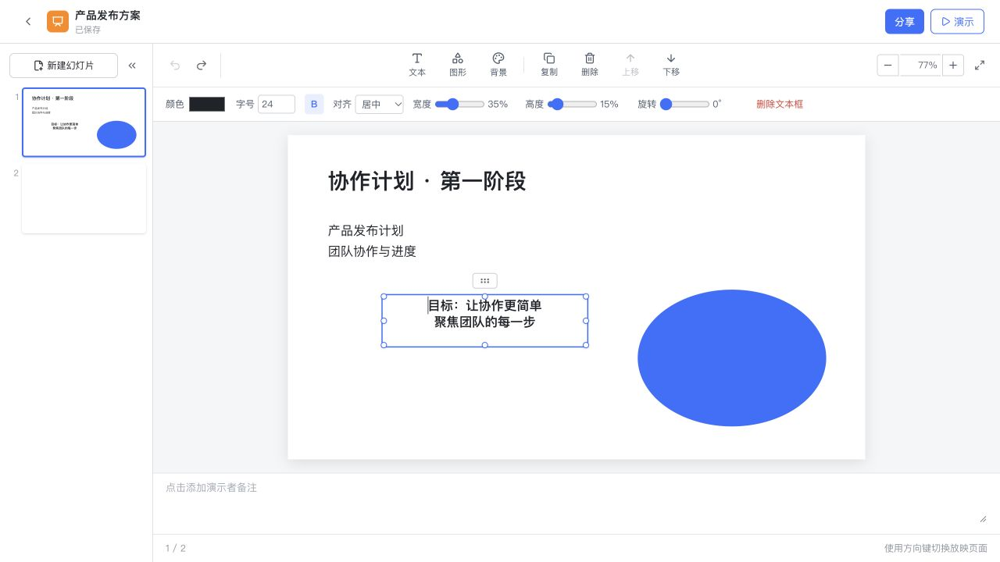

点击“文本”可插入独立文本框，支持文字、颜色、字号、加粗、对齐、移动、缩放、旋转和当前页撤销重做；缩略图及演示模式显示同一内容。隔离 Go/PostgreSQL 环境中验证了新增、多行输入、加粗、居中、拖动、刷新后保存、撤销焦点及演示；390×844 移动端仅验证模拟视口显示，未做真机触摸验收。

文本框目前是整框统一格式，尚无选中文字单独格式、字体、列表和超出框时自动扩展等能力；整体界面和功能仍未完全对齐。旧版客户端会把新文本框误显示为其他图形，旧版服务也不能保存新对象；使用该功能前须升级所有服务实例并刷新全部旧客户端，避免混合版本编辑。

## 2026-11-08：幻灯片图片

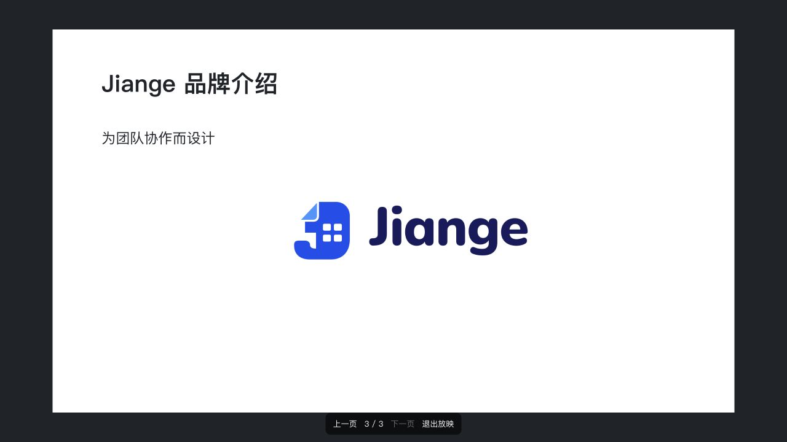

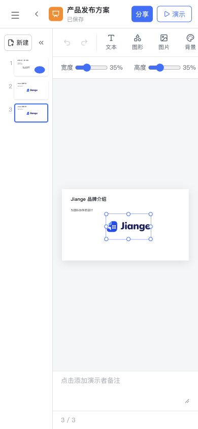

支持从本地上传 PNG、JPEG、GIF、WebP、BMP 图片（单张不超过 20 MB），并在画布中移动、缩放、旋转及撤销重做。缩略图、同一文稿内的复制页面和放映使用同一图片引用；编辑时保持原图比例显示。隔离 Go/PostgreSQL 环境验证了上传、复制页面、刷新后加载和放映；移动端为 390×844 模拟视口。图片测试使用项目 Logo 和合成文稿，浏览器中的对象存储为测试用内存存储，未验证生产 S3 或真机。

上传绑定账号，在写入附件元数据时复核会话和权限；页面保存会在事务中检查图片属于该文稿。内存和隔离 PostgreSQL 测试验证跨文稿引用被拒、附件不可单独删除及会话失效；API 测试覆盖限制下载时的引用检查和撤权。上传失败或页面切换可能留下未引用对象，暂保留到文稿永久删除或后续清理；图片裁剪、网络图片、跨文稿复制和整份幻灯片复制尚未实现。旧版服务和客户端不理解图片对象，须升级全部服务并刷新旧客户端；文件检查与网络发送之间仍有权限变化窗口。

## 2026-11-09：幻灯片对象层级与对齐

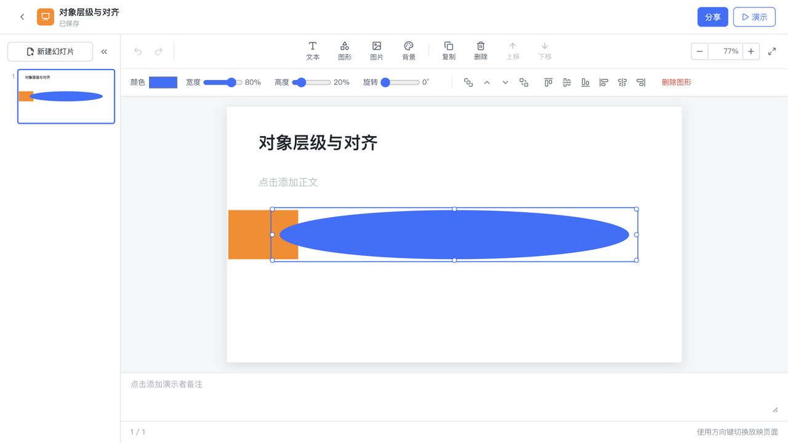

选中画布对象后，格式栏新增“对象层级”（置于顶层、上移一层、下移一层、置于底层）和“对象对齐到页面”（左、水平居中、右、顶、垂直居中、底）两组图标按钮；文本框、图形和图片均可使用，移动端格式栏横向滚动展示。层级按对象数组顺序渲染，调整即时反映在画布与缩略图中，并纳入当前页撤销重做（⌘/Ctrl+Z、⌘/Ctrl+Shift+Z）。

使用本地 Go 服务与隔离 PostgreSQL 验证：插入矩形与圆形后“置于底层”“置于顶层”改变遮挡关系并通过页面 API 确认数组顺序；左对齐、水平居中、垂直居中按页面百分比落位；⌘Z 撤销置顶、⌘⇧Z 重做、刷新页面后层级与位置均保持。桌面为 1440×900 视口截图，移动端为 390×844 模拟视口，未做真机触摸验收。

对齐以对象未旋转的包围盒计算，旋转后的对象对齐结果可能与飞书视觉包围盒不同；尚不支持多选对齐、对齐参考线、跨对象分布和拖拽时的智能参考线。截图中的橙色矩形与蓝色椭圆为合成测试数据。

## 2026-11-09：幻灯片整份复制

幻灯片编辑器头部新增「创建副本」按钮（分享左侧）：点击后在服务端同一事务中创建新演示文稿，复制全部页面、标题、正文、背景、备注、图形层级与顺序，图片引用重映射为新文稿自己的附件（共享不可变对象，不复制字节），随后跳转到副本继续编辑。标题为空时默认「源标题 副本」。存在未保存草稿时按钮禁用并提示等待保存；复制保护打开时阅读者请求被服务端拒绝。

使用本地 Go 服务与隔离 PostgreSQL 验证：复制含两个图形（不同层级与对齐位置）的文稿后，服务端页面数据逐字段一致；修改副本标题不影响源文稿；API 测试覆盖附图文稿复制的引用重映射、副本内继续编辑自己的图片、引用源图片被拒绝，以及复制保护与跨空间权限。桌面为 1440×900 视口截图，移动端为 390×844 模拟视口，未做真机验收。截图中内容为合成测试数据。

## 2026-11-09（第六轮）：延后项收尾与周边对照

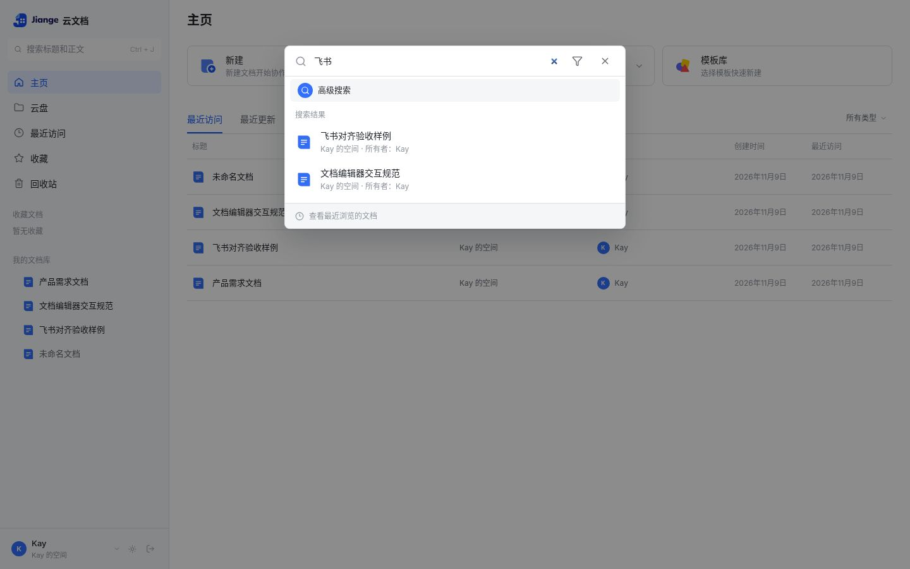

- 表格：斜杠/块菜单新建表格为空 3×3、无灰色表头（飞书默认）；表格工具栏「标题行」开关（`tableHeader` 块属性，只读同步）。旧表格保持原有表头。
- 整块复制：图片、附件、表格、分割线、网页卡片、视频的块菜单提供复制/剪切；粘贴到空行替换、否则插在当前块后，单步撤销。浏览器验证：复制图片后 Ctrl+V 得到两张，Ctrl+Z 回到一张。
- 网页卡片：编辑者首次打开时由服务端抓取 `<title>`/`og:*`/图标并写入块属性（只抓一次，读者不触发）；失败标记 `preview=none` 不再重试。SSRF：拨号时校验解析后的 IP（防 DNS 重绑定），拒绝回环、私网、链路本地、组播、CGNAT、保留段等，禁用代理，5s 超时，最多 3 次重定向，512KB 上限，仅 HTML。
- 全局搜索：Ctrl/⌘+J（飞书云文档快捷键）与 Ctrl/⌘+K（不在输入/正文编辑区时）均可打开；侧栏搜索框右侧显示快捷键提示。
- 周边复核：主页标签与列表、侧栏悬停 +/☆/…、新建模板库已为飞书式，未改动。
- 仍延后：分栏为真正块容器（拖块入栏、拖动分隔改比例）需嵌套块编辑，暂缓；跨文档粘贴的图片引用源文档文件，目标文档读者可能无权访问；未在登录飞书中逐像素比对。

## 2026-11-13：幻灯片复制一致性与权限

复制前核验过的图片引用必须与事务内读取的页面一致；期间新增或移除图片会拒绝本次复制。目标文件夹需有编辑权限，跨空间复制到根目录默认放入个人空间。内存存储在检查、图片引用重映射及会话复核完成后才发布副本，重映射也保留其他 JSON 数字的精度。复制期间编辑操作暂时不可用；页面操作和图片上传完成前不能发起整份复制，网络异常时提示先检查云盘。

测试覆盖核验后新增图片、只读目标目录、失败时不留下部分副本及图片重映射；内存和隔离 PostgreSQL 均运行了目标目录与图片引用测试。浏览器在隔离内存服务中复制含两页和图片的合成文稿，并通过人工延迟验证复制期间标题只读、新建及编辑按钮禁用；移动端为 390×844 模拟视口。生产对象存储、真机和所有并发时序尚未验证。多实例部署须先排空旧服务，否则旧版本仍可能绕过这些校验；网络响应丢失时复制可能已经提交。

## 2026-11-13：流程图移动端与工具栏避让

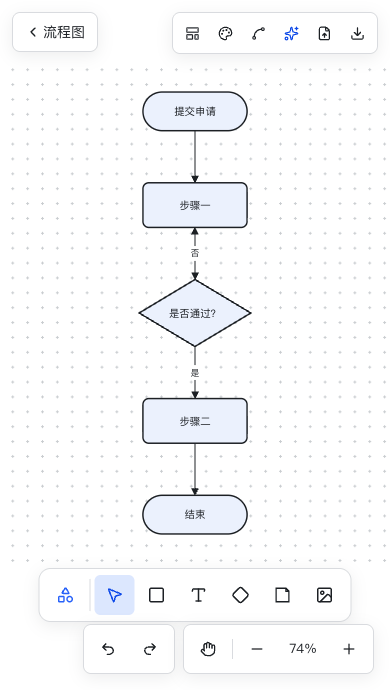

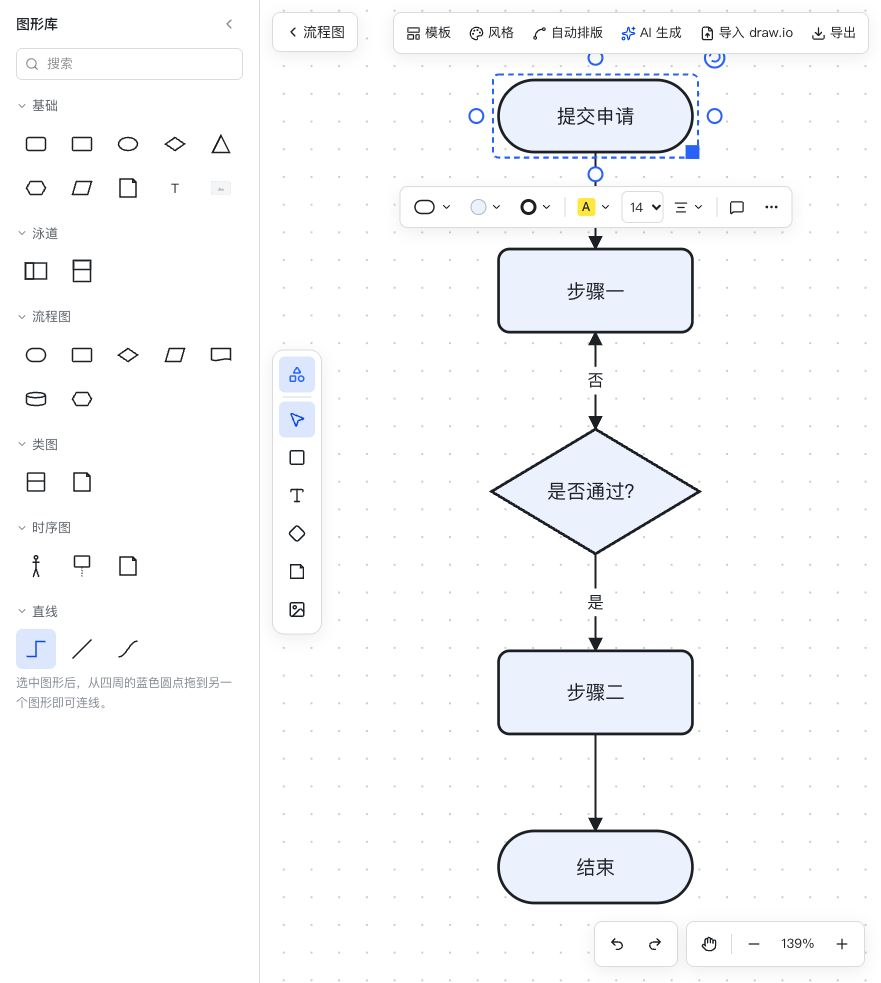

手机端画布位于顶部操作区与底部工具区之间，选中对象时格式栏换行并独占底部区域，避免遮挡流程和裁切按钮；图形库按需展开，选择图形后自动关闭，空白模板也可手动关闭。桌面选中工具栏根据对象位置在上下切换，避免与顶栏重叠。缩放画布后插入图片会按可用区域等比适配。移动端还提供点选源图形、再点目标图形的连线操作，放大了连接点的触控范围，并实现单指平移和双指缩放处理。

隔离内存 Go 服务中用合成画板验证了模板关闭、图形放置、文字与颜色编辑、点选连线、撤销、刷新保存以及放大后插入图片；检查了 390×690 和 320×568 浏览器模拟视口，并测量选中格式栏与画布之间保留间距。截图为模拟视口，不是真机；双指手势的坐标计算有单元测试，实际触控事件及手机系统键盘尚未在真机验证。展开图形库或菜单时会临时遮住部分画布。本轮未逐像素对照实际飞书流程图，整体功能和视觉仍需继续对齐。

## 2026-11-13：流程图协作冲突与提示避让

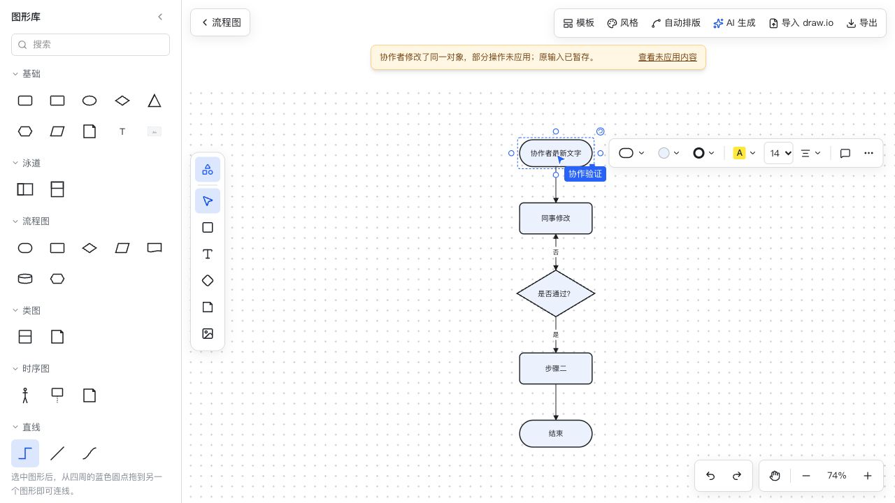

流程图提交、拖动及撤销重做按本次操作前后的对象差异写入；已经收到的其他节点和连线修改不会被旧画布状态删除或覆盖。若同一对象已被修改或删除，相关操作不会覆盖最新值；未应用内容在当前编辑器中暂存，用户可复制可读摘要或下载完整备份。删除关联节点时会检查新建、变化的连线，避免部分删除造成悬空。冲突提示占用画布上方独立空间；桌面浮动格式栏优先避开可见节点，手机端恢复窗口打开时隐藏底部格式栏。

使用两个浏览器标签、同一测试账号和隔离内存 Go 服务验证：一侧保留未完成输入时另一侧修改不同节点，再提交及撤销、重做，双方内容保留；同节点冲突时画布保留已收到的远端内容，本地文字可在恢复窗口中复制。手机截图为 390×690 模拟视口，已测量提示、画布和底部工具之间的间距，并验证恢复窗口键盘焦点循环；未在真机测试。

此修复只检查提交前本客户端已经收到的变化，消息仍在途时底层对象级 LWW 仍可能丢失并发修改，不能视为完整实时冲突解决。未应用内容仅保存在当前编辑器内；关闭、浏览器内路由切换或异常退出前需自行复制或下载，浏览器关闭提示也受浏览器限制。密集图形没有足够空白时浮动格式栏仍可能覆盖其他内容。本轮未对实际飞书流程图进行逐像素核对。

## 2026-11-13：多维表格仪表盘移动端入口与统计

移动端增加「数据表 / 仪表盘」切换，统计卡片和分布图的最小宽度随可用空间收缩；桌面仪表盘中仍可打开自动化面板。仪表盘统计授权响应中的全部记录，不跟随当前视图筛选、搜索，页面文案已说明范围。人员分布按成员 ID 聚合，同名成员分别展示并附 ID；重复成员在同一条记录中只计算一次，异常非有限数字不参与汇总。

在隔离内存服务中以合成账号创建多维表格和单选字段，验证桌面入口以及 390×690 浏览器模拟视口中的双向切换；该视口下页面宽度为 390px，图表右边界为 361px。截图中的 5 条记录均未填写状态，展示的是空值统计，不能代表其他图表类型；未在真实手机和触控设备上验证。查看了用户提供的飞书多维表格中的空仪表盘，Jiange 的统计卡片和移动导航仍非与飞书逐像素一致；自定义图表、布局和持久化仪表盘配置仍未实现。

## 2026-11-13：Word 文档内嵌图片导入

在文档「更多 → 导入 Word」中，解析并上传 DOCX 内嵌 PNG、JPEG 和 GIF，再将图片与文字按出现顺序追加到文档。行内图片拆成独立块并提示；无法处理的图片、表格单元格图片及部分布局设置会提示可能丢失。外链图片不会被抓取。上传使用账号绑定的新接口，并在附件元数据写入时复验会话和文档编辑权限；图片上传或同步检查失败时不插入正文，已上传的附件可能需要后续清理。

浏览器验证使用隔离内存服务和本地构造的测试文件：导入后刷新，图片与前后文本仍存在，浏览器确认图片原始尺寸为 720×250。桌面截图为 1280×720；手机截图为 390×690 模拟视口，图像右边界约 362px、页面宽度 390px。未测试真实手机或真实 Word/WPS 文件；云盘「导入为在线文档」入口尚不能导入图片，本次只覆盖已有文档内的 Word 导入。图片裁剪、尺寸、浮动环绕、文本框及表格单元格中的图片未完整保留；网络中断或页面关闭后可能留下未引用附件，新旧服务混用时旧服务不提供新上传接口。

验证补充：前端 Word 导入测试 24 项与生产构建通过；服务端账号绑定、撤销会话、资源类型和附件写入测试使用 `-race` 通过，并在不包含工作区既有服务端改动的代码快照及隔离 PostgreSQL schema 中复跑通过。此测试覆盖上述事务分支，并不证明附件对象存储与数据库能原子提交。

## 2026-11-13：云盘 Word 图片导入与原文件暂存

云盘「上传 → 导入为在线文档」现在也能处理 Word 内嵌 PNG/JPEG/GIF。先解析文件并提示已知损失，通过账号绑定接口创建文档，再将原始 Word 文件按账号和文档暂存在浏览器 IndexedDB；进入文档后由用户确认导入。图片逐一上传并复验编辑权限，全部完成且文档仍为空时再构造一次导入操作。浏览器持久存储不可用时退回本页内存并提示不要刷新；刷新后丢失时提示重新选择原文件。原件可下载，需用户核对后手动清除，清除不会删除已导入正文。

隔离内存服务和本地构造文件验证了云盘选择、刷新后恢复原件、确认导入、刷新后图片与前后文字仍在、清除暂存后内容保留；下载的 Word 与原测试文件逐字节一致。另验证在导入前写入其他内容时按钮禁用，原件仍可下载。桌面截图为 1280×720，手机截图为 390×690 浏览器模拟视口，图片右边界约 362px；未验证真实手机或实际 Word/WPS 文件。此条更新替代上一节「云盘入口尚不支持图片」的历史状态。

本地暂存保存在当前浏览器配置中，不会自动同步到其他设备；清除浏览器站点数据会删除它。上传或断开连接可能留下未引用附件，创建文档响应不明时也可能留下空文档。当前空文档检查基于客户端已收到的状态，多人或不同浏览器同时导入仍可能重复，尚无服务端幂等和事务级并发门禁；表格单元格图片、图片尺寸/裁剪/环绕以及真机和多实例升级验证仍待完成。旧服务没有新增账号绑定接口，升级前云盘 Word 导入会失败，不应在混合版本服务中依赖完整功能。

## 2026-11-13：Word 图片宽度、对齐和图注

修复 Word 导出将 Jiange 图片宽度百分比误当作像素的问题；按导出 A4 页面的可用正文宽度计算图片尺寸，并保留图片的左、居中、右对齐。导入普通单分节 Word 时，根据页面宽度和图片尺寸还原相对宽度、段落对齐以及紧随图片的 Caption 样式图注；图片说明中的文字格式仍无法保留。

隔离内存服务中导入本地构造的 50% 宽度样本，刷新后桌面图片宽 416px、正文宽 832px，手机模拟视口图片宽 167px、正文宽 334px，图注与居中均存在。浏览器导出的 DOCX 中图片宽度是 2,865,755 EMU，等于导出页面正文宽度的 50%；该文件经 LibreOffice 无头模式渲染，图像和中文说明可见，渲染时使用本机 Arial Unicode MS 作为中文字体替代。未使用 Microsoft Word、WPS 或真实手机核验。

导入宽度按页面正文宽度估算并四舍五入到 1%，限制在 10%–100%；多分节、分栏、段落缩进、超出范围、裁剪、旋转、形变或浮动环绕会提示近似或损失。Word 表格内图片、分栏相对宽度及复杂图形仍未实现完整保真，窗口宽度变化后 Jiange 的响应式百分比与 Word 的绝对打印尺寸也不完全相同。

## 2026-11-13：文档表格多单元格复制与粘贴

文档表格支持粘贴多行多列纯文本 TSV，识别引号、制表符和单元格内换行；粘贴超出表格时自动增加行列。已选择的矩形区域可复制为 TSV；Tab/Shift+Tab 在可见单元格之间移动，单元格可显示和编辑多行文字。粘贴作为一次本地撤销/重做记录；在已收到其他协作者的数据或合并布局变化后，撤销会提示冲突而不覆盖对方内容。工具栏预留固定高度，出现时不会遮住上方提示或使表格在点击前跳动。

隔离内存服务中实际验证了多行粘贴及扩展、刷新保存、整次撤销/重做、选区复制、含换行的单元格及 Tab 切换；双标签模拟协作时，另一端修改后撤销被拒且保留修改；另以两个合成账号验证受限编辑者的复制不会改变剪贴板。390×690 浏览器模拟视口中，工具栏底部为 263px、表格顶部为 267px，点击前后行数和表格位置不变。手机截图并非真机或触控验证。

本轮不处理合并单元格范围内的批量粘贴，会提示先拆分；不支持多单元格剪切。单次粘贴上限为 1000 格、256 Ki UTF-16 码元，表格最多 200 行、50 列且不超过 5000 格，结果 JSON 上限 1 MiB；超限整体不写入。撤销检查只覆盖本端已收到的变化，消息在途时仍存在底层后写胜出风险，结构并发仍需进一步治理。为避免工具栏跳动，编辑态表格上方固定预留 34px，尚未逐像素对照真实飞书表格。

## 2026-11-13：表格多格剪切与合并区域粘贴

文档表格的矩形选区可以剪切为 TSV，整次操作可撤销和重做。对于合并区域，只有源数据完整覆盖合并区域且被覆盖位置为空时才接受批量粘贴；单个合并格也可接收多行文本。复制、剪切和兼容粘贴只处理可见单元格，保留被合并隐藏的底层内容；不匹配的粘贴整体拒绝并提示。修复旧格式表格首次清空非空单元格时未产生显式空值的问题，旧客户端镜像修复与表格块剪贴板投影也覆盖该情况。

隔离内存服务中以 Markdown 导入非空旧格式表格，实际验证了多格剪切、剪贴板内容、撤销/重做、刷新后的空值、合并表头后的兼容粘贴以及不兼容粘贴保护；包含合并格的多格剪切及撤销也已验证。单元测试另覆盖隐藏单元格保留、新旧客户端与另一单元格并发编辑、整块复制后的空值和两种粘贴位置；Go 读取测试覆盖显式空值覆盖旧底值。手机截图为 390×690 模拟视口，截图前手动关闭了目录抽屉，不是真机触控测试。

上述多格剪贴板通过浏览器测试，但整张表格块菜单的「复制」在本次内置浏览器验证中显示成功后，粘贴仍得到先前的剪贴板内容，尚未确认原因。已增加对复制事件缺失或不可写的保护，但事件成功并不证明系统保留了自定义格式，整块复制/剪切仍需在实际浏览器核验；剪切后请核对剪贴板和原文。纯文本 TSV 不携带合并结构，非空内容落入被覆盖格或部分覆盖合并格时会拒绝。协作保护仅覆盖本端已收到的变化；在途并发和结构操作仍非事务级保护。此节更新替代上一节「多格剪切及合并区域粘贴未支持」的历史状态。

测试补充：编辑器 310 项、协同核心 174 项测试及生产构建通过；Go 表格读取测试在不含工作区既有服务端改动的快照中以 race 模式通过。整块粘贴前会将稀疏表格物化为独立数据，超过 50,000 格的稀疏表格自定义剪贴板数据会拒绝物化；这不等于整块复制在所有浏览器都可用。

## 2026-11-13：整块复制与安全剪切

块菜单对表格、图片、附件、分隔线、网页卡片、视频和流程图改用异步剪贴板写入：输出可读文本与携带结构数据的 HTML，表格 HTML 包含行列和合并信息；Jiange 粘贴时只读取受限结构标记并校验，不解析或加载粘贴 HTML 中的外部资源。表格合并区域若有非空隐藏数据，整块复制和剪切会拒绝并提示先拆分，避免将不可见内容放进剪贴板。块数据限 2 MiB。

剪切仅在文档同步完成、剪贴板 HTML 读回并与写入内容一致、权限仍有效且文档状态未变化后删除原块；剪贴板不可用、读回失败或超时会保留原块。标准异步剪贴板依赖浏览器支持及安全上下文，读取也可能要求用户授权，参见 [Clipboard.write](https://developer.mozilla.org/en-US/docs/Web/API/Clipboard/write) 和 [Clipboard.read](https://developer.mozilla.org/en-US/docs/Web/API/Clipboard/read)。剪贴板 HTML 中包含被复制块的结构化数据，粘贴到其他应用时该应用也可能读取这些数据。

本次隔离内存服务和内置浏览器中，先复现旧路径返回成功但剪贴板未更新；新路径实际将含合并表头的表格复制到另一篇文档，刷新后内容与合并结构保留，剪切后源表格移除并可撤销；另一测试页面接收到 TSV 和标准 HTML 表格。截图为 1280×720 桌面及 390×690 浏览器模拟视口，非真机。未在 Chrome、Safari、Word 或 Excel 实测，HTML 标记若被浏览器或目标应用清理，可能只剩纯文本；剪切读回无法确认时不会删除原块。跨文档图片、附件和画板中的文件仍引用源文档资源，目标协作者未必有权限；在途并发修改仍需协议级保护。此节更新替代上一节内置浏览器整表复制失败的历史状态。

## 2026-11-13：跨文档附件与流程图图片复制

文档图片、附件、整块流程图内图片以及流程图编辑器内的图片节点，跨文档粘贴时由服务端验证来源和权限，并在目标文档创建独立的附件记录；同一份文件内容仍由存储层共享。服务端要求源文档允许读取、复制和下载，目标文档允许编辑；提交时锁定权限和源附件记录。重试使用相同请求编号，避免网络结果不明确时重复创建记录。粘贴等待期间文档、选区或画板发生变化会拒绝写入；无法确认来源的旧版剪贴板附件会提示重新复制。

隔离内存服务中，浏览器实际将源文档图片 `/api/files/1` 粘贴为目标文档 `/api/files/2`，刷新后仍能显示；另将源流程图图片节点 `/api/files/3` 粘贴为目标流程图 `/api/files/4`。手机截图来自 390×690 浏览器模拟视口，并非真机测试。服务端测试覆盖目标协作者可读取新附件、源权限撤销、复制与下载限制、目标权限撤销、同编号重试和并发请求；在不包含工作区既有服务端改动的快照中以 PostgreSQL 和 Go race 模式通过。编辑器 323 项测试及生产构建通过。

本次没有逐像素对照飞书，也未在 Chrome、Safari 或真实手机测试。请求编号只在当前页面保留，刷新或关闭页面后网络结果不明的请求可能留下未引用附件；附件清理机制仍待完善。来源以站点地址和文档 ID 标识，数据库恢复且 ID 被重用时尚无代际校验。客户端只保护已收到的协作变化，在途并发仍需协议级保护；所有服务实例和客户端须升级后才能依赖新路径。此节更新替代上一节关于跨文档附件仍引用源文档资源的历史状态。

## 2026-11-13：文档页宽菜单与小屏子菜单

以已登录飞书文档的“更多 → 页宽设置”实际浮层为参考，将 Jiange 的行内二档按钮改为“默认、较宽、全宽”三张选择卡片。较宽模式提供 1200px 最大正文容器，默认 960px，全宽使用可用宽度；旧版全宽偏好继续生效。偏好仅保存在当前浏览器、按账号和文档区分，不写入文档内容。菜单支持点击空白处或 Escape 关闭；窄屏内联展开页宽和下载子菜单并允许菜单滚动。

隔离内存服务和内置浏览器中，在 1280px 视口实际测得三档容器分别为 960px、1200px 和 1280px；较宽选择刷新后保留。390×690 模拟视口下检查了页宽选项、下载子菜单与横向溢出，选择默认后页面没有水平溢出。截图是真实浏览器界面，手机截图不是实体设备测试。实际飞书的页宽数值、其余更多菜单项、模板预览与全页面视觉仍需继续对照；此处只完成页宽浮层及相关菜单布局的局部对齐，不代表整体已一比一。

## 2026-11-13：文档信息面板

参照已登录飞书文档的“更多 → 文档信息”，新增信息与数据、访问记录、操作记录的面板入口，以及桌面侧栏和手机横向分类。概览展示文档创建者和时间，评论总数只在评论数据可用时展示；正文字符数从已加载内容计算，包含文本块、可见表格单元格、图片说明和流程图文字，不含标题和公式源码。字符按 Unicode 码位计数，并分别显示包含和不包含空白的结果；它不是已验证的飞书字数统计口径。正文尚未同步时面板会提示数值可能变化。

本地隔离内存服务中，输入 14 个正文字符后面板显示 14；再追加一个空格及两个汉字，显示含空白 17、不含空白 16，刷新后相同。两种记录标签均显示未采集提示。390×690 浏览器模拟视口中已检查分类、面板滚动和关闭；不是实际手机触控测试。单元测试覆盖合并单元格隐藏数据、旧版/新版表格、表情字符和公式源码排除。

所有者、文档大小、访问人数/次数及点赞总数尚无可靠数据来源，显示“—”，访问记录和操作记录尚未实现采集或权限、隐私设置；不可把面板视为完整的飞书统计功能。界面按飞书参考布局调整，未逐像素验收，真实多端同步、撤权时序和飞书统计口径仍待核对。

## 2026-11-13：另存为文档版本

参照已登录飞书文档中的“另存为版本”弹窗，新增更多菜单入口、版本名称和字符计数；历史版本侧栏的创建按钮共用同一弹窗。前端要求当前文档已追平、无未确认操作、历史代际已知且权限已验证，保存请求绑定当前账号；服务端重新生成当前快照，并在事务内重新核验原会话、编辑权限、历史代际和文档头。相同作者、相同名称和相同序号的重试返回已有版本；不同名称或不同内容不会覆盖已有版本。历史列表缓存按账号隔离。

隔离内存服务和内置浏览器中，实际创建命名版本并在历史侧栏预览；对未变更的内容使用不同名称再次保存时，界面提示冲突，原版本仍保留。390×690 模拟视口中检查了弹窗尺寸；这不是实体手机测试。服务端 memory 和隔离 PostgreSQL race 测试覆盖相同请求重试、不同名称并发、撤权、会话失效、序号及代际不匹配；另测已有自动快照和账号切换。前端测试覆盖未同步、未知代际、未确认操作、被拒操作和网络结果不明，生产构建通过。

现有版本模型以协同序号为主键，同一序号不能保存多个不同名称；如有需要须先修改文档。超时后结果可能已提交，界面要求检查历史记录，只有同名称且文档头未变的重试可复用结果。旧客户端仍可调用原有未加此事务保护的接口，上线须升级并排空旧服务/客户端；历史还原与迟到协作修改的既有风险仍未完全解决。本轮没有逐像素验收整个历史版本界面。

另核对飞书隐私设置：关闭访问记录后，用户访问他人文档和他人访问该用户文档均不记录。Jiange 现有“最近访问”属于访问者私有历史，不能直接公开给文档协作者；访问统计及隐私设置仍待独立实现。

## 2026-11-13：同一内容保存多个命名版本

命名版本现在有独立的记录 ID，可以让多个版本名称指向同一个不可变协同快照。创建请求带随机编号，在文档头未变化时同一请求的重试返回原记录；不同请求即使名称和快照相同也可以创建独立记录。历史列表按记录 ID 区分选中状态，预览和还原继续使用共享快照；列表读取绑定账号并在事务中复核会话和文档访问权限。版本列表或预览尚未验证、重新加载或失败时不会允许还原。

隔离内存服务和内置浏览器中，将未改变的正文分别保存为“方案初稿”和“评审基线”，刷新后两条记录均存在，能够分别选择与预览；再修改正文并还原初稿，正文恢复。390×690 手机模拟视口中检查了列表和预览，未在实体设备测试。隔离 PostgreSQL race 测试覆盖同请求并发去重、不同请求并发创建、重名新记录、访问撤销和会话失效；迁移测试从实际旧结构及命名快照升级，确认旧记录和快照保留。此节替代上一节“同一序号只能保存一个不同名称版本”的历史限制。

新增数据库迁移 0053 和账号绑定接口，部署时需要升级全部服务与客户端。旧接口按序号展示代表性快照，无法展示同快照的所有名称；新旧客户端混用时，旧的版本写入路径也不具备新记录及权限保护，不应依赖其行为。重试编号只保存在当前弹窗，关闭或刷新后无法自动识别之前结果不明的请求；请先检查历史记录。历史还原和数据库回滚后的协作代际限制仍未消除，整个历史版本界面尚未与飞书逐像素验收。

## 2026-11-13：历史记录全屏预览

参照已登录飞书文档的历史记录界面，将历史视图从侧栏内的小预览改成全屏正文预览、右侧按日期排列的版本列表，以及顶部返回、版本切换和还原入口。默认选择最新的已保存版本；手机窄屏使用列表和正文预览切换。打开历史视图时正文编辑暂时只读，退出后恢复。桌面窗口缩窄时自动收起原本默认展开的目录，手机仍可手动打开。

隔离内存服务和内置浏览器中创建两份不同正文的命名版本，验证自动选择、版本切换、块文本对比及还原；390×690 模拟视口验证列表、预览、目录手动开关和 Escape 退出；还原确认弹窗验证默认焦点、Tab 循环和 Escape 取消。Web 全量测试 807 项及生产构建通过。还原请求使用专用账号绑定接口，前端要求同步追平且没有待确认修改；服务端会复核原会话和编辑权限。网络超时后的结果可能已提交，界面不会直接提供重试，而提示返回文档核对。旧服务不提供新接口，须升级服务与客户端。

比较功能仍是“历史版本与当前正文”的块文本摘要，不是飞书的逐人逐字符修订记录；不比较格式、图片和附件变化。公式与 Mermaid 块在摘要中显示占位，不展示原始源码；大型文档超过比较上限时保留完整版本预览。当前时间线仅列出 Jiange 已保存的版本，尚未提供飞书全部自动历史记录。还原时的在途协作操作及数据库回滚后的代际问题仍待解决；移动截图不是实体手机测试，本轮也未完成整个界面的逐像素验收。

## 2026-11-13：自动历史版本

修复原自动版本任务将系统创建者写成不存在的用户 ID、导致 PostgreSQL 拒绝保存且错误被忽略的问题。服务启动及定时扫描时，为尚无版本的当前文档头建立系统自动快照；扫描按文档 ID 分页，不再只依赖最近时间窗口，因此任务失败或服务重启后可再次尝试。写入时锁定文档头并复核代际、序号和文档有效性，重复扫描不会覆盖手动命名版本；同一快照也可另存为手动版本。系统快照不计入手动版本的默认编号。

历史页面在前台约每 15 秒重新验证列表，失败后隐藏旧列表，还原在重新验证期间不可用。隔离内存服务使用 3 秒测试间隔，实际验证了自动快照、与手动版本共存、预览及还原；两个标签页中，一边编辑后，保持打开的历史列表出现新记录而未强制切换选中项。手机截图为 390×690 浏览器模拟视口。干净代码快照中，隔离 PostgreSQL 和内存 race 测试覆盖并发自动保存、自动与手动保存竞态、快照不匹配、代际和序号变化、分页及失败后重试；PostgreSQL 测试还验证了真实正文重建和旧版本列表。

生产默认间隔为 30 分钟，可通过 `JIANGE_AUTO_VERSION_EVERY` 配置，为 0 时关闭。系统只保留每次扫描时捕获的当前状态，不保证覆盖两次扫描之间的每次编辑或创建瞬间；显示的创建者为“系统”，不是逐人编辑记录，也没有自动版本清理策略。首次启动可能扫描大量旧文档，性能和存储增长尚未在大规模数据上验证。旧服务/客户端混用、数据库回滚后的同序号代际和在途协作还原仍有既有风险；这不是飞书完整自动历史记录的验收。

后端扩大回归补充：`go test -race ./internal/api ./internal/store ./internal/syncsrv` 中，store 与 syncsrv 通过，API 的既有 `TestQueryPerfSmoke` 在 race 模式测得约 470ms，超过其 200ms 门限；单独 race 重跑约 439ms，仍未通过。该多维表格查询测试普通模式单独运行约 35ms，通过；本次自动版本的定向 race 测试（含 PostgreSQL）通过。这里不能把完整 race 回归记为通过。

## 2026-11-13：文档演示模式

参照已登录飞书文档的演示模式，在更多菜单增加演示入口，以只读视图展示当前文档，支持封面、评论面板和图片预览；文档有未同步的修改时显示提示。退出或切换评论面板时保留已有评论草稿。公式及流程图以渲染结果显示，页面不直接展示公式文本和 Mermaid DSL。

隔离内存服务与内置浏览器中，验证演示视图打开、退出、评论发送及未发送草稿恢复；另一个标签页编辑正文后，演示视图随协作更新。手机截图使用 390×690 模拟视口，检查了评论开关和 Escape 返回，未使用实体手机。浏览器拒绝原生全屏请求时提示用户仍可在演示视图阅读；原生全屏的成功进入、退出尚未验证。图片预览入口有静态渲染测试，但实际图片上传、预览与关闭的端到端路径仍需补测。Web 全量测试 812 项和生产构建通过；构建提示部分打包文件较大。

当前演示模式参照的是可访问的飞书界面，尚未逐像素比对所有内容类型及状态；评论锚点在演示视图中尚不能定位到对应正文，点赞等飞书演示交互也未补齐。截图仅覆盖所示状态，不代表整个飞书文档的 UI 或功能已完全对齐。

## 2026-11-13：演示评论定位

演示视图中的未解决评论现在使用协同字符 ID 在正文显示高亮；点击评论可滚动到对应文字或整块，点击正文高亮可打开对应评论。重叠评论以当前选中的评论优先，已经删除的锚点不会用旧引用猜测位置。手机窄屏点击评论后会收起评论面板，以便查看定位结果。此节替代上一节“演示视图中尚不能定位评论锚点”的旧描述。

隔离内存服务和内置浏览器中创建了文本锚定评论，验证桌面端双向打开、长文档从底部滚动回正文，以及 390×690 模拟视口下的评论定位。单元测试还覆盖分栏、整块、重叠和已失效锚点，但这些类型本轮未逐一用浏览器端到端验证。另以独立页面和合成图片验证了图片预览组件的关闭按钮、Escape 与焦点恢复，未验证实际上传、文档加载图片及打开预览的完整链路。相关测试 52 项和生产构建通过；构建仍提示部分文件较大。模拟视口不是实体手机，演示界面及图标也尚未完成逐像素验收。

## 2026-11-13：图片预览与块评论

图片附件预览增加放大、缩小和适应窗口，支持 `+`、`-`、`0` 快捷键；比例以适应窗口的大小为 100%，放大超出视口时可以滚动。预览背景改为不透明，避免底层文档控件与预览头部叠在一起；图片加载失败时显示提示。图片或表格评论被选中时，高亮收紧到实际图片或表格，其他未选中块不再显示整行边框。

隔离内存服务预置合成 PNG、图片和表格整块评论及分栏文字评论，浏览器从实际文档进入演示模式，验证图片加载、预览打开、缩放、适应窗口、Escape 和关闭后焦点恢复，以及这些评论的定位。手机使用 390×690 模拟视口，实测图片从 358px 放大至 448px 并可横向滚动，图片评论定位后面板收起。图片由测试服务预置而非通过上传界面创建，因此上传到预览的完整链路仍未验证；也未使用实体手机或验证双指缩放。本节替代上节有关图片预览仅用独立组件、整块及分栏评论未在浏览器验证的旧状态。Web 全量测试 817 项与生产构建通过；构建仍提示部分文件较大。

截图展示 Jiange 的实现，不代表已经与飞书图片预览逐像素一致；旋转、双指缩放等操作及原生全屏成功路径仍需对照和验证。

## 2026-11-13：图片旋转与触控手势

图片预览增加顺时针 90° 旋转，旋转后按新的宽高适应视口；旋转仅影响预览，不修改文档中的图片。图片区域增加双指缩放和单指拖动逻辑，放大时尽量保持手指指向的图片位置。手势状态在图片切换或旋转时清除。

使用隔离服务预置图片，浏览器验证桌面和 390×690 模拟视口中的旋转、适应窗口和控件布局；手势控制器单元测试覆盖缩放边界、缩放中心、单指拖动及抬指早于布局完成的情况。内置浏览器拒绝 `Input.dispatchTouchEvent`，因此未能在浏览器中执行双指触控，实体手机及不同浏览器的手势表现仍需验证。Web 全量测试 821 项及生产构建通过，构建仍提示部分文件较大。

本轮查看了已登录飞书示例文档，但图片预览停留在加载中，未能核对完整工具栏、旋转及手势行为；不能将这些实现称为飞书逐项或逐像素对齐。原生全屏成功路径、真实图片上传链路仍待验证。

## 2026-11-13：表格查找与单项替换

文档查找现在包含可见的表格单元格，与正文、分栏结果按文档顺序导航；合并区域中被覆盖的隐藏格不计入。表格结果按单元格高亮，支持单项替换；替换前检查单元格及表格快照，并在隔离副本上检查操作大小，复用表格的撤销与重做记录。手机上查找面板移到底部，结果滚动到可见区域，按钮按两列排列。

隔离内存服务与浏览器中验证了表格与分栏间的查找跳转、单项替换及撤销/重做，也验证了 390×690 手机模拟视口中的显示和替换。单元测试覆盖合并隐藏格、Unicode 偏移、陈旧版本、无效数据及撤销冲突。Web 全量测试 827 项和生产构建通过，构建仍提示部分文件较大。已登录飞书的空白文档可用于对照查找面板，但本轮没有飞书表格内容可供逐项验证；手机截图不是实体设备测试。

包含表格结果时“全部替换”仍禁用；表格高亮目前以整格表示，尚未精确高亮单元格中的匹配字符。单元格仍采用整格后写胜出的协同模型，本地快照和撤销检查不能排除尚在途的并发编辑冲突。标题及公式仍不在查找范围内。本节替代此前关于表格完全不参与查找的旧记录。
