# 飞书文档界面核验记录

## 2026-11-09（第二轮）：块菜单、多块选择、目录形态、工具栏对齐

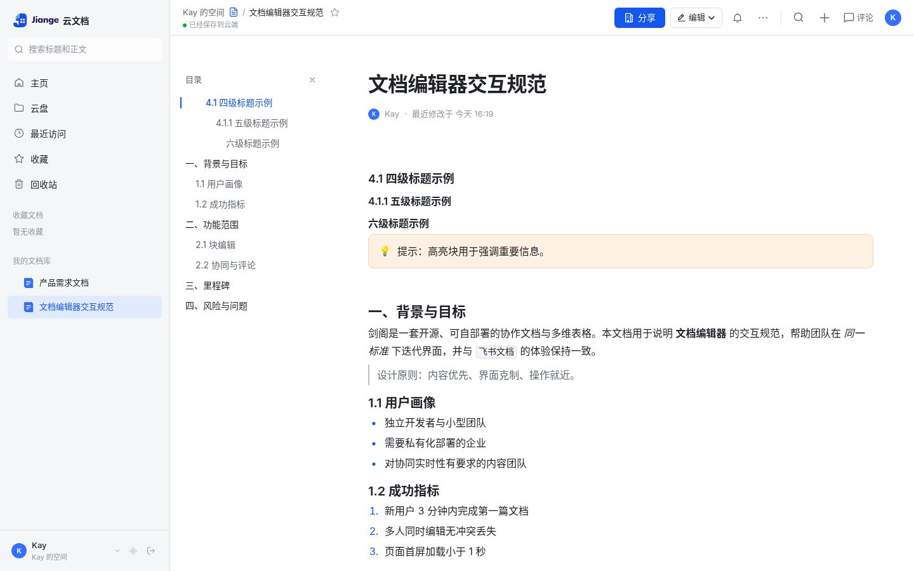

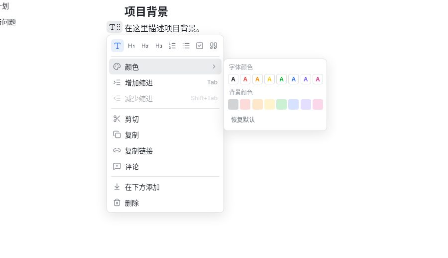

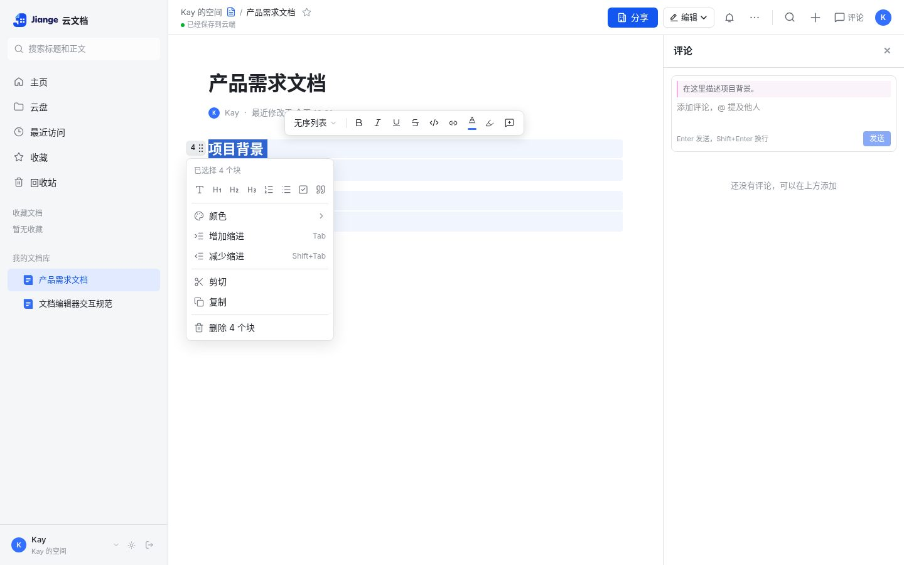

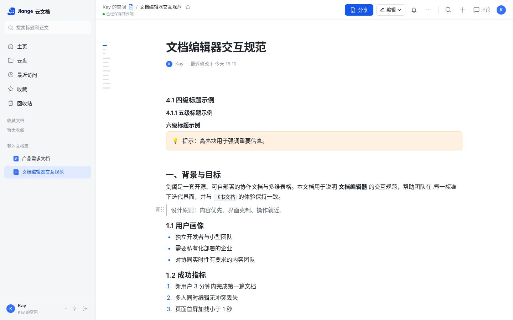

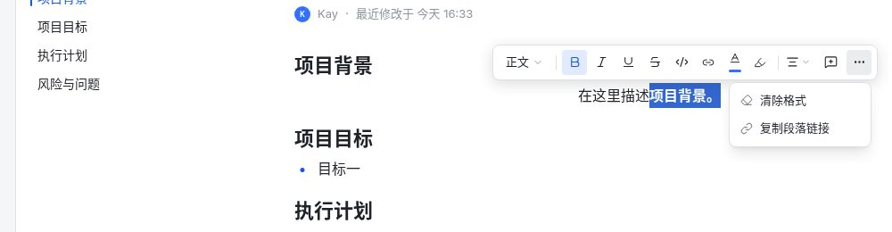

环境同上一轮（1440×900 无头 Chromium、合成账号、临时 PostgreSQL 16 + Go 服务，无 MinIO）。已在浏览器验证：块菜单设置字体色并恢复默认、缩进 24px 后减少缩进、复制写入剪贴板并提示「已复制」、复制链接得到 `#/doc/1?block=…` 且新开页面高亮目标块、评论打开评论面板；拖选 4 个块后只出现一个显示「4」的手柄，批量增加/减少缩进作用于 4 个块；斜杠网格 → 再 ↓ 从「正文」移动到「H6」；目录折叠子标题、取消固定后悬停展开；工具栏居中对齐后恢复左对齐、清除格式去掉加粗、复制段落链接。前端 100 个测试文件 596 项、协同模块 173 项、TypeScript、生产构建与 Go 测试通过。仍**未**在用户登录的飞书中逐像素对照。

## 2026-11-09：文档页外观（目录、块手柄、斜杠菜单、侧面板、顶栏星标）

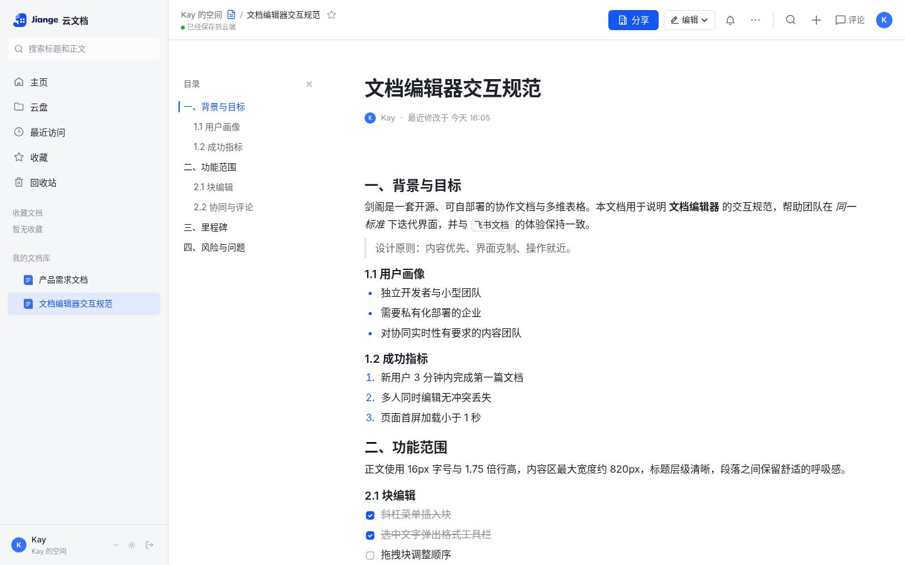

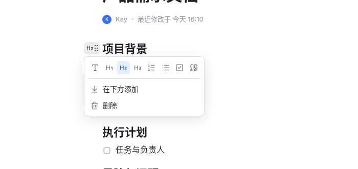

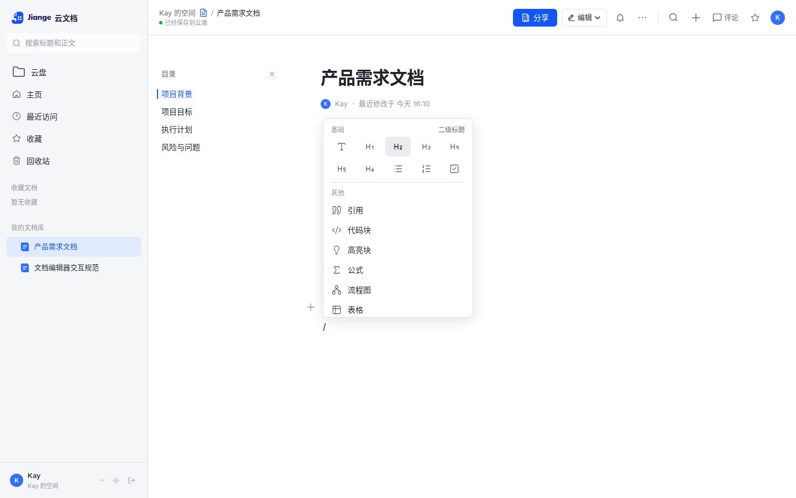

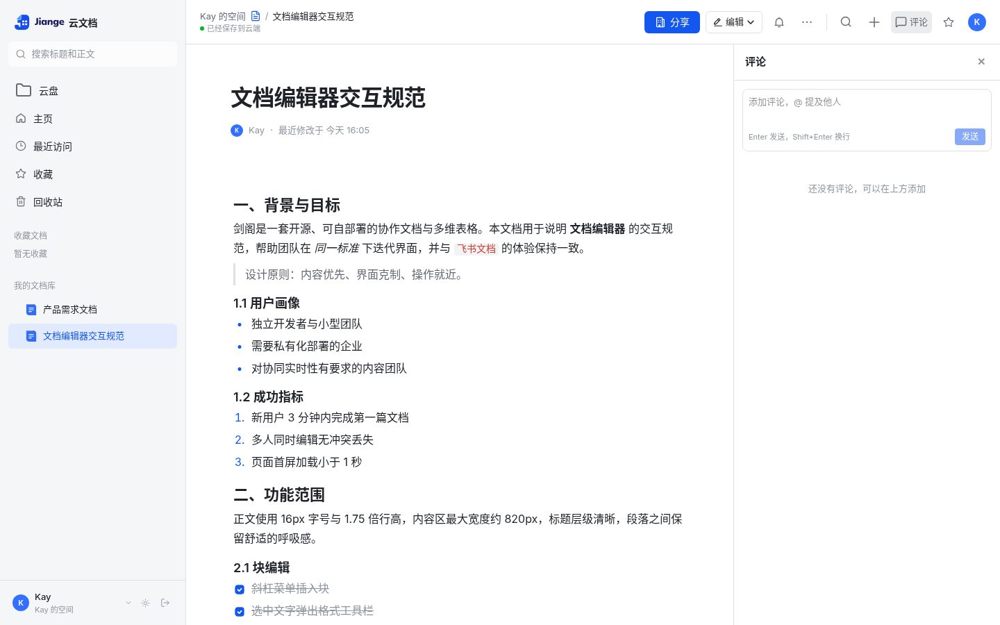

环境：1440×900 无头 Chromium，合成账号与文档，隔离的临时 PostgreSQL 16 与 Go 服务（未配置 MinIO，附件/封面上传未覆盖）。参考为飞书公开帮助与开放平台文档组件配置，**未**在用户登录的飞书中逐像素对照。已在浏览器验证：目录随滚动高亮、点击跳转；块菜单转换 H2→H3 并撤销恢复；斜杠菜单方向键高亮与拼音搜索回落为列表；评论面板不再遮挡顶栏且正文重排；星标切换收藏。390×844 模拟移动视口下目录不默认展开、正文无横向溢出。前端 98 个测试文件 582 项、协同模块 173 项、TypeScript 与 Go 测试通过（Go 未连接一次性 PostgreSQL 集成库）。

## 2026-11-07：封面与全局搜索

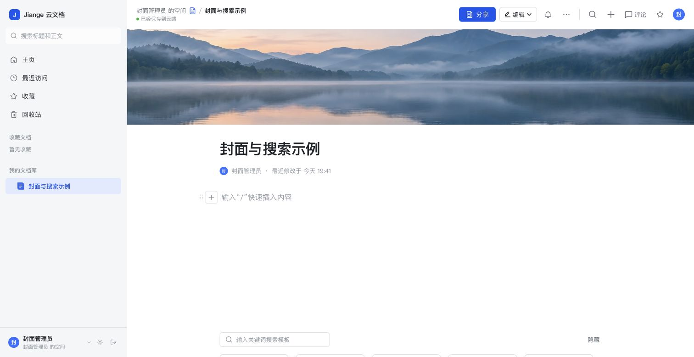

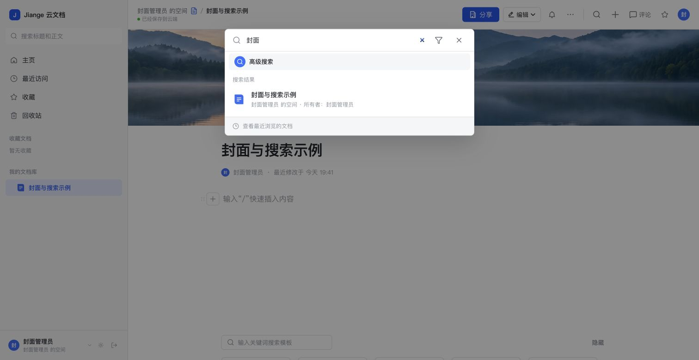

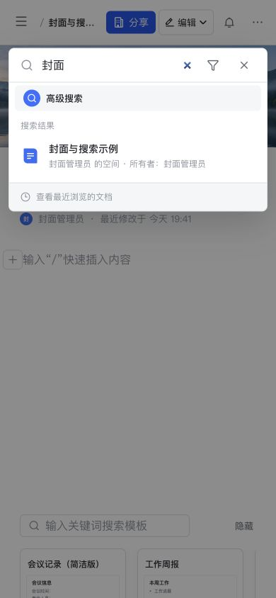

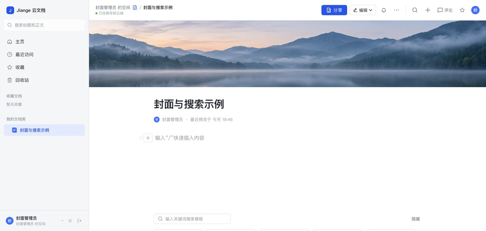

参考[飞书封面说明](https://www.feishu.cn/hc/zh-CN/articles/230455566106-%E8%AE%BE%E7%BD%AE%E6%96%87%E6%A1%A3%E5%B0%81%E9%9D%A2)及实际飞书全局搜索界面；截图来自合成文档、隔离 PostgreSQL 和 Go 服务。已验证原创图库封面添加、位置调整、移除和刷新保留，以及标题搜索与方向键选择。上传使用仅本机的内存 S3 替身，不验证真实 S3/MinIO、系统文件选择器或真实手机。移动图为 390×844 浏览器模拟视口。

目前只有一张原创图库图，未包含飞书官方图库；上传完成但绑定失败或离开页面可能留下未引用对象。全局搜索的高级筛选仅支持当前结果的类型与所有者，不代表完整飞书高级搜索。

干净快照通过前端 503 项测试、TypeScript、生产构建和 PostgreSQL 下的 Go 全量测试；最终封面组件另通过定向测试。构建仍提示部分资源包较大。

## 2026-11-07：文档图标

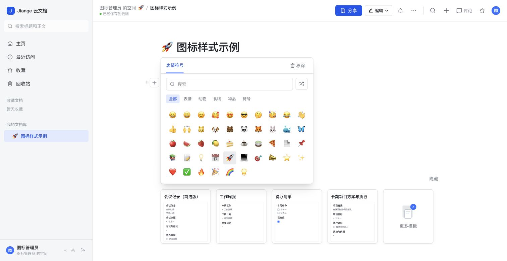

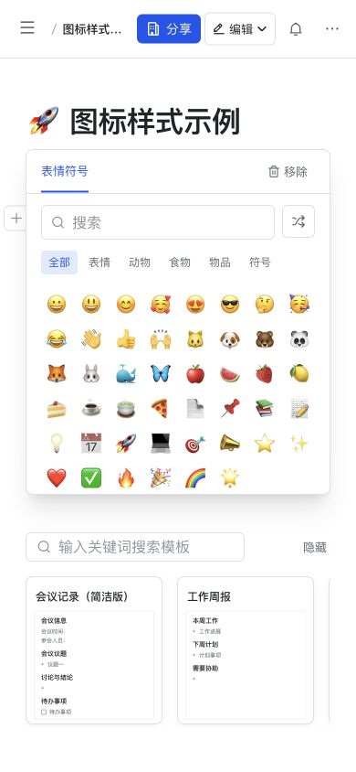

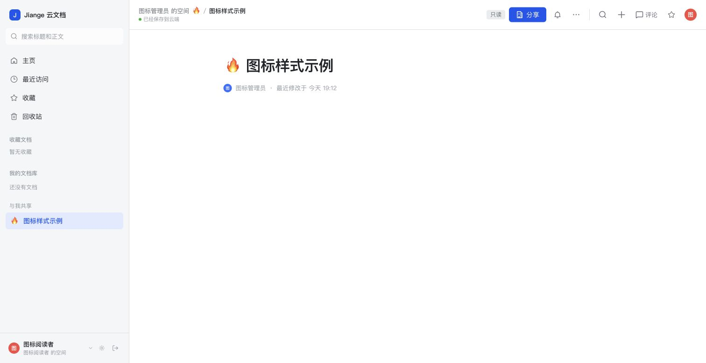

已对照用户登录的飞书文档：添加图标会先生成表情，并在标题、面包屑和侧栏显示。隔离 PostgreSQL、Go 服务和合成账号下验证了添加、更换、移除、刷新后保留，以及阅读者可查看但没有更改入口。移动截图为 390×844 浏览器模拟视口；尚未验证真实手机。当前选择器只包含部分 Unicode 表情，尚缺飞书完整表情和专有图标库；匿名公开页、复制文档及历史版本的图标行为也尚未对齐验证。

本次干净提交快照通过前端 494 项测试、TypeScript、生产构建和隔离 PostgreSQL 下的 Go 全量测试。构建仍提示部分资源包较大。

## 2026-11-07：评论权限与草稿

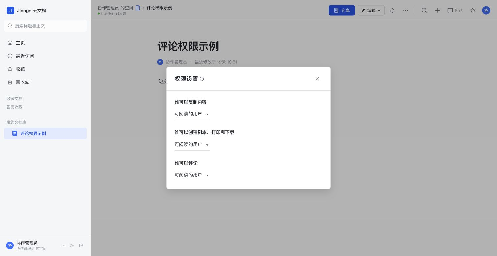

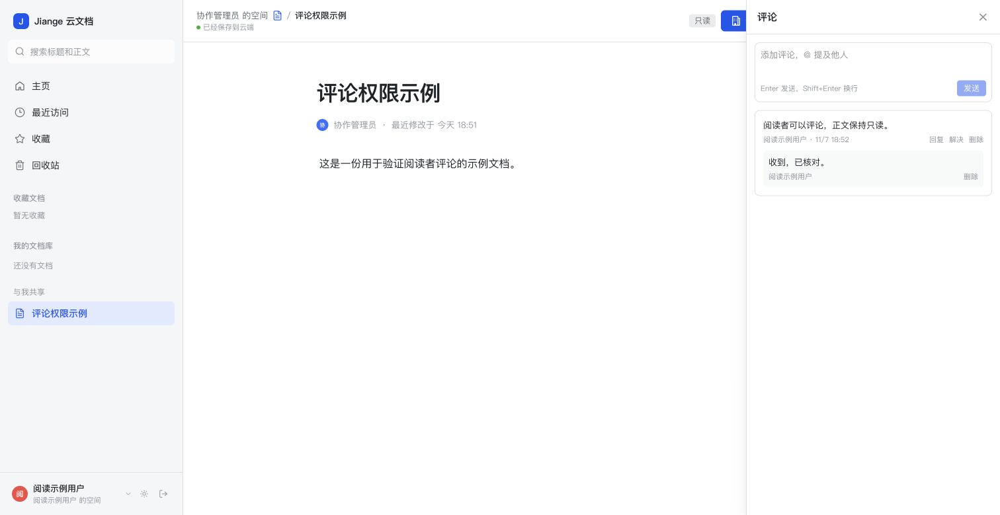

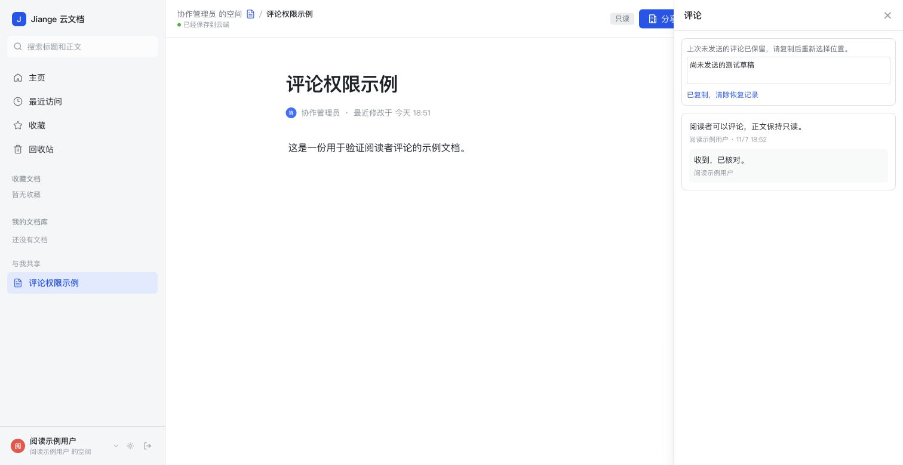

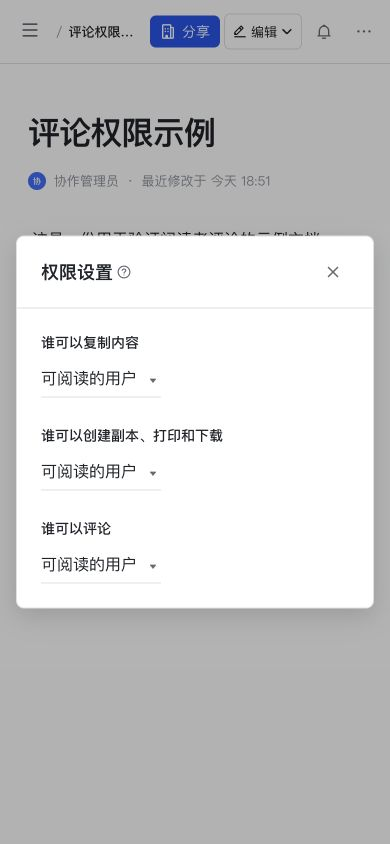

在用户登录的飞书文档中核对了评论权限的「可阅读的用户 / 可编辑的用户」两档。隔离 PostgreSQL 与 Go 服务中，合成管理员将测试文档设为阅读者可评论；合成阅读者发送评论及回复，并验证正文仍只读。管理员改为仅编辑者可评论后，阅读者的未发送草稿保留且发送入口关闭。移动截图为 390×844 浏览器模拟视口，尚未验证真实手机和系统输入法。

干净提交快照通过前端 484 项、协同模块 137 项测试、TypeScript、生产构建与隔离 PostgreSQL 下的 Go 全量测试。匿名公开评论仍未实现，正文提及仍可能先于协同操作确认发出通知；评论和通知分别提交，进程中断可能漏通知。PostgreSQL 为保护旧跨文档回复数据在删除评论时使用表级锁，性能尚需评估。

## 2026-11-07：分项角色权限

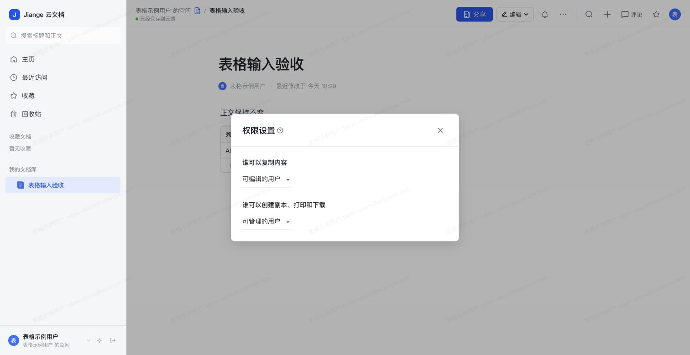

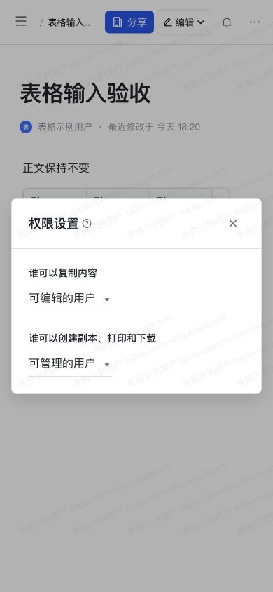

截图使用隔离 PostgreSQL、Go 服务和合成账号，实际将正文复制设置为编辑者、下载和创建副本设置为管理者，刷新后两项仍分别保留。移动图为 390×844 浏览器模拟视口；尚未验证真实手机或系统打印预览。飞书的评论、对外分享等其他权限选项仍未实现。界面复制、打印和媒体限制不能阻止阅读者提取已经接收的数据；升级前须排空旧版本服务。

干净快照通过前端 476 项、协同模块 137 项测试、TypeScript、生产构建和隔离 PostgreSQL 下的 Go 全量测试。构建仍有大资源包提示。

## 2026-11-07：文档表格输入

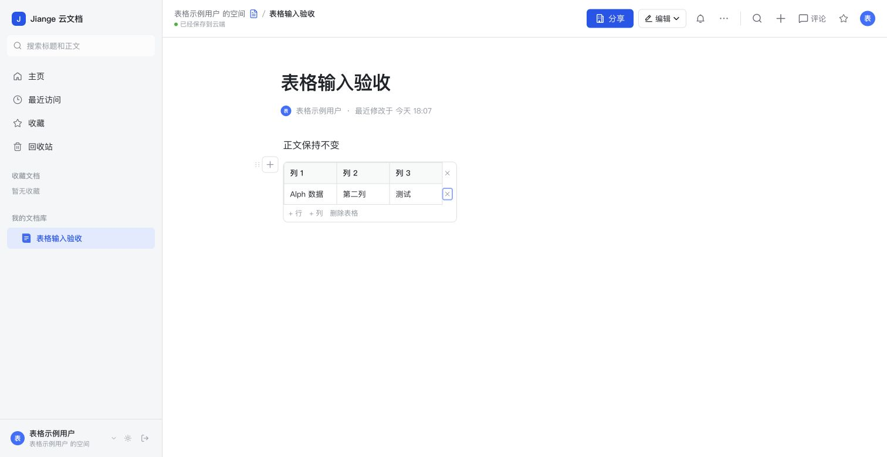

使用隔离 PostgreSQL、Go 服务和合成文档，验证了表格单元格键入、退格、粘贴、Tab、撤销和重做，以及刷新后内容保留。也验证了焦点回到正文后撤销最近的表格编辑。移动图是 390×844 的浏览器模拟视口；没有使用真实手机或系统中文输入法。表格数据仍以整表存储，多人并发编辑不同单元格仍可能相互覆盖。

## 2026-11-07：文档权限设置

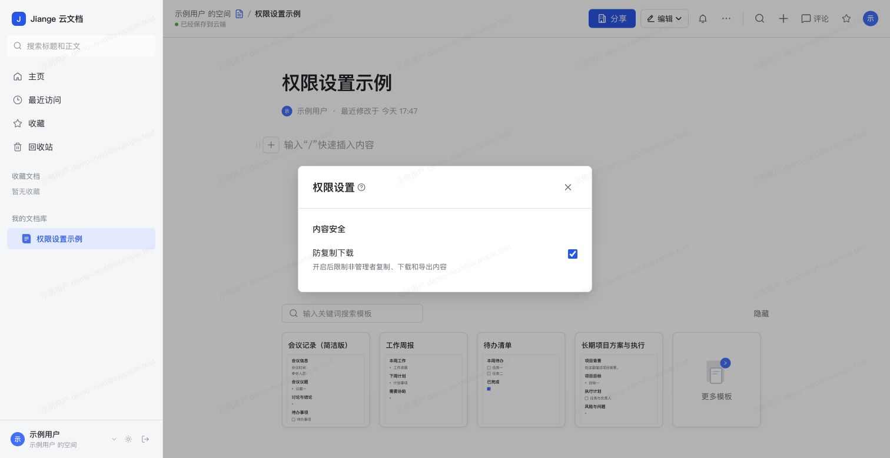

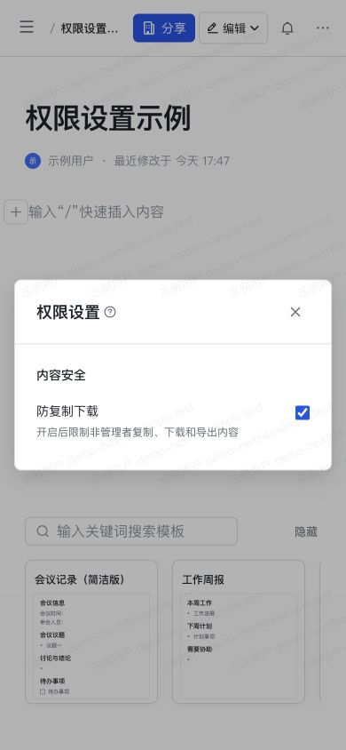

通过用户登录的飞书文档核对了权限设置入口和弹窗。项目现在提供独立弹窗，可设置现有的合并型防复制、下载及导出开关；在隔离 PostgreSQL、Go 服务和合成文档中验证了开启、刷新和重新打开后的状态，并检查了 Tab 焦点循环及返回分享后的焦点。截图仅包含合成账号，移动端为 390×844 浏览器模拟视口，未在真实手机上验证。飞书将复制、下载、评论等按角色分别配置，项目目前仍只有合并型设置，界面和能力尚未完全对齐。

本次提交的干净快照通过前端 447 项测试、TypeScript、生产构建以及使用隔离 PostgreSQL 的 Go 全量测试；构建仍提示部分资源包大于 500 kB。

## 2026-11-07：多维表格截图核验

使用隔离真实 Go 服务、PostgreSQL 和合成任务数据，查看了桌面表格、字段弹层、看板、日历及 390px 模拟视口；表格中主字段显示锁标识。各图均为单次浏览器截图，未使用拼接；移动表格需要横向滚动查看其他字段。

本轮截图由浏览器工具直接显示，未能保存为本地图片文件；因此本节没有图片附件。截图展示当前实现，并不能证明与飞书逐像素一致；实际手机及系统输入法尚未验证。

本轮暂存代码的前端 395 项测试、TypeScript 和生产构建通过；Go 全量测试使用隔离 PostgreSQL。主字段及一致性快照的并发回归单独执行；公式求值的实验实现因跨端语义差异未接入生产。

## 2026-11-07：多维表格视图与收集表

使用隔离真实 Go、PostgreSQL 和合成数据，在浏览器中查看了桌面表格、字段弹层、视图菜单、日历及 390px 表格。另验证了视图重命名、复制和移动，8 行粘贴覆盖并新增记录，以及收集表字段选择、必填、发布、匿名提交和关闭。界面仍与飞书存在差异；这不是逐像素对齐证明。

本轮截图只通过浏览器工具显示，未能保存为本地截图文件。移动端为模拟视口；文件选择器、原生剪贴板读回、甘特和日历的浏览器拖拽未完成验收。

## 2026-11-07：多维表格

已在登录后的飞书空白多维表格中对照桌面布局；本项目使用隔离的真实 Go 服务、PostgreSQL 和合成数据验证。桌面和 390px 模拟视口检查了字段添加弹层、筛选及日历；新建表的“文本”“表格”和 5 条记录来自真实后端。80 行长多选项在窄屏滚动后仍能打开正确记录；受限用户的只读提示、轮询更新、断网重试及撤权隐藏也已验证。

本轮截图在浏览器工具中目视检查，但未能保存为本地文件，本节没有附新的截图文件。390px 为浏览器模拟视口，附件和关联字段的长值、真实手机及拖拽尚未完整验证。界面和功能仍与飞书有差距；CSV 导入暂时停用，原因见[对标调查](FEISHU_DOCS_GAP_ANALYSIS.md)。

本轮前端 318 项测试、TypeScript 和生产构建通过；Go 全量测试包含隔离 PostgreSQL，相关权限和初始化并发测试通过。一次包含性能烟测的 `-race` 运行中，1 万行查询耗时 451ms，超过 200ms 阈值；普通全量测试通过，功能性 `-race` 回归单独通过，不能据此宣称并发检测模式下性能达标。

## 2026-11-07：公式、分栏评论与名称检查

使用合成文档与隔离浏览器进行了界面检查：分栏评论的高亮、重叠计数、面板定位、解决，以及 390px 模拟视口中的入口；已有评论面板时再次划词评论，输入焦点不会落回正文。多次关闭面板可保留多份草稿；通过拦截评论请求模拟连续 403，验证了停止重试及手动验证后的草稿恢复。上述评论与名称检查使用真实 Go 服务和隔离 PostgreSQL；名称检查可展示两份标题，且不修改它们。

公式验证使用真实前端编辑器和模拟协同数据：测试了公式前后输入、复制相邻公式、删除其中一个及撤销。它不等同于真实双端协作或系统输入法验收；旧公式无独立标识时的边界仍有歧义。

本轮截图在浏览器工具中目视检查，但未能保存为本地文件，故本节没有新的截图文件。390px 是浏览器模拟视口，并非真实手机。

## 2026-11-07：模板与分栏查找

在隔离的真实编辑器、Go 服务和 PostgreSQL 中，用合成数据验证了模板搜索与插入；桌面和 390px 浏览器视口下检查了空白文档的插入按钮。分栏文字的查找、高亮、导航、单项与全部替换及撤销也已验证。390px 是浏览器模拟视口，未覆盖真实手机或系统输入法。

这轮浏览器截图已目视检查，但当前截图接口没有提供可用的本地保存方式，因而本节没有附新截图；不能把目视检查当作已保存的截图证据。模板预览基于本项目实际内容，与飞书参考中的照片封面仍有差异。公式附近的编辑风险仍未解决，详见[对标调查](FEISHU_DOCS_GAP_ANALYSIS.md)。

## 2026-11-07：主页最近访问

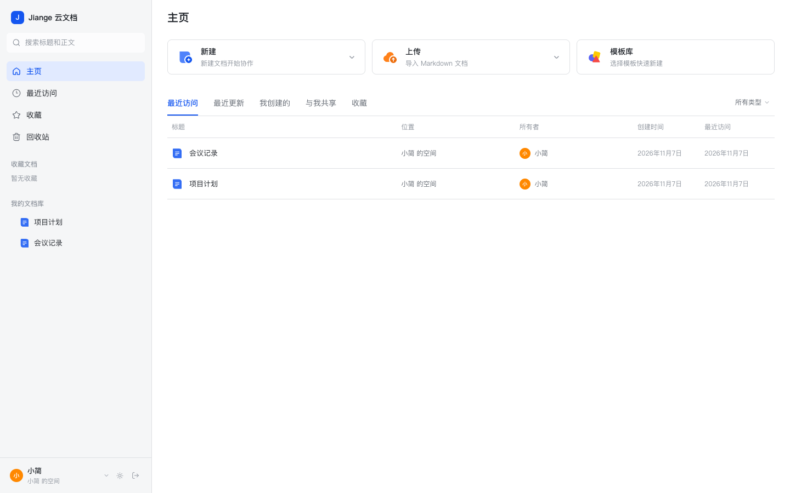

截图来自隔离的真实前端、Go 服务和 PostgreSQL，文档与账号均为合成测试数据。已验证空状态、访问排序、再次访问置顶、与最近更新区分以及搜索入口；390px 是桌面浏览器模拟视口，不是真机。截图展示当前实现，不代表与飞书逐像素一致。

## 2026-11-07：附件与粘贴保护

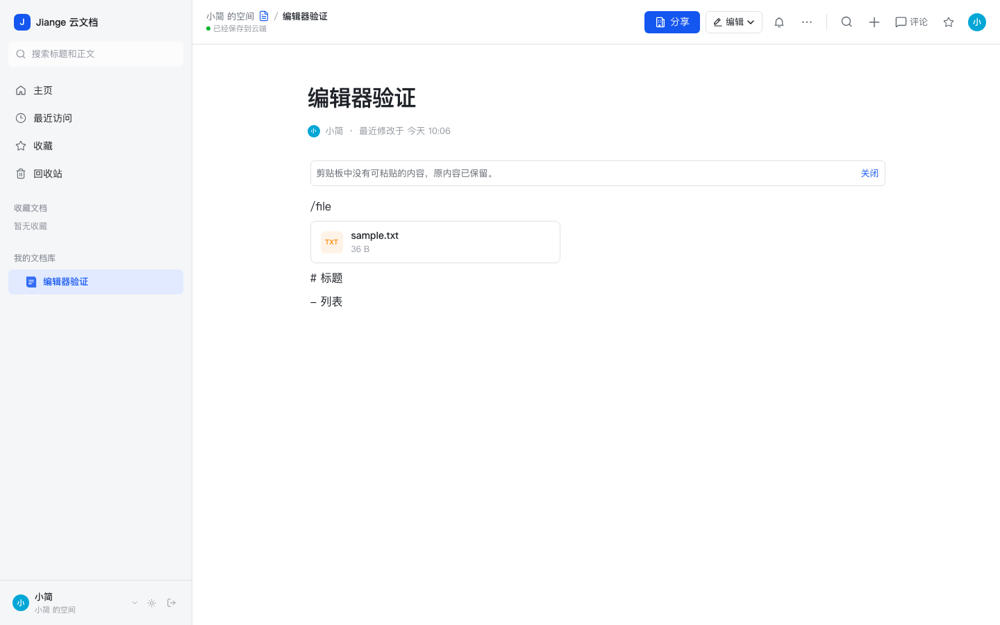

在真实编辑器、Go 服务、隔离 PostgreSQL 和临时内存 S3 替身中，验证了取消文件选择后保留命令、合成附件上传插入、无效内部剪贴板保留选中文字，以及回退纯文本时保留 `#`、`-` 前缀。图中的提示和 `/file` 是刻意触发取消与异常粘贴后留下的验证状态；文件选择通过浏览器调试接口注入，粘贴使用合成事件，未覆盖系统原生对话框和剪贴板。

## 2026-11-07：分栏编辑

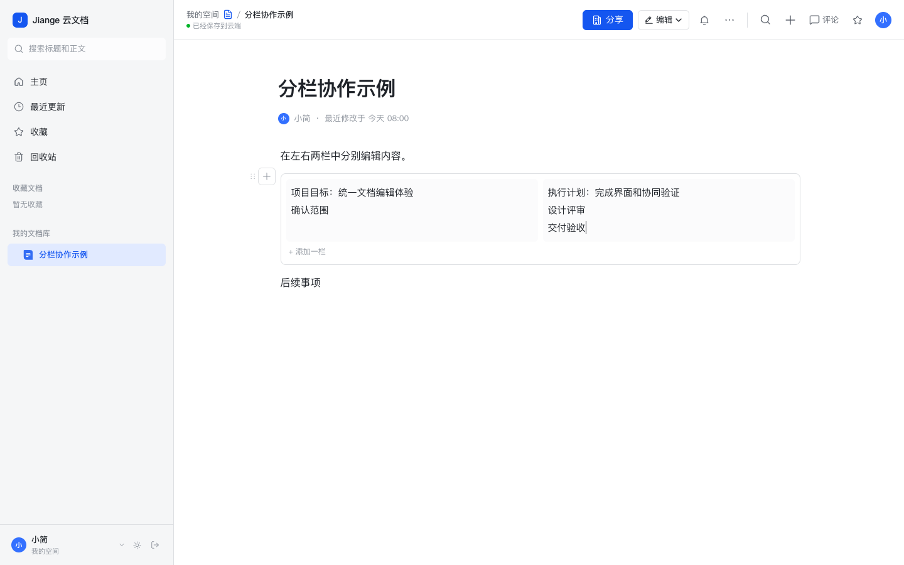

截图来自真实前端编辑器和隔离的模拟协同数据。桌面浏览器中验证了首次点击各栏后输入、栏内换行、多行粘贴、撤销，以及阅读模式不能编辑；390px 为浏览器模拟视口，并非真实手机。栏内块类型/斜杠插入、跨栏编辑与安全删除仍未完全对齐。

## 2026-11-07：匿名分享自动刷新

使用独立浏览器和合成内容验证：页面在前台定期更新；链接切换为需登录或关闭后不再显示旧正文；临时网络错误显示提示，恢复后更新内容。此项使用可控的本地服务替身，不能替代真实 Go 服务的权限测试。

日期：2026-11-06。截图均为隔离测试内容，不包含用户真实文档。它们用于核验当前项目界面和操作，不能证明已与飞书逐像素一致。

## 匿名分享中的图片和附件

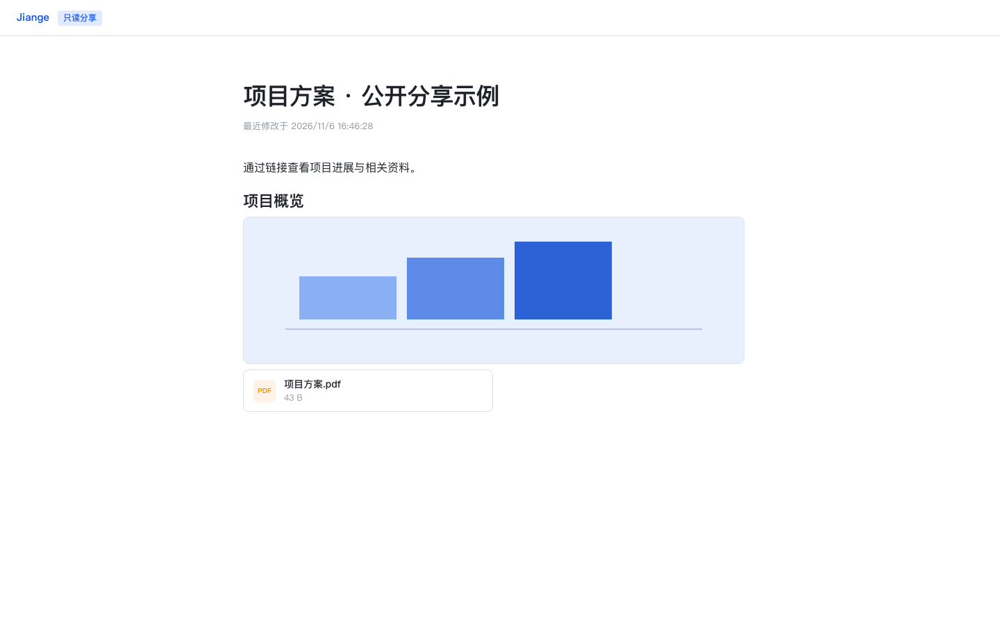

截图来自隔离的真实前端与 Go 服务，使用内存文件存储。图片和附件接口均返回成功；示例附件为合成占位数据。自动测试覆盖无效链接、链接降级和撤销、其他文档与未引用的文件、防下载设置、文件类型伪装及部分请求中途变更权限的情况。图片预览字节仍可被浏览器读取，防下载并不是完整的防泄漏能力。

## 文档内查找与替换

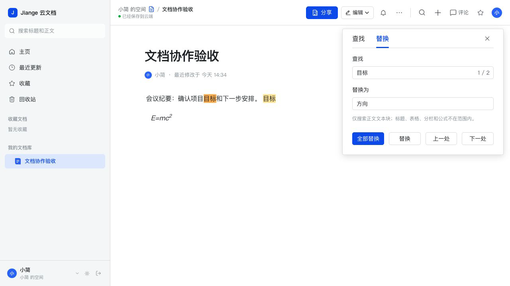

在隔离 PostgreSQL 和 Go 服务中验证了正文高亮、上一处/下一处、单项及全部替换和一次撤销。目前只搜索正文文本块，标题、表格、分栏与公式仍待覆盖；大规模高密度替换受到性能限制。

## 命令效果

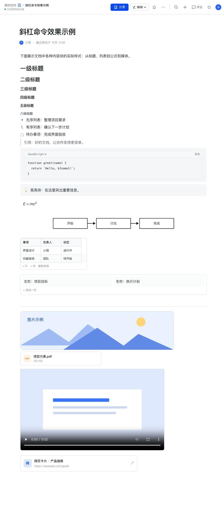

示例使用合成数据，由实际编辑器渲染；长图拼接自同一文档连续滚动的四次截图。图片和视频为本地示例，附件是占位卡；此图展示命令对应的块，不代表每条插入、上传和协作流程均已验收。

## 验证范围

2026-11-07 的 Go 全量测试包含隔离 PostgreSQL，前端 Vitest 共 177 项、协同模块 125 项；TypeScript、`go vet` 与生产构建通过。分栏的输入法和粘贴验收使用合成事件，尚未覆盖真实系统输入法及网络双端。与飞书的未完成差距和同步协议风险记录在 [对标调查](FEISHU_DOCS_GAP_ANALYSIS.md) 中。

本轮后续复测：前端 222 项、协同模块 137 项通过；协同输入延迟测试此前两次超过 16ms，后续整套测试通过，仍需建立稳定的大文档性能基线。Go 全量测试使用隔离 PostgreSQL，TypeScript、`go vet` 与前端生产构建通过。
# 2026-11-07：文档和分享面板

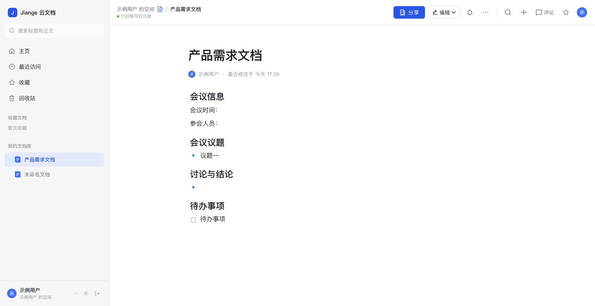

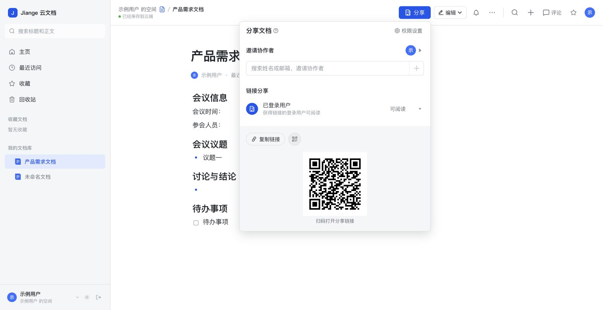

截图来自本地真实前端、Go 服务与隔离 PostgreSQL，账号、文档内容和二维码均为一次性测试数据。桌面图为 1512×779；移动端为浏览器模拟的 390×844 视口，并非真机。已通过界面插入会议记录模板、开启需要登录的阅读链接并显示二维码；尚未使用手机扫码，不能据此证明扫码链路已验收。截图反映当前实现，不能证明与飞书逐像素一致。

本次提交的干净快照通过前端 428 项和协同模块 137 项测试、TypeScript 检查、生产构建及使用隔离 PostgreSQL 的 Go 全量测试。生产构建仍提示部分资源包大于 500 kB。原工作区的多维表格未提交改动使该工作区的表格行高测试失败，未包含在本次快照中。

# 2026-11-08：云盘和幻灯片

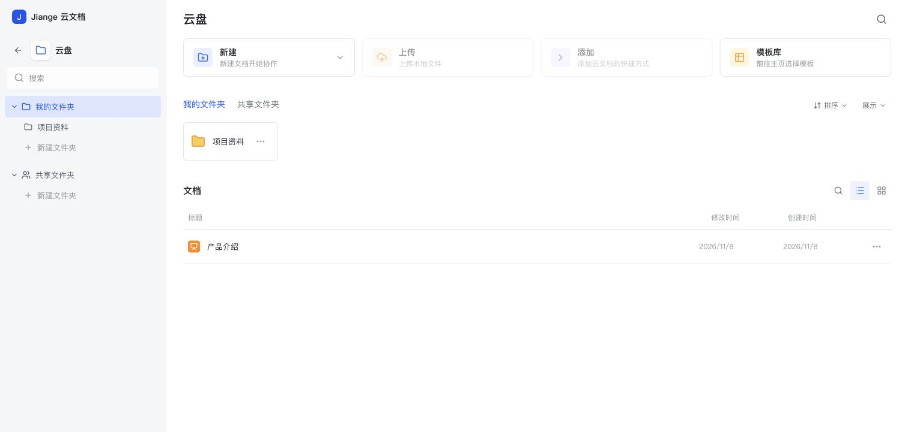

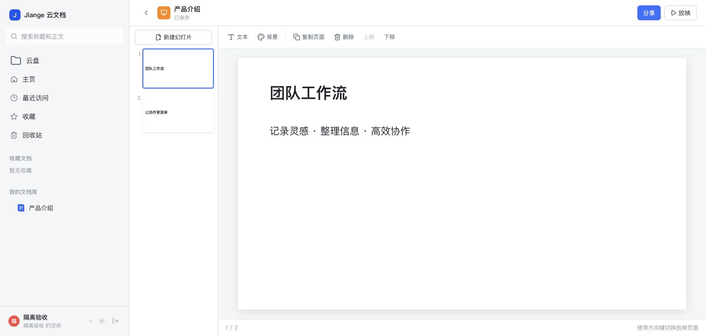

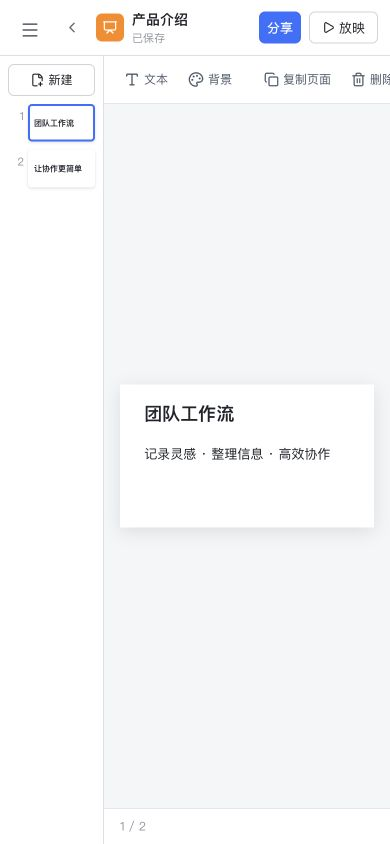

截图来自独立端口上的本地前端、Go 服务与隔离 PostgreSQL，使用合成账号和测试内容。桌面使用浏览器默认视口；移动端是 390×844 浏览器模拟视口，不代表真机验收。已通过界面验证新建文件夹、创建幻灯片、连续输入并刷新、移动幻灯片页面后刷新，移动端工具栏可横向滚动。截图展示当前实现，不代表与飞书逐像素一致。

截至上次截图，云盘上传和添加快捷方式尚未实现；幻灯片仅支持标题、正文、背景、页面管理与简单放映。保存冲突或网络结果不明时，未保存的内容只保留在当前页面内，离开前应手动复制。幻灯片保存协议增加版本号，需要更新服务端和前端并执行迁移 0038；旧客户端必须刷新到新版。

## 2026-11-08：云盘 Markdown 导入与演示者备注

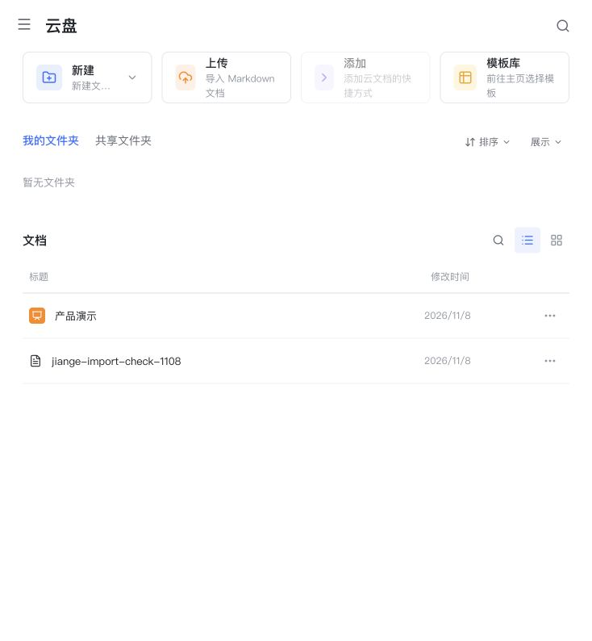

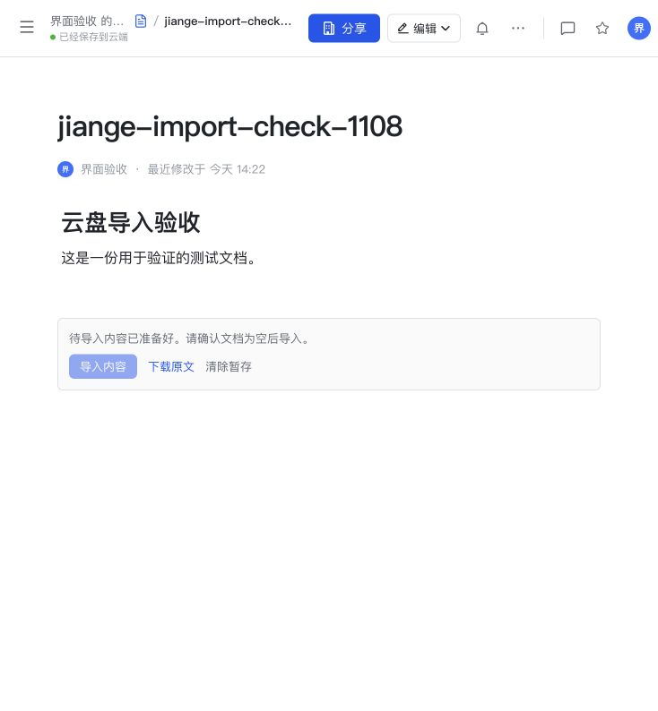

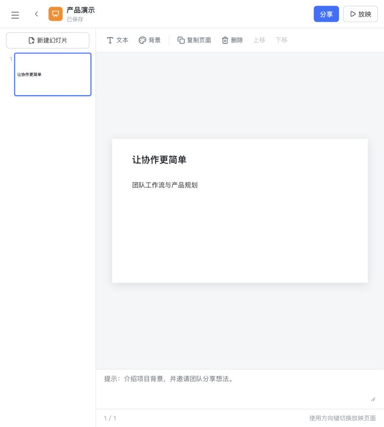

使用独立端口、测试账号和隔离 PostgreSQL 验证：云盘上传 Markdown 后创建文档，确认导入后刷新仍可看到正文；幻灯片备注输入后刷新仍保留。新文档原先缺少协同初始操作，导致正文无法初始化，本次同时修复；此前已产生的空文档不会自动修复。导入完成后的原文仍暂存在标签页中，需手动清除，避免错误判断服务器是否接收操作。截图来自浏览器模拟视口，不代表与飞书逐像素一致。

当前仅支持不含图片的 Markdown 文档导入，并非任意文件上传；快捷方式仍不可用。幻灯片新增演示者备注；服务端需要运行迁移 0039，旧客户端不传备注时服务端保留原备注。

## 2026-11-08：幻灯片图形与云盘内部链接

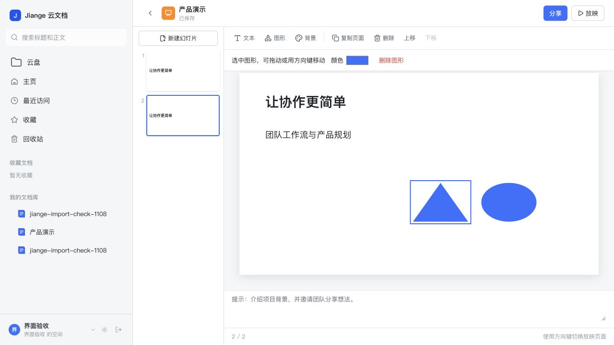

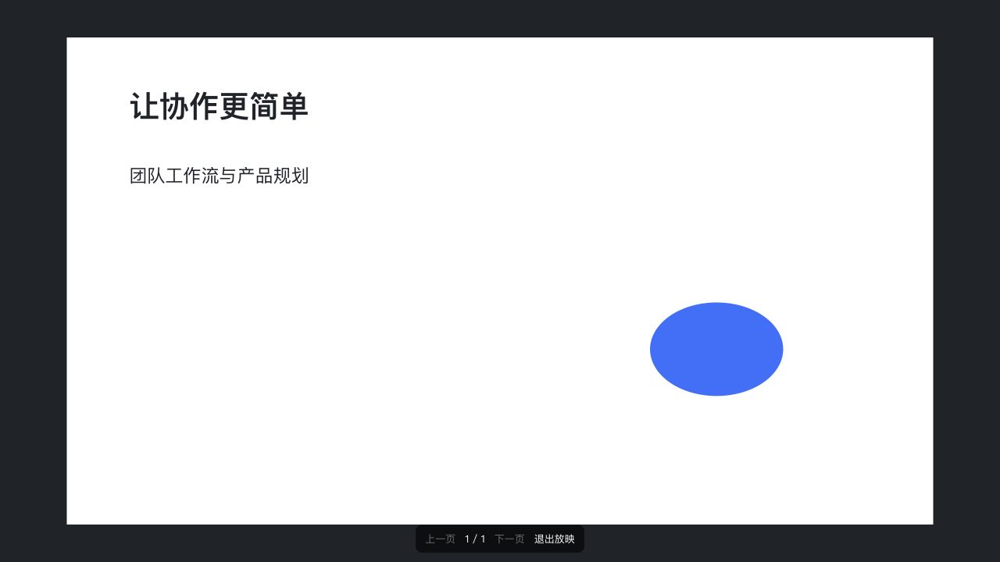

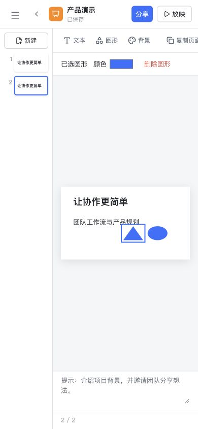

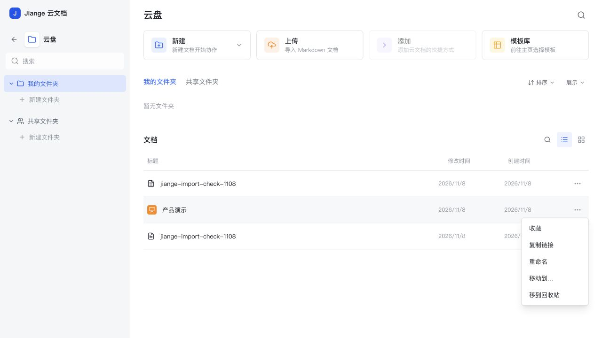

在隔离前端、Go 服务和 PostgreSQL 中验证了插入圆形和三角形、用方向键移动并刷新、复制页面保留图形、放映画面显示图形、云盘复制内部链接。移动端截图为模拟视口；触屏拖动、颜色选择器和真实设备尚未验收。该轮的图形支持矩形、圆形和三角形，可拖动、键盘移动、改色和删除。放映支持按钮和方向键翻页。云盘复制的是受现有权限约束的内部地址，不会开启公开分享。

服务端需要运行迁移 0040。图形随页面内容的版本一起保存，旧客户端不传图形数据时会保留它们；图片、动画、复杂版式和多人实时协作仍未实现，界面尚非飞书逐像素复刻。

## 2026-11-08：图形格式与文件夹模板库

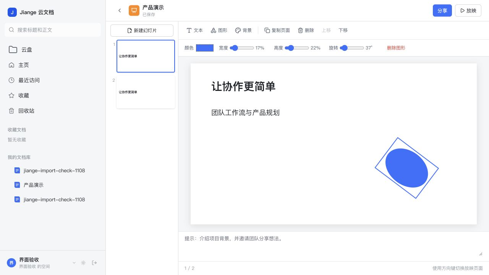

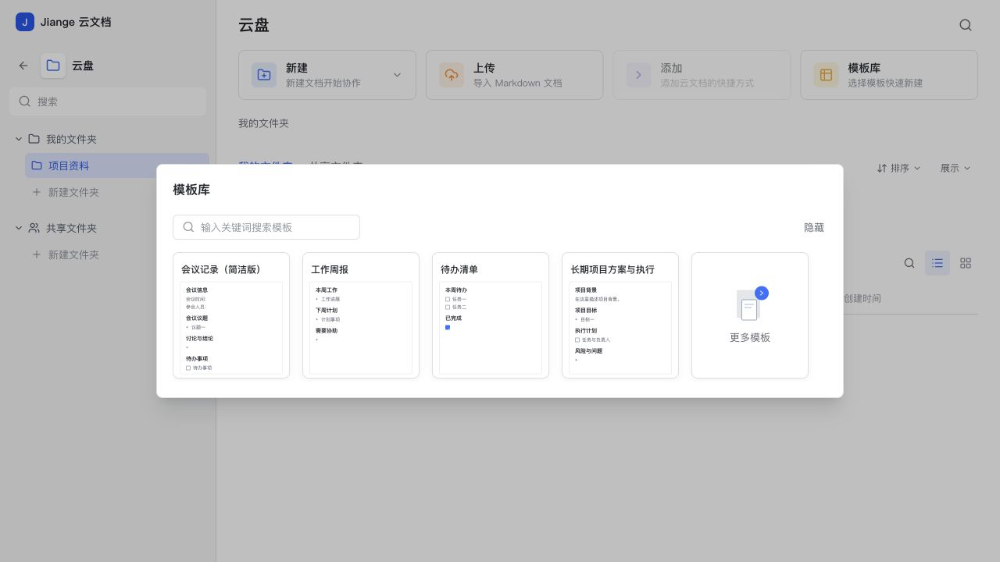

在隔离前端、Go 服务和 PostgreSQL 中，验证旧图形默认尺寸兼容、连续修改宽高与角度、刷新后保留，以及在文件夹内选择会议记录模板，确认导入后刷新仍有正文。图形旋转后的可见边缘目前可能超出画布；尺寸和角度通过滑块操作，尚无画布上的缩放手柄。云盘模板内容需在新文档中再次确认导入，原文会暂存在当前标签页。移动端与触屏本轮未单独复测。

## 2026-11-08：文档协同协议首连

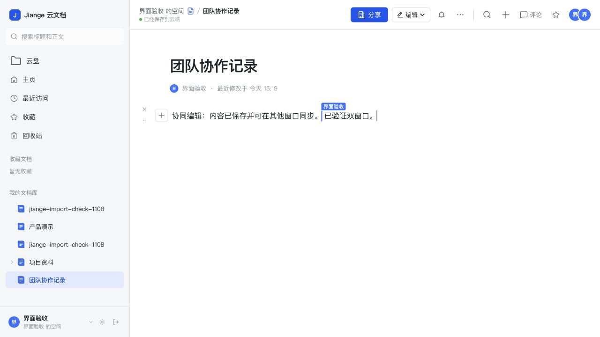

截图来自隔离本地前端、Go 服务和 PostgreSQL，两个标签页使用同一测试账号；一个页面输入后，另一个页面显示了相同修改。另用真实 TypeScript 协同客户端和 Go 服务验证 v2 首连、写入确认及 epoch 变化后断线重连；服务端 WebSocket 测试覆盖旧协议和含表格文档的新版首连。该截图不构成不同账号、移动端、断网冲突或在线数据库回滚的完整验收。

## 2026-11-08：文档附件复制

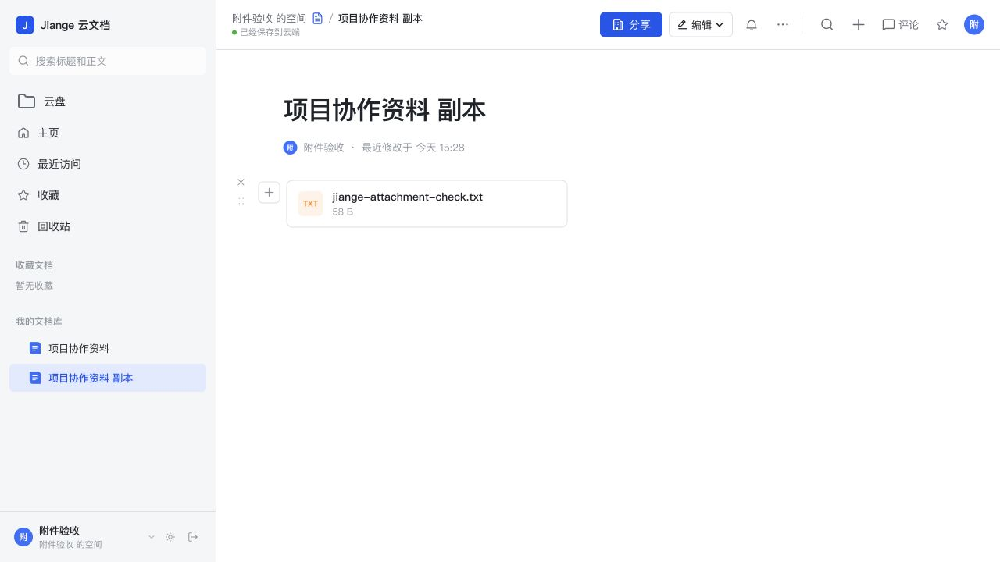

截图来自隔离前端、Go 服务、PostgreSQL 和内存对象存储：通过界面上传合成测试附件并创建文档副本。并发安全另由 PostgreSQL 集成测试验证：复制事务停在提交前时，源附件删除等待，提交后副本附件仍可通过 HTTP 读取；删除先完成时复制失败。旧实现运行同一并发测试会失败。该截图本身不证明并发行为，也不覆盖 S3、跨实例混版或移动端。

## 2026-11-08：云盘普通文件

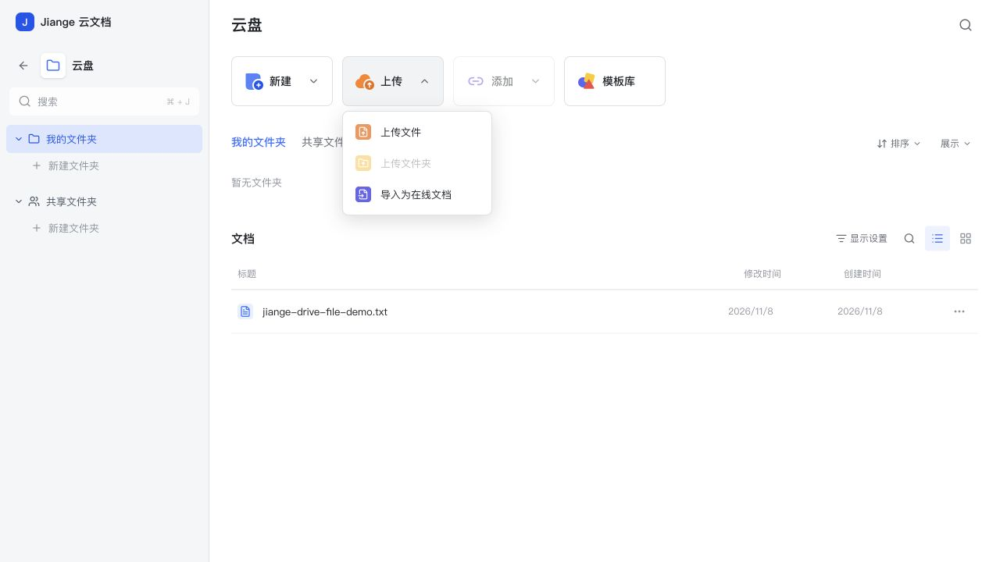

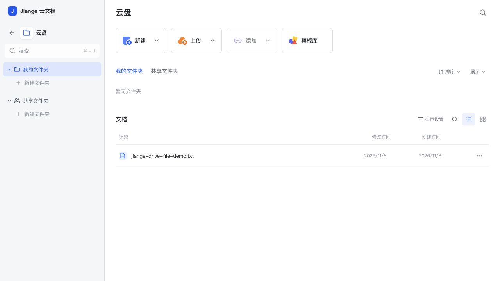

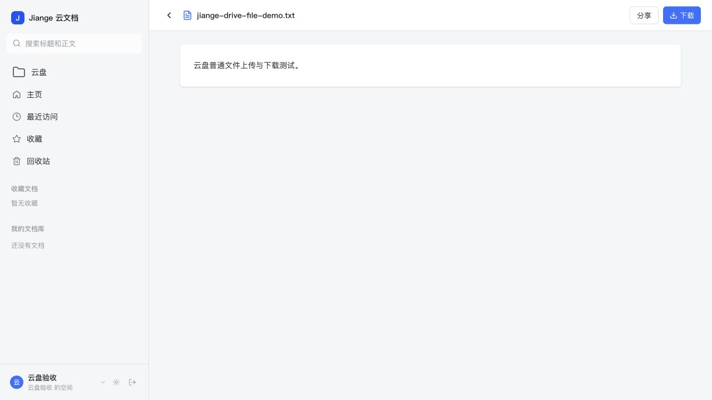

使用独立端口的前端、Go 服务、隔离 PostgreSQL 和内存对象存储，验证上传合成文本文件、在线预览与浏览器下载，下载文件与原文件字节一致；移动端为浏览器模拟视口。顶部操作卡片、图标、上传菜单和列表显示设置参考了实际飞书页面，尚未逐像素验收。内存和 PostgreSQL 接口测试覆盖目录列表、搜索、分享和撤权、重命名、移动、回收、恢复与永久删除。截图不证明 S3、跨浏览器或真机体验。

当时仅支持单文件上传；图片和 1 MB 以内纯文本可预览，其他类型可下载。数据库迁移 0041 引入独立文件节点，上线应先排空旧服务并刷新旧客户端；上传过程中数据库结果不明确时保留对象以避免误删，尚需后台清理无引用对象。

## 2026-11-08：批量及文件夹上传

在隔离前端、Go 服务、PostgreSQL 与内存对象存储中，通过浏览器选择含两层目录的合成文件夹，确认两个文件上传、目录层级及子文件正文；另验证同目录多文件上传。移动端截图为 390×844 浏览器模拟视口。上传前校验路径与大小，完成后不会覆盖同名条目；网络结果不明或停止时不自动重试。测试覆盖了账号绑定请求的拒绝、路径校验、部分失败与取消，未在真实浏览器中模拟账号切换或弱网。

当时每批最多 1000 个文件及 1000 个目录、单文件最多 20 MB；兼容目录选择器不提供空文件夹。上传进度仅保留在当前登录会话，刷新页面不会续传；尚无断点续传、文件夹合并/覆盖和真实设备验收。批量接口需要新版服务端；旧服务端不支持时会拒绝而不是静默降级。

## 2026-11-08：空文件夹上传

支持原生目录读取的安全环境可枚举空目录；不支持时可使用兼容入口，后者无法读取空目录。选择后的目录会先完整扫描和校验，再开始云端写入；扫描期间可停止。单元测试覆盖空根目录、嵌套空目录、读取失败和扫描取消；使用合成目录句柄连接真实 Go 服务和隔离 PostgreSQL，验证了空根目录、空子目录和文件层级。浏览器兼容入口已实际选择文件夹并验证非空内容；该验收浏览器未完成系统原生选择器选择，因此尚未证明真实系统选择器的端到端体验。移动端为模拟视口，尚未真机验收。

当时上传菜单多出“兼容上传文件夹”入口，上传进度面板也尚未逐项比照真实飞书；这些截图只能证明当时实现的布局和合成数据结果，不能作为与飞书一比一一致的证明。目录选择结果若在用户重新打开上传菜单或切换目录后才返回，将被忽略，避免意外启动旧上传。

## 2026-11-08：云盘上传菜单对照

参照已登录飞书云盘，上传菜单保留“上传文件”“上传文件夹”“导入为在线文档”三项；目录选择器无法使用或一直没有返回时，从同一文件夹入口进入兼容选择，并提示兼容模式不会上传空文件夹。验证浏览器中实际选择测试目录后，两个文件和非空目录上传完成；原生选择器仍未完成真实系统选择的端到端验证。已在桌面端验证 Escape 关闭菜单，390×844 模拟视口验证弹层不超出屏幕。截图使用隔离数据库和合成文件；图标、进度面板以及云盘其他功能仍需继续与飞书逐项对照，不能据此认定整体一比一一致。

## 2026-11-08：云盘布局、排序与展示规则

对照已登录飞书云盘，桌面操作卡片改为四列和说明文字；文件夹排序提供创建时间、修改时间、名称及方向。展示菜单提供全部／个人文件夹；在隔离 PostgreSQL 和真实服务中创建测试共享目录，验证全部模式显示该目录、个人模式隐藏、再次切换后恢复，文档列表／网格切换保持独立。移动端是 390×844 模拟视口。截图来自隔离服务和合成数据，不证明逐像素一致。

当前“属于我的共享文件夹”按节点创建者判断，仅覆盖共享空间的顶层目录，不支持所有权转移后的归属；展示规则在共享空间和子目录暂不可用。排序与展示偏好目前仅在当前页面会话中保留，刷新不会持久化；名称方向文字及完整键盘交互尚未逐项对照飞书。添加快捷方式、真实设备和其他浏览器仍需验收。

## 2026-11-08：云盘文档表头与显示设置

参照飞书云盘表头，文档列表可按标题、修改时间、创建时间分别选择排序方向，排序与文件夹顺序独立；显示设置可控制两个时间列。文档默认图标改为蓝色图标，并保留自定义文档图标。隔离前端、Go 服务和 PostgreSQL 中创建两份合成文档，验证标题升降序以及创建时间的隐藏和恢复；时间排序与日期格式另有单元测试。移动端为 390×844 模拟视口，启用的时间显示在标题下方。

当时所有者、修改者的名称数据和列展示尚未实现，设置面板中的这两项不可操作；列顺序拖动也尚未实现，跨设备设置同步和真机验收仍未完成。截图中的菜单和图标是本项目实现，不代表云盘整体已与飞书逐像素一致。

## 2026-11-08：文档列顺序与本机保存

“修改时间”和“创建时间”可在显示设置中拖动手柄排序；也可使用上下方向键或点击手柄调整，列表表头、行内容和窄屏时间信息随之变化。列可见性和顺序按账号保存在当前浏览器，存储不可用时提示刷新会恢复默认。隔离浏览器中验证了鼠标拖动、键盘调整、移动视口点击、隐藏列后刷新以及顺序和可见性保留；单元测试覆盖账号隔离、损坏数据和存储失败。移动端为模拟视口，未在真实触屏设备验收。

当时仅支持两个时间列排序，所有者、修改者仍不可用；设置不跨浏览器或设备同步。截图来自隔离服务与合成数据，未证明整体界面一比一一致。

## 2026-11-08：云盘所有者列

云盘目录接口为有权访问的条目返回创建者名称；显示设置可显示、隐藏和调整“所有者”列，旧版时间列设置会迁移并保留原有顺序和可见性。隔离浏览器中验证了所有者显示、键盘调整及刷新保留；内存和隔离 PostgreSQL 测试覆盖创建文件夹、文档、文件、重命名，以及查看他人创建的共享文件夹。截图使用合成账号和数据，移动端为模拟视口。

当前所有者按节点创建者确定，本项目还没有独立所有权转移模型。接口未返回名称时显示“—”，部署需同时更新前后端。当时“修改者”列尚不可用；与飞书的完整功能和逐像素界面仍有差距。

## 2026-11-08：文档协同修改者

文档协同操作和历史恢复会在内容提交的同一事务内记录经认证的操作者；云盘列表可显示、隐藏和调整“修改者”列。未记录、旧数据或无法确认的写入显示“—”，不会猜测为创建者。数据库修订号使未覆盖的节点写入失效旧记录，操作日志插入也会清除旧记录，旧版列设置会迁移。隔离前端、Go 服务与 PostgreSQL 中通过实际协同连接编辑合成文档，验证列表显示操作者和未记录文档显示“—”；内存及 PostgreSQL 测试覆盖重复重试、过期版本、历史恢复、无归属写入、重命名、时间戳未变化时的修订号失效，以及旧写入直接追加操作而不更新节点的情况。两个测试用户通过 WebSocket 依次编辑的服务端测试也验证了修改者切换，该测试使用测试身份头，不代表真实双账号浏览器验收。移动端为 390×844 模拟视口。

部署前须应用迁移 0042；当时旧服务及封面、图标、重命名等未覆盖写入会使修改者变为未知。多维表格、幻灯片和普通文件的修改者仍未实现，历史数据不会回填；跨设备设置同步和真机验收仍未完成。截图不是整体逐像素对齐证明。

## 2026-11-08：文档元数据修改者

云文档的标题、图标、封面以及现有文档移动接口现在也记录操作者；仅变更权限不会覆盖修改者。内存与隔离 PostgreSQL 测试覆盖不同用户、版本冲突、权限撤销和会话在写入中失效，验证失败操作不会改变归属；另通过登录后的 HTTP 标题更新测试确认使用请求账号。隔离浏览器中为合成文档添加图标后，云盘列表显示该测试账号；移动端为 390×844 模拟视口。

当时普通标题和移动接口沿用写入前权限检查，检查与持久化间仍有竞态；未覆盖的写入继续显示未知。多维表格、幻灯片、普通文件和历史数据的修改者仍未补齐，真机及整体 UI 对齐仍需验证。

## 2026-11-08：文档标题与移动的事务保护

普通文档元数据接口在同一事务内复核会话、当前权限及移动目标；标题和移动一起提交，失败时不留下部分修改。若提交后权限或会话失效，接口返回无正文成功响应，前端重新获取数据。内存测试覆盖提交前、提交后的撤权与会话失效；隔离 PostgreSQL 测试实际观察到权限、会话及目标目录授权撤销时的锁等待，并验证写入被拒绝，另验证协同写入与元数据更新的加锁顺序。浏览器中编辑合成文档标题、刷新并返回云盘，确认标题和修改者显示；移动端为模拟视口。

旧服务仍走旧写入路径，升级时需先排空旧服务；涉及云盘文件夹的移动继续使用带版本号的云盘接口。该测试不证明协同连接的权限检查与操作持久化之间不存在竞态，也不代表整体 UI 已一比一对齐。

## 2026-11-08：协同写入权限复核

协同写入在操作日志事务内复核连接的原始会话、当前编辑权限、继承授权和文档状态；拒绝的写入不会重置其他协作者的房间。测试在 WebSocket 帧通过初次检查后撤销权限或会话，验证操作未提交、其他用户仍可编辑；隔离 PostgreSQL 测试覆盖会话、直接授权、祖先授权和成员资格的并发撤销及重复操作重试。多实例压力回归重复五次，出现的一次重试耗尽问题已加入有界错峰重试后复测通过。

浏览器在隔离服务中编辑合成文档并刷新，正文保留。窄屏验收发现窗口宽度改变后长标题可能被裁切，现会随可用宽度重新计算高度；图为 390×844 模拟视口。截图不能证明撤权竞态，权限结论来自上述测试；真实手机未验收。

升级时需应用迁移 0042 并排空旧服务。输出帧从权限检查到网络发送仍有竞态；数据库回滚后的活跃房间和历史代际隔离未完成，不应将本轮写入保护视为协同协议整体验收。

## 2026-11-08：Jiange 品牌标识

标志依据项目概念图重新绘制为 SVG，并分别提供图形、字标和组合版，以及浅色／深色背景版本和透明 PNG。登录页、文档与云盘侧栏、公开文档、公开表单及浏览器图标使用新标识；截图来自隔离服务和合成数据，移动端为 390×844 浏览器模拟视口。公开文档检查的是无效链接状态的页头；公开表单使用隔离环境的测试表单。尚未进行真实手机或全部浏览器验收。

补充：浏览器提供 PNG 图标回退，添加到手机主屏幕时使用 180×180 白底图标。图形、文字和组合标志均可从 `apps/web/public/brand/` 单独获取。

## 2026-11-08：幻灯片画布与缩略图

新建幻灯片文件在同一事务中创建首张空白页；旧的空文件不自动补页。编辑器去掉全局侧栏，支持缩放、适合屏幕和收起缩略图栏，缩略图展示当前标题、正文和图形。125% 截图中画布大于视口，可滚动查看。隔离 Go/PostgreSQL 服务中验证了新建、缩放、图形拖动与刷新后保存、演示及缩略图；移动端截图为 390×844 模拟视口，不代表真机验收。

当前仍缺图片、图表、动画、自由文本框和实时协作等能力，界面与操作尚未完全对齐飞书。离开页面时未保存草稿的保护也仍需完善。

## 2026-11-08：幻灯片图形直接缩放

选中图形后可拖动四角和四边控制点调整尺寸，控制点支持键盘方向键；尺寸受画布边界和最小尺寸约束，旋转时沿图形自身方向缩放。隔离 Go/PostgreSQL 环境中验证了桌面拖拽、方向键、刷新后尺寸保留，以及 390×844 模拟视口中的鼠标拖拽；旋转和边界计算有单元测试，未做真机触摸验收。截图使用合成测试数据，不能据此认定整体界面或全部功能已对齐。

## 2026-11-08：幻灯片内容撤销与重做

标题、正文、备注、背景和图形编辑支持当前页的撤销、重做；连续输入按时间合并，快捷键和工具栏均可使用。保存进行中撤销会等待前一写入完成再按新修订保存；结果未知或发生冲突时保留本地内容，不自动重放。单元测试覆盖上述保存边界；隔离 Go/PostgreSQL 环境中验证了标题快捷键撤销、图形插入的撤销重做和刷新后的最终内容，移动端为 390×844 模拟视口中的按钮操作。

历史仅保留在当前编辑会话中，刷新后清空；页面创建、删除和重排不在撤销范围内。未进行真机及多用户实时编辑验收，整体界面和功能仍未完全对齐飞书。

## 2026-11-08：幻灯片独立文本框

点击“文本”可插入独立文本框，支持文字、颜色、字号、加粗、对齐、移动、缩放、旋转和当前页撤销重做；缩略图及演示模式显示同一内容。隔离 Go/PostgreSQL 环境中验证了新增、多行输入、加粗、居中、拖动、刷新后保存、撤销焦点及演示；390×844 移动端仅验证模拟视口显示，未做真机触摸验收。

文本框目前是整框统一格式，尚无选中文字单独格式、字体、列表和超出框时自动扩展等能力；整体界面和功能仍未完全对齐。旧版客户端会把新文本框误显示为其他图形，旧版服务也不能保存新对象；使用该功能前须升级所有服务实例并刷新全部旧客户端，避免混合版本编辑。

## 2026-11-08：幻灯片图片

支持从本地上传 PNG、JPEG、GIF、WebP、BMP 图片（单张不超过 20 MB），并在画布中移动、缩放、旋转及撤销重做。缩略图、同一文稿内的复制页面和放映使用同一图片引用；编辑时保持原图比例显示。隔离 Go/PostgreSQL 环境验证了上传、复制页面、刷新后加载和放映；移动端为 390×844 模拟视口。图片测试使用项目 Logo 和合成文稿，浏览器中的对象存储为测试用内存存储，未验证生产 S3 或真机。

上传绑定账号，在写入附件元数据时复核会话和权限；页面保存会在事务中检查图片属于该文稿。内存和隔离 PostgreSQL 测试验证跨文稿引用被拒、附件不可单独删除及会话失效；API 测试覆盖限制下载时的引用检查和撤权。上传失败或页面切换可能留下未引用对象，暂保留到文稿永久删除或后续清理；图片裁剪、网络图片、跨文稿复制和整份幻灯片复制尚未实现。旧版服务和客户端不理解图片对象，须升级全部服务并刷新旧客户端；文件检查与网络发送之间仍有权限变化窗口。

## 2026-11-09：幻灯片对象层级与对齐

选中画布对象后，格式栏新增“对象层级”（置于顶层、上移一层、下移一层、置于底层）和“对象对齐到页面”（左、水平居中、右、顶、垂直居中、底）两组图标按钮；文本框、图形和图片均可使用，移动端格式栏横向滚动展示。层级按对象数组顺序渲染，调整即时反映在画布与缩略图中，并纳入当前页撤销重做（⌘/Ctrl+Z、⌘/Ctrl+Shift+Z）。

使用本地 Go 服务与隔离 PostgreSQL 验证：插入矩形与圆形后“置于底层”“置于顶层”改变遮挡关系并通过页面 API 确认数组顺序；左对齐、水平居中、垂直居中按页面百分比落位；⌘Z 撤销置顶、⌘⇧Z 重做、刷新页面后层级与位置均保持。桌面为 1440×900 视口截图，移动端为 390×844 模拟视口，未做真机触摸验收。

对齐以对象未旋转的包围盒计算，旋转后的对象对齐结果可能与飞书视觉包围盒不同；尚不支持多选对齐、对齐参考线、跨对象分布和拖拽时的智能参考线。截图中的橙色矩形与蓝色椭圆为合成测试数据。

## 2026-11-09：幻灯片整份复制

幻灯片编辑器头部新增「创建副本」按钮（分享左侧）：点击后在服务端同一事务中创建新演示文稿，复制全部页面、标题、正文、背景、备注、图形层级与顺序，图片引用重映射为新文稿自己的附件（共享不可变对象，不复制字节），随后跳转到副本继续编辑。标题为空时默认「源标题 副本」。存在未保存草稿时按钮禁用并提示等待保存；复制保护打开时阅读者请求被服务端拒绝。

使用本地 Go 服务与隔离 PostgreSQL 验证：复制含两个图形（不同层级与对齐位置）的文稿后，服务端页面数据逐字段一致；修改副本标题不影响源文稿；API 测试覆盖附图文稿复制的引用重映射、副本内继续编辑自己的图片、引用源图片被拒绝，以及复制保护与跨空间权限。桌面为 1440×900 视口截图，移动端为 390×844 模拟视口，未做真机验收。截图中内容为合成测试数据。
