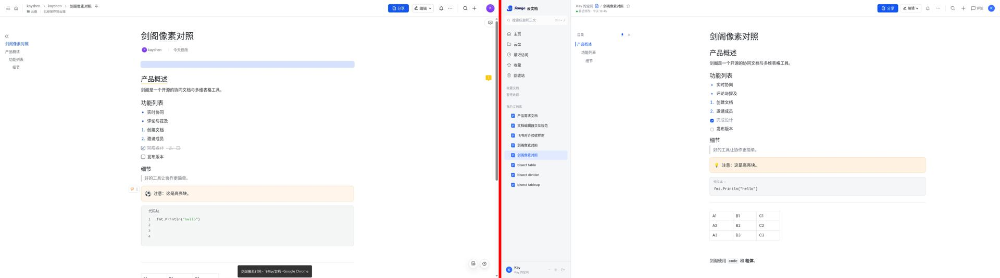
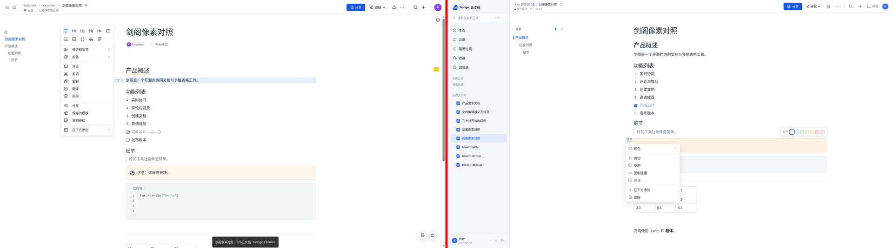

# 飞书文档像素对照（2026-11-09）

参照：用户登录的真实飞书文档「剑阁像素对照」截图（`/workspace/feishu-ref/*.webp`，1920×1200 屏幕，DPR 1，Chrome 100%）。按 Chrome 顶栏 87px / 任务栏 42px 裁切为 1920×1071 视口。Jiange 用 Playwright 在同尺寸视口截取同内容文档（演示库 doc 10「剑阁像素对照」）。数值为 CSS px，取自字形墨迹带（`bands.py`）与逐像素取色。WebP 有损压缩，1px 线条颜色误差约 ±10。

| 项目 | 飞书实测 | Jiange 修正前 | Jiange 修正后 |
|---|---|---|---|
| 文档顶栏高度 | 64（底边 #E0E0E0） | 56（#DEE0E3） | **64** |
| 标题字形高 / 顶部 y | 32 / 122 | 32 / 116，粗体 | 30 / 125，**中等字重** |
| H1 / H2 / H3 字形高 | 26 / 22 / 20，常规观感 | 26 / 22 / 20，semibold | 同尺寸，**font-medium** |
| 正文字形 / 列表行距 | 16 / 34 | 16 / 32 | 16 / **34** |
| H1→正文、正文→H2、H2→列表 | 47 / 47 / 39 | 45 / 45 / 37 | 45 / 45 / 38 |
| 引用→高亮块框顶 | 38 | 32 | **37** |
| 高亮块高度 / 背景 | 60 / ≈#FFF5EB | 54 / #FEF1E1 | **60** / #FEF1E1（色板保留，偏差在压缩误差附近） |
| 高亮块→代码块 | 16 | 11 | **17** |
| 代码块 背景 / 边框 | #F5F6F7 / ≈#DEDEDE 1px | #F5F6F7 / 无 | #F5F6F7 / **#DEE0E3 1px** |
| 分割线颜色 | ≈#DDDDDD | #DEE0E3 | #DEE0E3；上下留白 12→20 |
| 正文列（高亮块外框）宽 | 830 | 832 | 832 |
| 正文左缘 x | 544（无应用侧栏，目录在最左） | 803（应用侧栏 268） | 未改（见下） |
| 块菜单 宽 / 行高 | ≈230 / 32 | 234 / 32 | 234 / 32 |
| 块菜单 图标内缩 / 文字起点 | 16 / ≈52 | 12 / 36 | **16 / 48** |

差异分数（灰度平均绝对差，0 为相同；正文列对齐裁切 830×900）：a-top **9.82 → 8.62**。整帧（含布局差异）：a 7.9、b 6.49、c 7.69、d 8.24、e 7.4、f 7.22、g 7.34、h 8.07（修正后）。并排图与差异图：`/workspace/shots/pixel-<label>-{side,diff}.png`。

## 第二轮（2026-11-11）

按上轮「仍未对齐」逐项修正（参照截图仅剩仓库内并排图，未重新计算差异分数）：

- 布局：文档页不再常驻应用侧栏，目录贴视口左侧；左上角按钮以浮层打开应用导航（`App.tsx` 的 `docLayout`）。
- 标题下作者行：头像（16px）+ 创建者 | 「今天修改 / 昨天修改 / M月D日修改」，悬停显示精确时间（`DocAuthorLine`、`formatEditDay`）。
- 代码块：左侧行号栏（`CodeLineNumbers`），按逻辑行编号；自动换行时逐行测量首个视觉行位置对齐，无布局环境回退为逐行堆叠。行号栏不在 `data-text` 内，不影响光标与选区映射。
- 按 2026-11-11 用户登录飞书的新截图（PNG，`1024×571` 缩放图与 `769×810` 原尺寸图）复测：
  | 项目 | 飞书 | 修正前 | 修正后 |
  |---|---|---|---|
  | 正文左缘 | 544–549（按视口居中） | 668（目录占位后居中） | 内容区在 ≥1456px 时右侧留出目录宽度，左缘 544 |
  | 目录 | 首行文档标题，行距 30，缩进 15，文字 x≈20 | 无标题行，行距 32，缩进 16，x 24 | 同飞书 |
  | 作者行头像 | 20 | 16 | 20 |
  | 作者行→首块、H1→正文、正文→H2、H2→列表、任务→H3 | +9 / 46 / 47 / 40 / 45 | 基准 / 44 / 46 / 37 / 43 | 按差值逐项补齐 |
  | 代码块 背景 / 描边 | #F3F5F6 / #D9DBDF | #F5F6F7 / #DEE0E3 | 同飞书 |
  | 代码块 标签与行号内缩 / 正文内缩 / 行距 / 底部留白 | 29 / 61 / 22 / ≈27 | 16 / 34 / 22.4 / 12 | 29 / 61 / 22 / 26 |
  | 表格 单元格 / 描边 | 100×40，#D9DBDF，左内边距 8 | 90×37，#DEE0E3，10 | 同飞书 |

## 第三轮：斜杠菜单与块菜单（2026-11-11）

参照用户登录飞书的原尺寸截图（769×810 视口，CSS px 1:1）逐项取值：

| 项目 | 飞书 | 修正前 | 修正后 |
|---|---|---|---|
| 斜杠菜单形态 | 纯列表，分组「基础」：文本、一至四级标题、有序列表、无序列表、代码块… | 基础/列表为 5 列图标网格 + 其余列表 | 纯列表，同序（其后为待办、引用、五六级标题、媒体、其他） |
| 斜杠菜单 宽 / 描边 / 内边距 | 232 / #D9DBDF / 8 | 272 / 默认边框 / 4 | 232 / #D9DBDF / 8 |
| 分组标题高、行高、选中色 | 40（含上边距）/ 32 / #EDEDEE | 28 / 36 / bg-hover | 40 / 32 / #EDEDEE |
| 图标 / 文字起点（相对菜单左缘） | 17 / 53，图标蓝色（代码块绿色） | 15 / 45，灰色 | 17 / 53，蓝色（代码块绿色） |
| 块菜单 宽 / 分组分割 | 232 / 整宽 1px #D9DBDF，组内上下 4 | 236 / 内缩分割线 | 232 / 整宽分割 |
| 转换区 | 6 列 24px 图标格，列距 36.5、行距 36，当前类型 #DBE5FE 底 | 8 列 26px | 6 列 24px，加入四级标题 |
| 分组顺序 | 转换 / 缩进和对齐 ›、颜色 › / 评论、剪切、复制、删除 / 复制链接… | 颜色、缩进×2 / 剪切、复制、复制链接、评论 / 在下方添加、删除 | 同飞书；「缩进和对齐」子菜单含增减缩进与左/中/右对齐 |
| 菜单项 图标→文字 | 20 | 16 | 20 |
| 块手柄（菜单打开时） | 42×26，#ECEEEF 底、#D9DBDF 描边，类型图标蓝色，右缘距正文 21 | 24 高、bg-hover | 26 高、同色底与描边、图标蓝色，桌面端左移至正文前 62px |
| 菜单打开时块底色 | #E6ECFD | 无 | #E6ECFD |

（后续：「问问豆包」改为可自配 API Key 的 AI，翻译、分享、保存为模板已加入；工具栏与面板见第四轮。）

## 第四轮：浮动工具栏、颜色面板、「…」菜单、评论与 AI 侧栏（2026-11-11）

参照用户登录飞书的 1920×1071 截图（缩放 1024 宽查看，精度约 ±2px）：

- 浮动工具栏顺序改为飞书：AI | 文本类型（显示当前类型图标）、对齐 | 加粗、删除线、斜体、下划线、链接、行内代码、颜色 | 更多、评论；描边 #DEE0E3，激活态 #E1EAFF。
- 颜色：文字色与背景色合并为一个「A」按钮（按钮本身预览当前字体色与背景色），面板宽 227：字体颜色 8 个（首个默认）、背景颜色两排 16 个（首个无色），底部「恢复默认」同时清除两者。
- 「…」菜单：188 宽、整宽分组线、每项带图标，分组为页宽设置 / 查找、目录 / 收藏、移到顶层 / 保存为模板、创建副本、下载为 ›（Markdown、PDF）、导入 / 打印 / 字数、历史记录、检查文档名称、AI 设置 / 删除。
- 评论侧栏：宽 296，标题「评论（N）」，右上角收起图标，顶部对齐 64px 顶栏；正文右侧让出 296。
- AI 侧栏（对应「问问豆包」）：宽 358，空态居中大标题「今天有什么工作要处理？」与快捷问题，底部圆角输入卡片。
- 斜杠菜单：输入「/」后其后显示灰色「输入关键词」占位，继续输入即消失。
- 分享弹窗已是锚定分享按钮的 480 宽浮层（飞书实测 ≈478），本轮未改。

## 浏览器复核（2026-11-12）

在临时数据库 `jiange_review_20261112`（同一 PostgreSQL 服务上新建、验后删除）上启动本地服务，用 Playwright 在 1920×1071 与 390×844 截取与飞书参考同状态的画面：`docs/screenshots/review-*-20261112.jpg`（顶部、斜杠菜单、块菜单、浮动工具栏、颜色面板、评论侧栏、分享弹窗、AI 侧栏、「…」菜单、移动端顶部与斜杠菜单）。页面无运行时错误。

- 与飞书一致：正文左缘 544、作者行、目录首行标题、斜杠纯列表与「输入关键词」占位、块菜单分组与 6 列转换格、工具栏顺序与合并颜色面板、「…」菜单分组、AI 侧栏空态。
- 复核中修正：评论侧栏打开时，宽屏（≥1720px）正文不再左移（飞书正文保持原位）；移动端面包屑开头多余的「/」。
- 已知差异：分享弹窗链接行默认是「仅指定协作者」（飞书参考文档为组织内可阅读，属权限状态不同）；Markdown 导入的表格首行为标题行；头像配色随用户而异。
- 同时在该临时库上运行了全部 Go 测试（含 Postgres 用例，覆盖迁移 0047–0050）：全部通过。

## 仍未对齐

- 代码块标签：飞书未悬停时显示「代码块」，Jiange 显示语言名（纯文本）。
- 浮动工具栏水平位置：飞书工具栏左缘约在选区起点左侧 100px，Jiange 以选区居中。
- 评论侧栏：飞书无评论时不显示顶部输入框；Jiange 保留输入框。
- 尚未复算 a–h 像素差异分数（参考图为缩放图，精度有限）。
