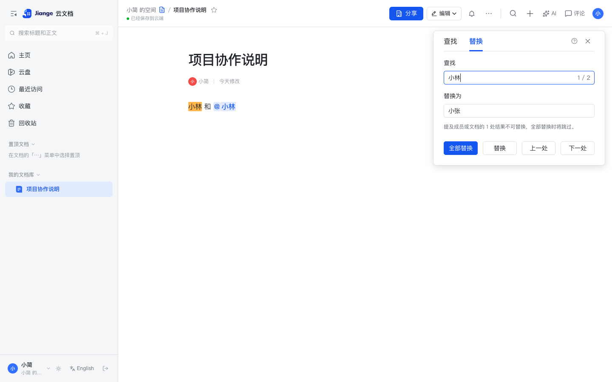
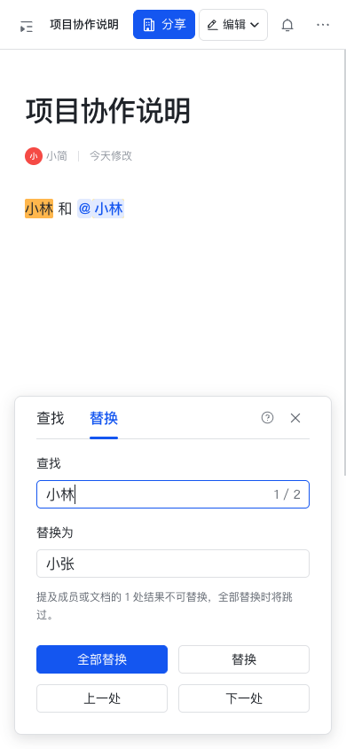
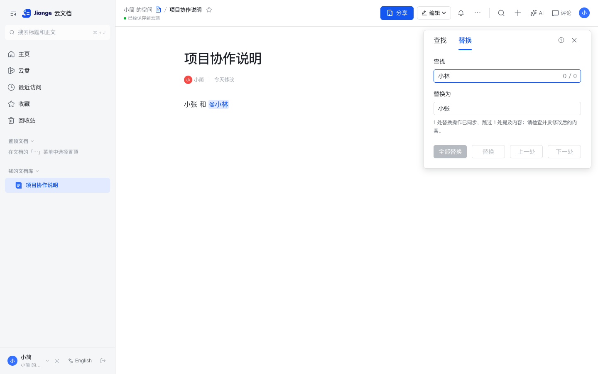

# 文档查找中的提及保护（2026-11-17）

飞书[查找和替换说明](https://www.feishu.cn/hc/en-US/articles/191994006277-find-and-replace-content-in-docs)说明：可以查找 @成员和 @文档，但不能替换提及内容。Jiange 现在仍查找并高亮提及；单项结果触及提及时禁用替换，全部替换跳过这些结果并给出数量。匹配范围即使仅部分覆盖提及，也不会破坏其身份或链接。普通文本、普通超链接和表格结果仍可替换。

替换执行时重新检查字符上的提及标记；搜索后已收到的协作格式变更不会被旧结果覆盖。含表格的混合批量操作若遇到此类失效结果会拒绝整批，普通正文批量操作会跳过失效结果并提示。该检查不能保证阻止尚未到达客户端的并发格式操作。文档提及以现有 `#/doc/` 链接标记识别；标题替换及含标题结果的全部替换仍未实现。

## 验证与截图

- 隔离 PostgreSQL 和浏览器：创建合成用户和文档，输入同名普通文本及 @成员，验证定位到提及时单项替换禁用、全部替换保留提及、提示跳过数量、撤销以及刷新后的身份标记。
- 单元测试：部分重叠、@成员、@文档、搜索后变为提及、正文和表格混合替换及撤销。
- 前端全量测试 210 个文件、1142 项通过；其后增加的混合场景测试另行运行。前端类型检查和生产构建通过，构建仍有大资源包提示。
- 服务使用当前工作区代码（包括原有未提交的服务端迁移）；仅在临时数据库测试。移动端截图为浏览器 390×844 模拟视口，不代表实体手机或飞书实页逐像素对照。

