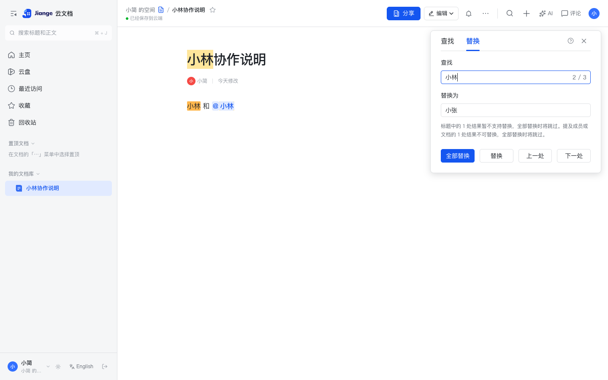
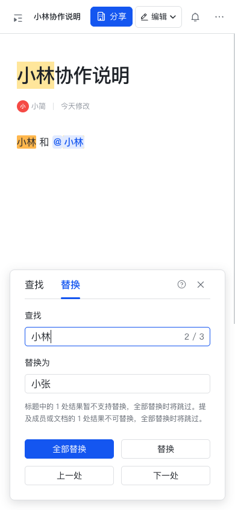
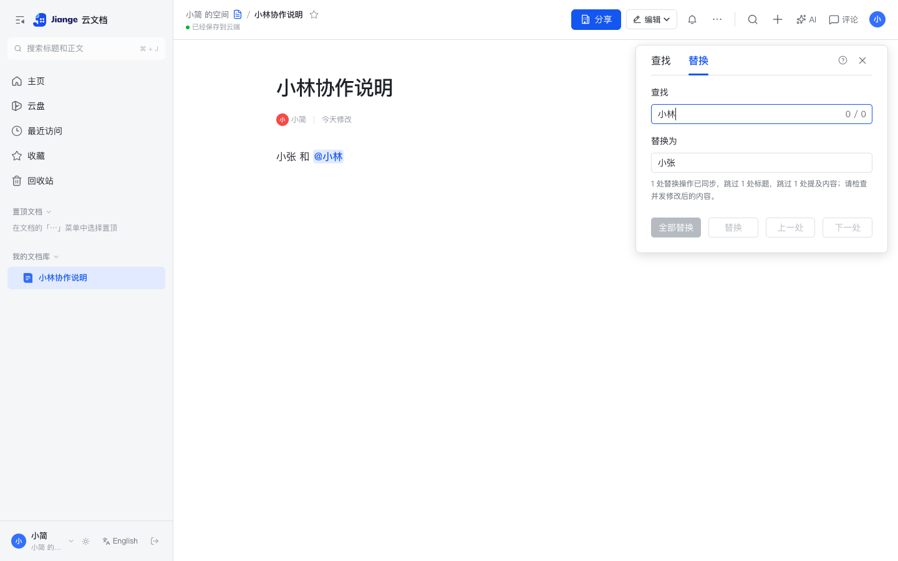

# 文档查找替换：标题匹配处理（2026-11-17）

标题命中时，之前“全部替换”会完全禁用，导致正文和表格也无法替换。现在批量替换会处理可替换的结果，并明确提示跳过的标题和 @提及数量；只有标题或提及命中时，替换按钮仍会禁用。

**标题本身仍未支持替换。** 正文标题的协作状态与云盘中的文档名称是两份数据，当前普通标题编辑通过异步请求更新目录名称。完整支持需要安全处理原子提交、撤销、并发、权限变化及旧客户端，不能简单地对正文标题直接执行替换。当前行为仍与飞书有差距。

## 验证

- 隔离 PostgreSQL 和浏览器：创建标题、正文及 @成员均含同一关键词的文档；验证标题和提及的单项替换被禁用，正文单项可替换，全部替换只改变正文，报告跳过两种结果，目录名称和提及身份保留；并验证撤销及刷新。
- 单元测试覆盖结果分组、跳过数量、混合正文和表格及撤销；前端全量 210 个测试文件、1144 项通过，生产构建通过，仍有大资源包提示。
- 截图来自 1440×900 桌面和 390×844 手机模拟视口；手机未使用实体设备，也没有进行当前飞书实页逐像素对照。隔离服务使用工作区原有未提交的服务端文件与迁移，未指向现有数据库。

