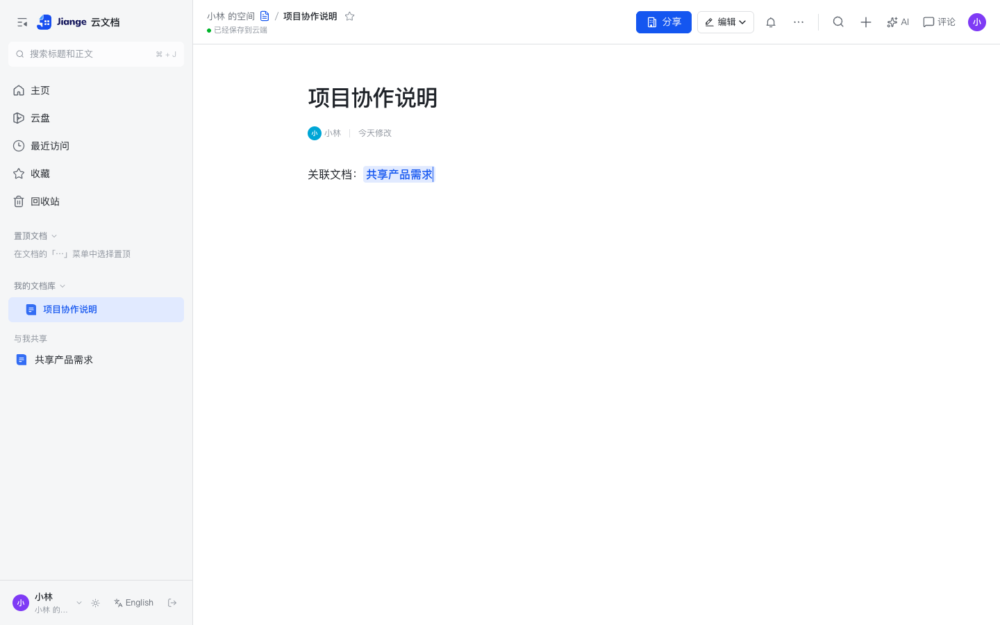
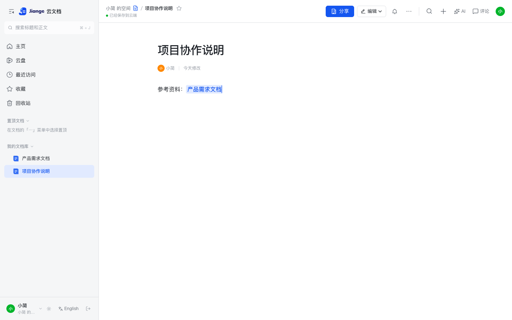

# 粘贴共享文档及块链接（2026-11-17）

后续已支持登录分享链接和公开阅读链接，见[分享链接验证](document-pasted-share-link-report-20261117.md)；以下分享 token 限制为当时状态。

粘贴当前站点的普通文档链接或带 `block` 定位的文档链接时，先立即插入原始地址，再以当前账号查询目标；确认有权阅读后展示标题和文档提及样式。块链接保留定位参数。目标可以是其他账号共享的文档，不再依赖 500 条文档列表或定时轮询。

转换前检查原文字的字符身份、格式、位置、当前账号、文档、光标及本地撤销记录。查询失败、权限不足、超时、用户继续编辑或原文被协作者修改时，保留原地址。成功转换与原粘贴合并为一次撤销；访问不会自动为其他协作者授权。

标题是在粘贴时读取的一次性值，源文档改名或撤权后已插入的标题不会自动更新；复制的分享 token、额外参数、外站地址、代码块和富文本剪贴板保持原内容。异步查询与后续转换之间仍可能发生尚未到达的并发权限或正文变化，不能视为服务端原子引用。现有文档提及样式及完整操作尚未与飞书逐像素验收。

## 验证

- 隔离 PostgreSQL、两个独立浏览器账号：共享文档和块链接的识别、块导航、一次撤销/重做；无权文档不泄露标题；延迟查询期间继续输入，以及请求前撤权，都保留原地址。
- 测试使用浏览器构造的粘贴事件，未验证系统剪贴板或实体手机；移动截图为 390×844 模拟视口。
- 前端全量 212 个测试文件、1161 项通过；单元测试覆盖链接解析、块参数、字符变动及一次撤销；服务端测试覆盖账号绑定和访问授权，干净提交快照叠加本次服务端代码后运行竞态测试。生产构建通过，仍提示部分资源包较大。
- 浏览器测试服务包含工作区原有未提交的服务端文件及迁移，数据库完全隔离。

