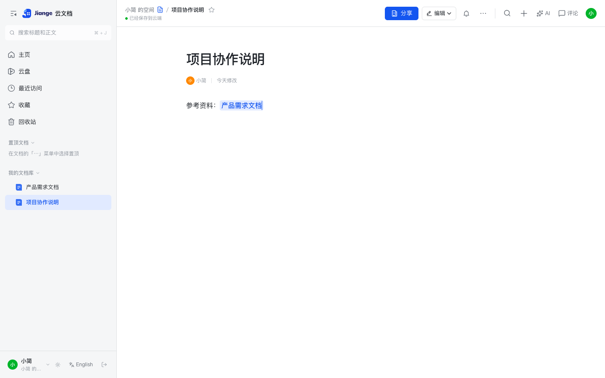

# 粘贴文档链接（2026-11-17，历史记录）

后续已改为按目标文档实时查询并支持共享文档与块链接，见[后续验证](document-pasted-link-direct-report-20261117.md)。以下描述保留当时实现和验证。

在正文或分栏粘贴当前站点中可识别的普通文档地址时，显示文档标题并沿用已有的文档提及链接样式，支持跳转、撤销和重做。飞书的[文档说明](https://www.feishu.cn/hc/zh-CN/articles/360044024994)也提供粘贴云文档链接并展示标题的能力。

名称列表使用绑定当前账号的新接口，只返回可见列表中的文档 ID 和标题，响应禁止缓存；没有可用的新服务或列表时保留原始粘贴内容。当前最多识别现有列表中的 500 条文档，名称列表按 30 秒刷新；粘贴时使用的名称可能暂时过期，粘贴后名称也不会自动随源文档改名。其他账号共享但不在列表中的文档暂不识别。带块定位参数、分享链接、外站地址、多行文本、代码块以及富文本剪贴板不转换，保持原内容；不会自动授予协作者源文档访问权。这些限制与飞书完整体验仍有差距。

## 验证

- 在隔离 PostgreSQL 中创建两个合成文档，浏览器通过构造的粘贴事件验证正文插入标题、文档链接、撤销、重做和刷新保留；非实体剪贴板测试。
- 单元测试覆盖 URL 域名、路径、参数、未知文档、富文本优先、Unicode、未命名文档及撤销重做；接口测试验证账号不匹配和私有文档不可见。干净提交快照叠加本次服务端文件的账号接口竞态测试通过。
- 前端 212 个测试文件、1159 项通过；生产构建通过，仍有大资源包提示。浏览器测试服务包含工作区原有未提交的服务端文件和迁移，只指向隔离数据库。
- 手机截图为 390×844 模拟视口，未在实体设备或当前飞书实页逐像素验证。

