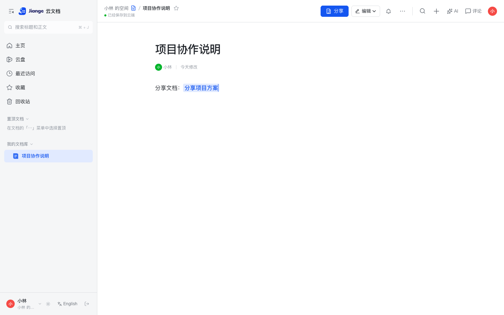
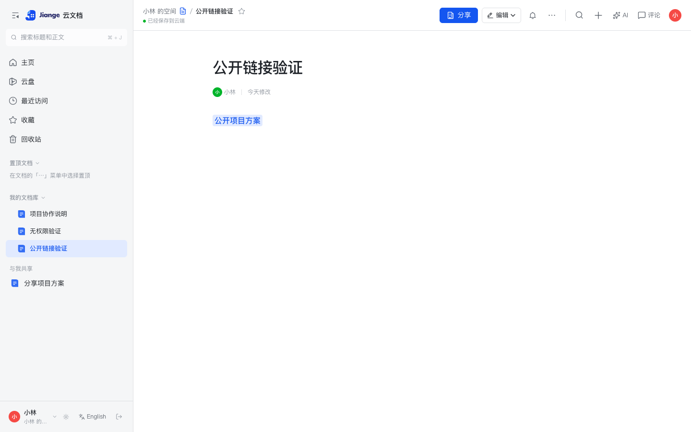

# 粘贴分享链接（2026-11-17）

本项目的登录分享链接和公开阅读链接现在可粘贴为标题引用，并保留原分享 token 与对应的访问路径。识别时按当前账号和链接范围检查资格，只读取标题；不会创建链接加入记录。点击登录分享链接时，仍由正常的链接加入流程判断并授予相应权限；公开链接仍进入公开阅读页面。链接关闭、范围不符或无法确认时保留原地址。

空间成员范围在服务端事务中检查并锁定成员资格，与成员移除串行；粘贴识别不会绕过该范围。标题是粘贴时的快照，源文档改名或权限变化不会自动刷新引用；查询结果返回后仍可能有在途权限变化。分享 token 保存在引用链接中，能读取当前文档的人可以取得它，目标文档仍按该 token 的分享范围判断访问。与飞书的完整双向链接、自动授权及逐像素界面仍有差距。

## 验证

- 隔离 PostgreSQL、两个独立浏览器账号：登录分享链接的标题展示、粘贴不加入、一次撤销/重做、点击后加入；空间外账号不能识别空间成员链接；公开链接保持公开路径并可打开。另核对公开文档投影保留引用链接。
- 内存和隔离 PostgreSQL 竞态测试覆盖账号绑定、范围切换、关闭链接和成员移除；与成员删除竞争时，识别和加入均不会授予已移除成员访问。
- 前端 212 个测试文件、1167 项通过，覆盖普通和公开分享链接、只读渲染及查找替换中的提及保护；生产构建通过，仍提示部分资源包较大。浏览器使用合成粘贴事件；手机截图为 390×844 模拟视口，未验证实体剪贴板或手机。
- 测试服务包含工作区原有未提交的服务端文件及迁移，仅连接隔离数据库；另以干净 Git 快照叠加本次服务端改动运行竞态测试。

