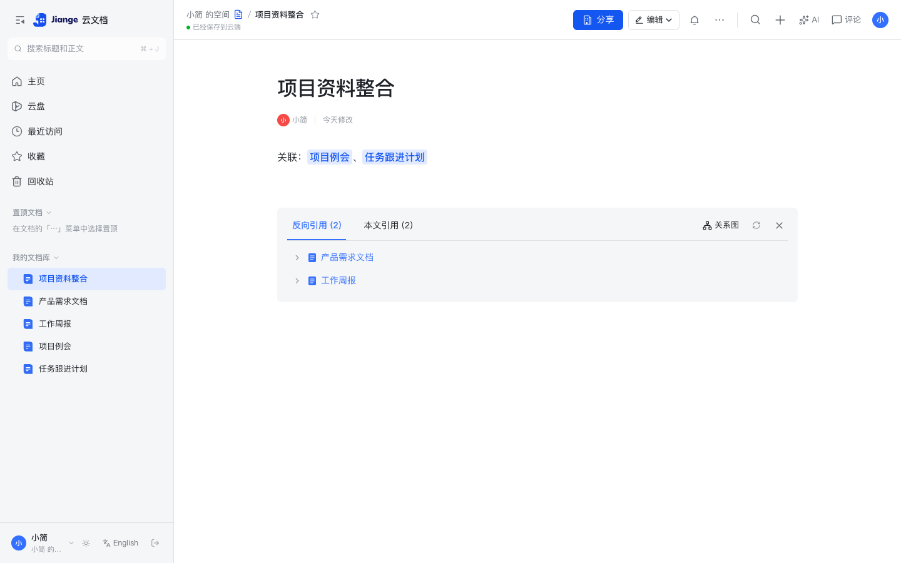
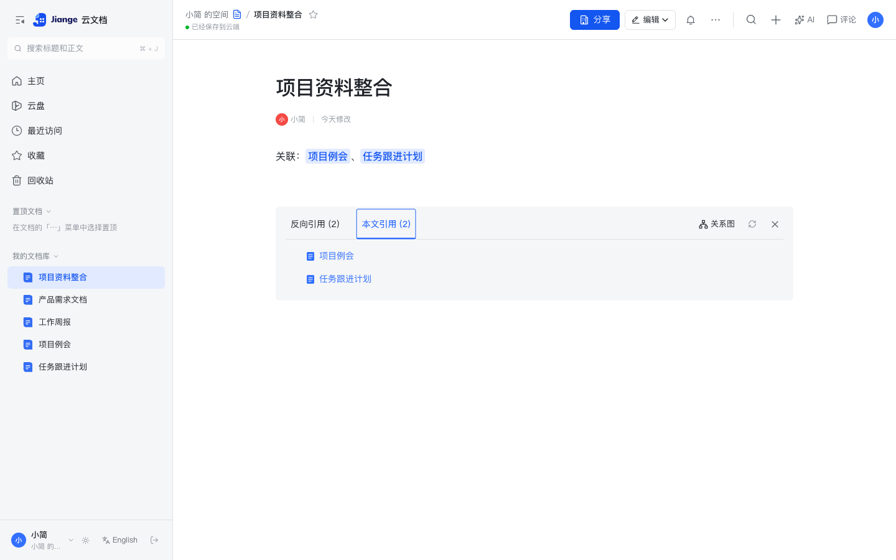
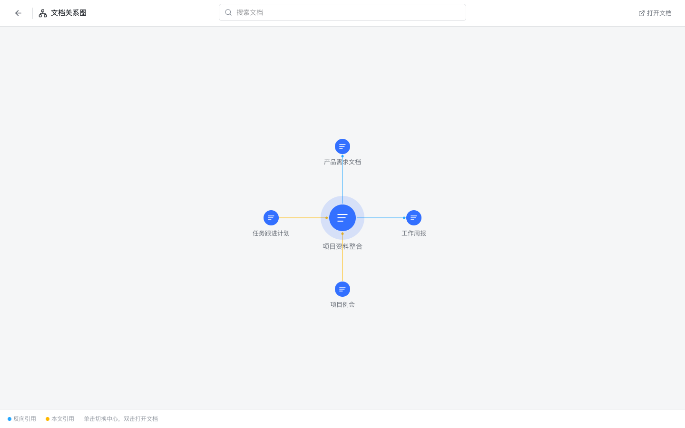
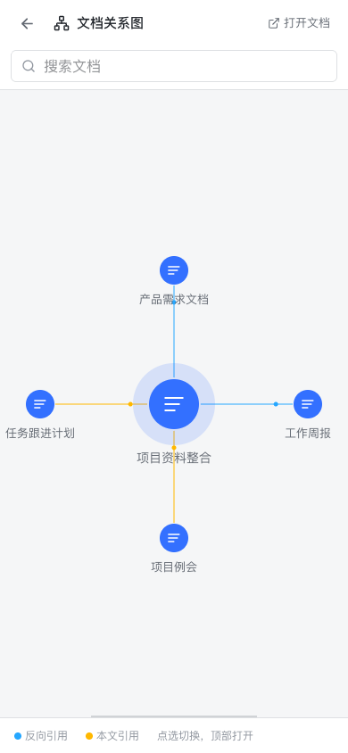
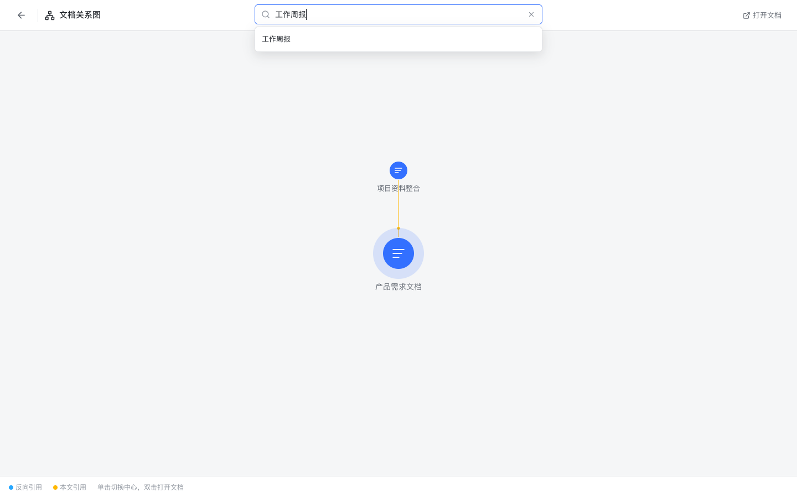
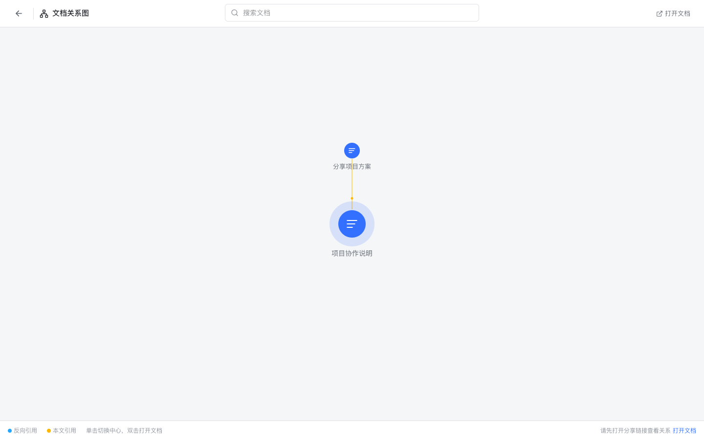

# 文档关系图与引用面板（2026-11-17）

参考[飞书双向链接帮助](https://www.feishu.cn/hc/en-US/articles/746133328060-use-bi-directional-links-in-docs)和其公开示例，将文档底部引用区调整为“反向引用 / 本文引用”标签，并加入关系图入口。图中以当前文档为中心，蓝线表示反向引用，黄线表示本文引用；单击节点切换中心，双击节点或点击顶部按钮打开文档。顶部搜索只返回当前账号可访问的文档，搜索结果超过 30 项时提示缩小范围。

手机窄屏可滚动关系图，初始位置自动居中，点选节点后可从顶部打开；画布超出视口时支持鼠标拖动空白区域平移。尚未加入的分享链接节点不会因查看关系图自动加入；需要时可通过提示主动打开。引用数据在文档同步后刷新，权限复核和查询失败时不显示旧关系。

## 范围与限制

- 当前图展示中心文档的直接引用和反向引用；重新选择中心可继续浏览，但不会同时显示所有邻居之间的连接、无关联的最近浏览文档或主页关系图。没有缩放、拖拽布局和持久图谱索引。为控制大图开销，仅前 80 个节点的连线播放小点动画，其余连线仍显示；遵循系统减少动态效果设置。
- 关系查询仍受 200 个候选节点、16 MiB 等上限约束；搜索复用现有全文扫描，超时、数据异常或服务繁忙时明确报错。没有可替代持久索引的大工作区性能保证。
- 仅展示查询时有权限的文档；关系与搜索各自读取时不是跨文档原子快照。旧服务缺少账号绑定搜索接口时，搜索不可用。引用设置隐藏后关系图入口也随之隐藏。
- 版式参考飞书公开帮助中的图片与动画，没有使用当前登录飞书实页做逐像素验收。移动端截图及触摸测试使用 390×844 浏览器模拟设备，未验证实体手机；浏览器粘贴使用合成事件。

## 验证

- 隔离 PostgreSQL 浏览器验证引用标签、关系颜色、单击切换中心、真实鼠标双击打开、搜索切换、无权文档过滤、手机模拟触摸切换、鼠标平移、键盘切换、输入法组合键和视口变化后居中；验证了系统减少动态效果设置。
- 双账号验证协作者新增引用后刷新、撤权后重新校验会移除关系，远端隐藏设置会关闭图谱；未加入的分享链接先提示主动打开，不会因查看图谱自动加入。既有跨协作者隐藏和恢复流程回归通过。
- 前端全量 216 个测试文件、1176 项通过，生产构建通过（仍提示部分资源包较大）；单元测试覆盖图节点布局、双向边、400 节点边界、搜索响应与账号绑定；服务端测试覆盖账号切换、访问撤销与搜索结果上限，包含隔离 PostgreSQL。测试浏览器使用的服务包含工作区原有未提交的服务端文件与迁移；另用干净 Git 快照叠加本次服务端文件进行测试。

