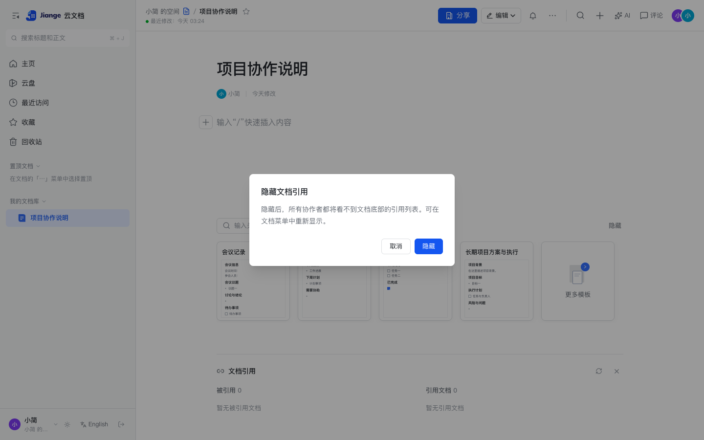
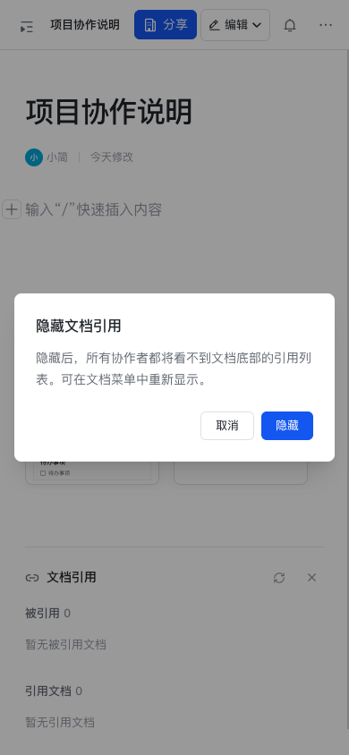
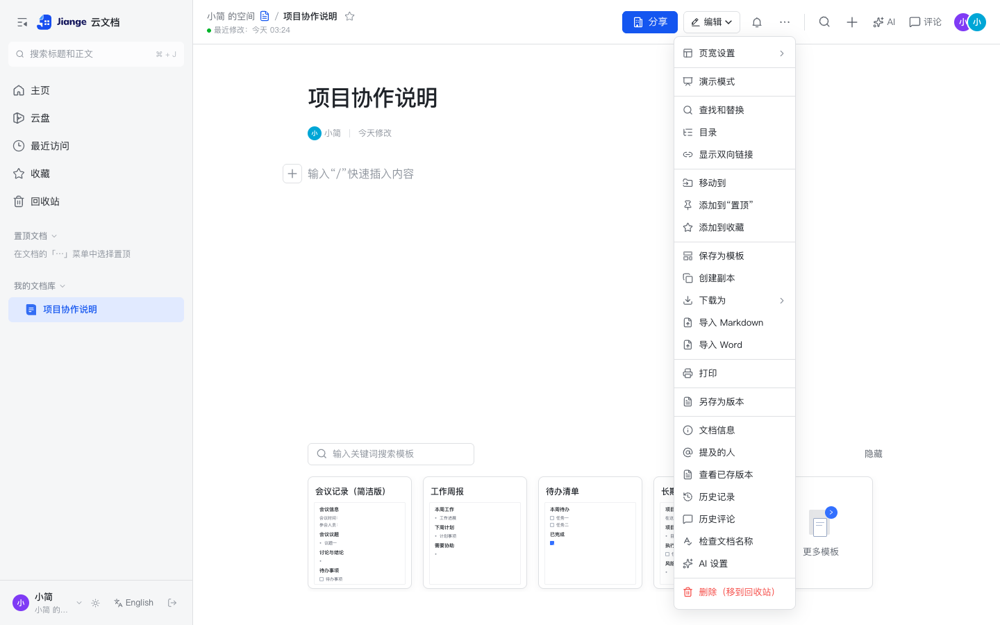

# 文档引用显示设置（2026-11-17）

参考[飞书双向链接说明](https://www.feishu.cn/hc/en-US/articles/746133328060-use-bi-directional-links-in-docs)，编辑者可以在文档底部隐藏引用列表，确认后对协作者共享该显示设置；隐藏后可在文档菜单中选择“显示双向链接”恢复。阅读者可以看到设置结果，但不能修改。复制文档时会保留隐藏状态。

服务端使用账号、当前角色和版本号校验写入；并发修改会产生冲突，而不是静默覆盖。请求结果无法确认时，页面重新读取设置并提示用户。其他打开的页面通过前台轮询更新，通常最多约 5 秒加网络时间；不是实时推送。隐藏是展示设置，不是访问控制：它不会撤销文档权限或禁止调用引用查询接口。

## 验证

- 隔离 PostgreSQL、两个浏览器账号：确认和取消隐藏、阅读者同步隐藏、阅读者不能修改、编辑者从菜单恢复、响应提交后丢失的重新读取，以及刷新后状态保留。
- 前端 214 个测试文件、1171 项通过，生产构建通过（仍提示部分资源包较大）。内存与隔离 PostgreSQL 的竞态测试覆盖版本冲突、并发写入、撤权、会话失效和复制保留；干净 Git 快照叠加本次服务端文件后，相关竞态测试和存储/API 全量测试通过。
- 浏览器截图为本地实现，未与飞书实页逐像素比对；手机截图是 390×844 模拟视口。浏览器服务包含工作区原有未提交的服务端文件和迁移，仅连接隔离数据库。

部署需要数据库迁移 `0063_document_reference_visibility.sql` 和新版服务。旧客户端不会读取此设置，旧服务复制文档时也不会保留该设置；混合版本期间无法保证所有客户端一致显示。文档引用的关系图、持久索引和完整视觉对照仍未完成。

