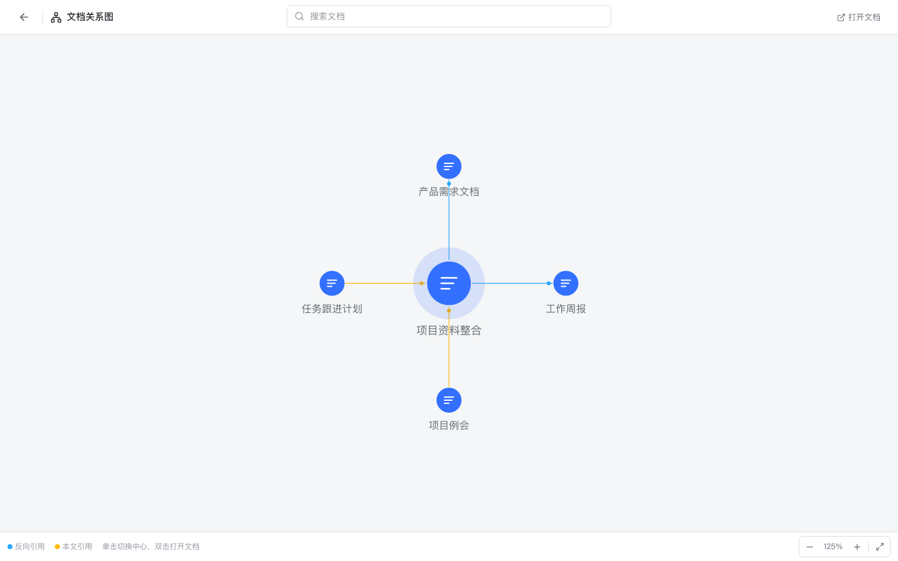
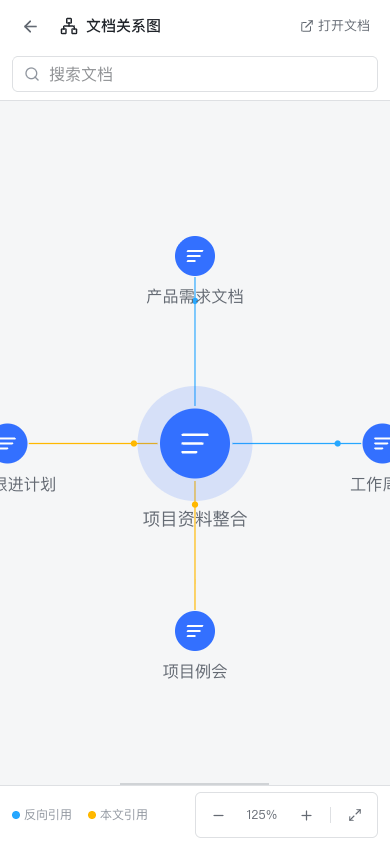
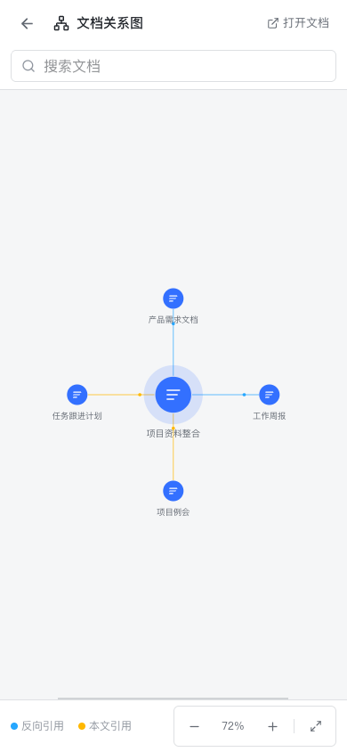

# 文档关系图缩放与触摸（2026-11-17）

关系图增加 25%–200% 缩放、重置和适应画布；桌面支持按住 Ctrl / ⌘ 滚轮围绕指针缩放，画布聚焦时可用 `+`、`-`、`0`。手机支持双指缩放、单指滚动和点选节点；缩放控制位于底部工具栏，不覆盖图谱。适应画布根据节点和文字范围计算，而非按空白画布缩小。

缩放尽量保持指针或双指中心对应的内容位置；当图形小于视口或滚动已到边界时，位置受浏览器滚动范围约束。缩放比例只保存在当前关系图会话中。对于极大的图，25% 下限可能仍无法完整放入屏幕，可继续平移；完整多跳图、持久索引和节点拖拽仍未实现。

## 验证

- 隔离 PostgreSQL + 浏览器：验证按钮缩放、重置、适应画布、Ctrl 滚轮指针定位、键盘快捷键、双指缩放及移动手势中心、缩放后无误触节点、单指点选、鼠标平移、双击打开和返回文档。
- 截图与触摸来自 390×844 浏览器模拟设备和桌面 Chromium，不代表实体手机；浏览器测试使用合成文档和粘贴事件。版式尚未与当前飞书实页逐像素对照。
- 前端全量 217 个测试文件、1180 项通过，生产构建通过（仍提示部分资源包较大）；单元测试覆盖缩放上下限、步进、适应计算、节点边界与坐标锚定。测试浏览器服务包含工作区已有未提交的服务端文件和迁移，只连接隔离数据库；本次没有修改服务端。

