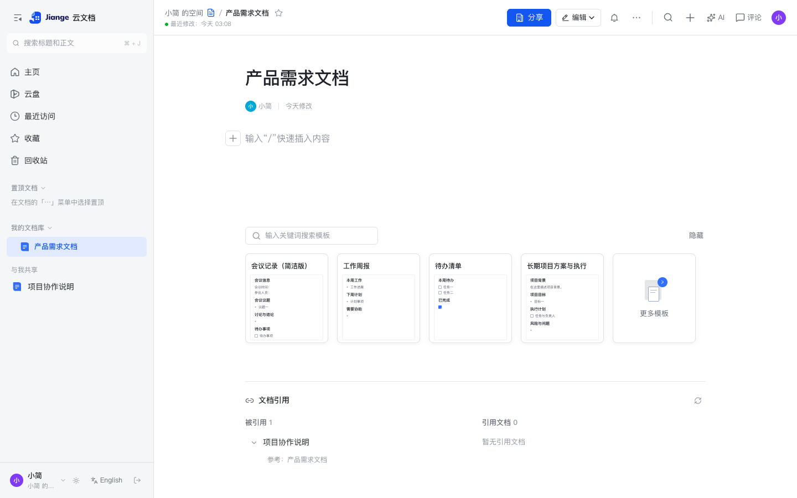
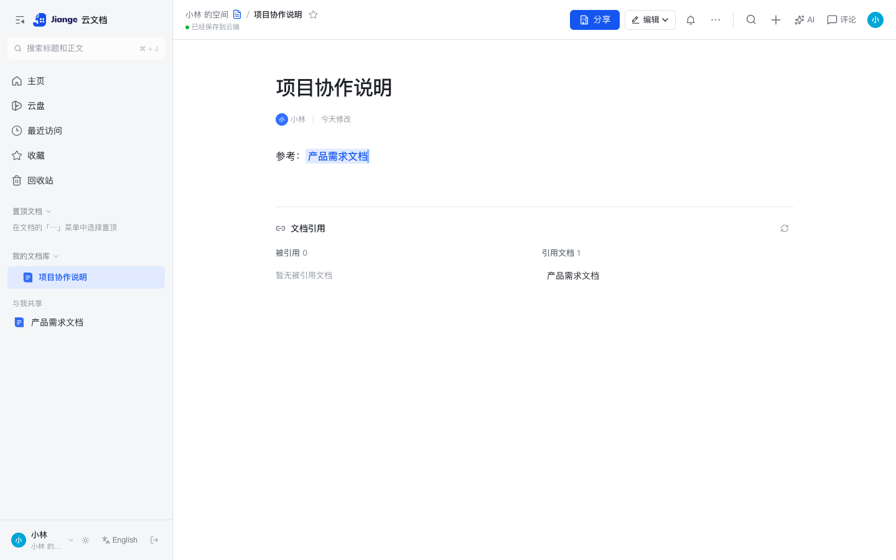
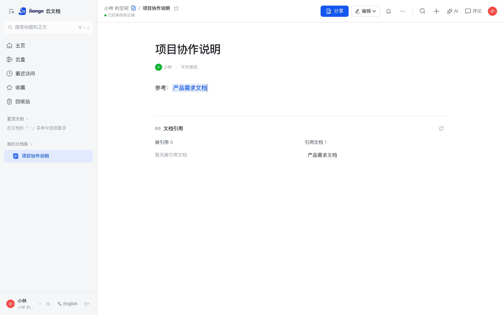

# 文档引用列表（2026-11-17）

文档底部新增“被引用”和“引用文档”列表。可展开来源文档的引用位置并跳转到对应正文块；只显示当前账号有权访问或持有有效分享链接的文档；查询不会自动加入链接。来源文档不允许当前账号复制时，不返回正文摘录。查询失败或超出限制时明确提示重试，不显示伪造的空结果。

飞书[双向链接说明](https://www.feishu.cn/hc/en-US/articles/746133328060-use-bi-directional-links-in-docs)提供被引用文档、引用文档、引用位置与关系图；本次实现前两类列表和正文块定位，尚未实现关系图及完整视觉对照；跨协作者隐藏设置见[后续验证](document-reference-visibility-report-20261117.md)。

## 工作方式与限制

- 当前按需扫描有权访问的文档，不使用持久化索引。单次最多扫描 200 个候选节点、16 MiB 快照及增量、200 个不同分享 token、2000 个引用位置，超限或存在无法安全读取的文档时返回未完成。每篇快照另受既有 2 MiB 和 10000 条增量操作限制。查询最多并发两项、超时 10 秒；同步解码阶段不能立即中断。大工作区需要后续持久索引。
- 结果以每篇文档读取时的已保存状态为准，并非跨文档同一时刻的全局快照。返回前重新检查目标与来源权限、来源复制策略和相关文档 head；链接关闭、并发写入或撤权仍可能在最终检查之后发生。面板在可见时每 30 秒重新查询，离开后再回来会先刷新过期结果。
- 当前模型无法区分手动创建的内部超链接与 @ 文档引用，两者都会计入；普通文档链接和当前账号符合范围的有效分享链接可识别，未实现独立引用身份、历史版本图谱或其他产品的引用。复制保护的摘录会隐藏，标题和跳转仅对有阅读权限的账号显示。
- 当前入口只在已登录文档页显示，匿名公开页、历史版本和演示模式尚未接入。查询依赖新版服务；旧服务返回错误提示。截图是本地实现，未与当前飞书实页逐像素核对。移动端截图为浏览器 390×844 模拟视口，非实体设备。

## 验证

- 双账号、隔离 PostgreSQL 浏览器验证了引用与被引用列表、展开上下文、定位入口、来源授权撤销后刷新隐藏，以及未加入的有效分享链接保留原跳转地址。
- 前端 213 个测试文件、1169 项通过，生产构建通过（仍提示部分资源包较大）。单元及接口测试覆盖账号绑定、无权来源、扫描期间撤权及复制策略变化、链接失效和扫描上限；隔离 PostgreSQL 测试覆盖授权与撤销。干净 Git 快照叠加本次服务端文件后运行竞态测试。
- 浏览器使用合成粘贴事件；测试服务包含工作区原有未提交的服务端文件和迁移，但只连接隔离数据库。

