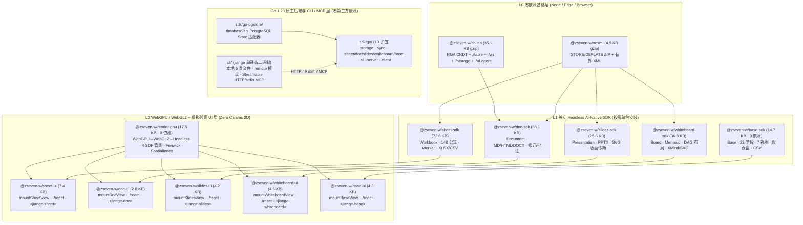

# Jiange AI-Native 全栈 Office SDK 文档中心 (`v0.2.0`)

欢迎使用 **Jiange SDK**。Jiange 提供一套**超轻量、独立按需安装、AI-Native、零 Canvas 2D（WebGPU / WebGL2 + 稀疏虚拟列表）**的前端与 Headless TypeScript SDK 套件（13 个 npm 包）、**零外部依赖的 Go 后端可嵌入 SDK**（`sdk/go/` 10 个子包 + `sdk/go-pgstore/` PostgreSQL 适配器），以及 **Go 单静态二进制原生 CLI & MCP Server**（`cli/`）。

- **极轻且彻底解耦**：每个业务 SDK 可单独安装，各业务域之间**零交叉依赖**，所有 Headless TS SDK 与 Go SDK 均**零第三方运行时依赖**。
- **AI-Native 一等公民**：五大文档形态（Sheet / Doc / Slides / Whiteboard / Base）共享统一的 `inspect → query → apply(dryRun) → verify → undo` 闭环与自描述 JSON Schema 工具集（TS 36 工具、Go 后端 20 工具、Go CLI MCP 19 工具）。
- **零 Canvas 2D 的现代渲染**：全部 UI 包基于 `@zseven-w/render-gpu`（WebGPU 主路径 → WebGL2 自动回退 → Headless 后端）+ 稀疏 `FenwickVirtualizer` / 池化虚拟 DOM，CI 静态门禁保证零 `getContext("2d")`。
- **工程质量门禁**：13 个 TS 包 V8 覆盖率四项 100%（Statements / Branches / Functions / Lines），Go 后端 SDK、PostgreSQL 适配器与 CLI/MCP 均通过 `-race` 并发检测与严格覆盖率门禁。

---

## 文档索引

| 文档 | 内容概览 |
| --- | --- |
| [快速上手（5 分钟入门）](./getting-started.md) | 4 条主流接入路径：单包 Headless TS、WebGPU/WebGL2 UI（Vanilla / React / Web Components）、Go CLI & MCP Server、Go 后端嵌入 + PostgreSQL 持久化 |
| [Headless TS SDKs 参考指南](./headless-sdks.md) | 全部 7 个 L0/L1 包的完整 API 与实战配方：`@zseven-w/ooxml`、`@zseven-w/collab`（含 `./table`/`./ws`/`./storage`/`./ai-agent`）、`@zseven-w/sheet-sdk`、`@zseven-w/doc-sdk`、`@zseven-w/slides-sdk`、`@zseven-w/whiteboard-sdk`、`@zseven-w/base-sdk` |
| [WebGPU / WebGL2 与 UI SDK 指南](./gpu-ui-sdks.md) | `@zseven-w/render-gpu` 架构（4 条 SDF/GlyphAtlas 管线、`FenwickVirtualizer`、`VirtualList1D`/`VirtualGrid2D`、`SpatialIndex`、`InstanceBatch`）与 5 个 `@zseven-w/*-ui` 包及零构建 UI Playground |
| [AI-Native 协议与 MCP 工具参考](./ai-native-protocol.md) | 统一 AI 交互闭环、Token 预算控制、确定性错误诊断、全量 AI/MCP 工具清册（TS / Go 后端 / Go CLI）及 OpenAI / Gemini / Anthropic / MCP 接入范例 |
| [Go 后端 SDK、PostgreSQL 与 CLI/MCP](./go-backend-and-cli.md) | `sdk/go/` 全 10 包、`Store`/`Authenticator`/`Authorizer`/`WebhookDispatcher`、`sync.RoomHub`、REST 与 `/ai/tools` & `/mcp` 端点、`sdk/go-pgstore/` 接入、`sdk/go/client` 及 `jiange` CLI / Remote / Streamable HTTP MCP |
| [性能基准、迁移与发布治理](./performance-and-release.md) | RFC §7 实测 SLA 基准、全包体积对比、单包隔离验证、`pnpm test:sdk:pack`、历史 camelCase 子路径迁移表、发版流程与许可条款 |

---

## 总体架构拓扑

---

## 全量包矩阵（13 TS 包 + 3 Go 模块）

### TypeScript / npm 包（`v0.2.0`）

| 包名 | 层级 | 运行时依赖 | Gzip 体积 | 原始 JS 体积 | 核心能力 |
| --- | --- | --- | ---: | ---: | --- |
| [`@zseven-w/ooxml`](../packages/ooxml/README.md) | L0 | `0` | 4.9 KB | 17.5 KB | 同步 STORE / 异步 DEFLATE ZIP + 防 DTD 有界 XML |
| [`@zseven-w/collab`](../packages/collab/README.md) | L0 | `0` | 35.1 KB | 144.9 KB | 文档 CRDT、`SyncClient`、`UndoManager` + `./table`、`./ws`、`./storage`、`./ai-agent` |
| [`@zseven-w/sheet-sdk`](../packages/sheet-sdk/README.md) | L1 | `@zseven-w/ooxml` | 72.6 KB | 348.7 KB | `Workbook`、AST+DAG 增量公式（148 函数 + `#SPILL!` + Worker）、DEFLATE XLSX/CSV、`createSheetTools` |
| [`@zseven-w/doc-sdk`](../packages/doc-sdk/README.md) | L1 | `@zseven-w/collab`, `@zseven-w/ooxml` | 58.1 KB | 234.7 KB | `Document`、Markdown/HTML/DOCX(DEFLATE) 双向、大纲章节、保样式替换、批注修订、`createDocTools` |
| [`@zseven-w/slides-sdk`](../packages/slides-sdk/README.md) | L1 | `@zseven-w/ooxml` | 25.8 KB | 111.8 KB | `Presentation`、主题/富段落/原生表格/图表/音视频媒体与图片裁剪、DEFLATE PPTX、16:9 SVG、`verify()`、`createSlidesTools` |
| [`@zseven-w/whiteboard-sdk`](../packages/whiteboard-sdk/README.md) | L1 | `@zseven-w/ooxml` | 36.8 KB | 160.7 KB | `Board`、Mermaid 双向、DAG 自动布局、对齐分布、SVG、DEFLATE XMind、拓扑 `verify()`、`createWhiteboardTools` |
| [`@zseven-w/base-sdk`](../packages/base-sdk/README.md) | L1 | **`0`** | 14.7 KB | 68.8 KB | `Base`、23 种字段、7 种视图、拓扑 `[Field]` 公式、`link`/`lookup`、多级分组、仪表盘、CSV、`createBaseTools` |
| [`@zseven-w/render-gpu`](../packages/render-gpu/README.md) | L2 | **`0`** | 17.5 KB | 78.5 KB | WebGPU → WebGL2 → Headless、4 条 SDF/GlyphAtlas 管线、`FenwickVirtualizer`、`VirtualList1D`/`VirtualGrid2D`、`SpatialIndex`、`InstanceBatch` |
| [`@zseven-w/sheet-ui`](../packages/sheet-ui/README.md) | L2 | `sheet-sdk`, `render-gpu` | 7.4 KB | 30.6 KB | 4 象限冻结 GPU 渲染 + 池化文本层 + 单例 IME 编辑器 + `mountSheetView` / `./react` / `<jiange-sheet>` |
| [`@zseven-w/doc-ui`](../packages/doc-ui/README.md) | L2 | `doc-sdk`, `render-gpu` | 2.8 KB | 9.7 KB | `VirtualList1D` + 动态块高追踪 + 大纲跳转 + `mountDocView` / `./react` / `<jiange-doc>` |
| [`@zseven-w/slides-ui`](../packages/slides-ui/README.md) | L2 | `slides-sdk`, `render-gpu` | 4.2 KB | 15.6 KB | GPU SDF 16:9 舞台 + 虚拟缩略图栏 + 放映模式 + `mountSlidesView` / `./react` / `<jiange-slides>` |
| [`@zseven-w/whiteboard-ui`](../packages/whiteboard-ui/README.md) | L2 | `whiteboard-sdk`, `render-gpu` | 4.5 KB | 17.3 KB | 无限画布相机 + `SpatialIndex` 剔除 + GPU SDF 节点/连线/脑图/笔迹 + `mountWhiteboardView` / `./react` / `<jiange-whiteboard>` |
| [`@zseven-w/base-ui`](../packages/base-ui/README.md) | L2 | `base-sdk`, `render-gpu` | 4.3 KB | 16.8 KB | GPU 网格（条件填色）+ 看板 + 甘特图 + 仪表盘 + `mountBaseView` / `./react` / `<jiange-base>` |

### Go 模块（Go 1.23+，零第三方外部依赖）

| 模块路径 | 目录 | 核心组成 |
| --- | --- | --- |
| `github.com/ZSeven-W/jiange/sdk/go` | [`sdk/go/`](../sdk/go/README.md) | 10 个独立可按需导入子包：`storage`、`sync`、`sheet`、`doc`、`slides`、`whiteboard`、`base`、`ai`、`server`、`client` |
| `github.com/ZSeven-W/jiange/sdk/go-pgstore` | [`sdk/go-pgstore/`](../sdk/go-pgstore/README.md) | 基于标准库 `database/sql` 的 PostgreSQL `storage.Store` 适配器，配合 `pgx/v5/stdlib` 或 `lib/pq` 开箱即用 |
| `github.com/ZSeven-W/jiange/cli` | [`cli/`](../cli/README.md) | 单静态二进制 `jiange`：本地 5 类文件解析/补丁/渲染、远程后端模式 `jiange remote`、stdio 与 Streamable HTTP MCP Server |

---

## 选型指南：我应该安装哪个包？

| 你的目标场景 | 推荐安装 / 引入 | 额外依赖 |
| --- | --- | --- |
| 在 Node.js / Edge / Worker 中读写 `.xlsx`、运行 Excel 公式或让 AI 编辑表格 | `npm install @zseven-w/sheet-sdk` | 仅自动带入 4.9 KB 的 `@zseven-w/ooxml` |
| 在服务端或 Agent 中将 Markdown / HTML / DOCX 互转、做章节定位或修订建议 | `npm install @zseven-w/doc-sdk` | `@zseven-w/collab` + `@zseven-w/ooxml` |
| 让 AI 生成 PPT、输出 16:9 SVG 预览并自动检测文字溢出/对比度 | `npm install @zseven-w/slides-sdk` | `@zseven-w/ooxml` |
| 双向转换 Mermaid / XMind、自动分层排布流程图并输出 SVG | `npm install @zseven-w/whiteboard-sdk` | `@zseven-w/ooxml` |
| 构建轻量化类 Airtable / 多维表格数据引擎、筛选分组与仪表盘统计 | `npm install @zseven-w/base-sdk` | **0 依赖** |
| 在 Web 页面（Vanilla / React / Vue / Svelte）嵌入百万行高性能表格或画板 | `npm install @zseven-w/sheet-ui @zseven-w/sheet-sdk`（或对应 `*-ui`） | `@zseven-w/render-gpu`；React 仅在使用 `./react` 时作为可选 peer |
| 仅需底层 WebGPU/WebGL2 2D 渲染核或百万行稀疏虚拟列表 | `npm install @zseven-w/render-gpu` | **0 依赖** |
| 为已有实时协同应用接入 CRDT、WebSocket 重连、IndexedDB 离线草稿或 AI 协作者 | `npm install @zseven-w/collab` | **0 依赖** |
| 让 Claude Desktop / Cursor / Codex / Antigravity 直接操作本地或远程 Office 文件 | 编译/下载 `cli/` 二进制 `jiange`，运行 `jiange mcp` | **单二进制零运行时依赖** |
| 在现有 Go 服务（`net/http` / Gin / Chi / Echo）中嵌入 Office REST API、协同与 MCP | `go get github.com/ZSeven-W/jiange/sdk/go`（生产持久化加 `sdk/go-pgstore`） | Go 标准库（PG 适配器自选 `pgx/v5/stdlib`） |
