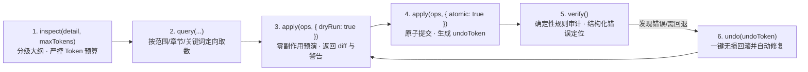

# AI-Native 协议与 MCP 工具参考

Jiange 全系列 SDK（TypeScript Headless、Go 后端 SDK、Go 原生 CLI/MCP）从第一天起围绕 **AI Agent 工作流**设计，避免了传统富文本/表格 SDK 将数百 KB 原始 XML/DOM 倾倒给大模型的“上下文爆炸”和“盲写破坏格式”问题。

---

## 1. 统一 AI-Native 闭环协议

五大文档形态（`Workbook` / `Document` / `Presentation` / `Board` / `Base`）共享同一套 5 步安全闭环：



### 1.1 分级探测与 Token 预算（`inspect`）

- **`detail` 分级**：
  - `@jiange/sheet-sdk` / `@jiange/doc-sdk`：`outline` | `summary` | `full`
  - `@jiange/slides-sdk` / `@jiange/whiteboard-sdk` / `@jiange/base-sdk`：`summary` | `standard` | `full`
- **软预算裁剪（`maxTokens`）**：按字符估算 token（默认约 `2000`），超出预算时自动截断采样并设置 `truncated: true`（Sheet/Doc 还支持 `cursor` 续读与 `focus` 聚焦单工作表/单章节）。
- **实测开销**：10,000 行（50,000 单元格）工作簿执行 `wb.inspect({ detail: "summary", maxTokens: 1500 })` 耗时仅 **`2.25 ms`**，输出仅 **`89 tokens`**。

### 1.2 原子事务、预演与回滚（`apply` / `undo`）

- **`dryRun: true`**：在沙箱副本上执行整批 `ops`，完整计算公式重算差异（`diff`）、变更计数与诊断警告，绝不污染原实例。
- **原子提交与 `undoToken`**：默认 `atomic: true`，任意一条 op 失败立即整批回滚并给出失败索引与错误原因；提交成功后返回 `undoToken`，可随时调用 `undo(token)` 精确撤销。

### 1.3 确定性诊断反馈（`verify`）

所有 `verify()` 均为纯确定性本地规则引擎（不消耗任何 LLM Token），返回带错误码、严重级别（`error` / `warning` / `info`）、定位坐标与修复建议的结构化列表：

| 业务域 | `verify()` 典型检测项 |
| --- | --- |
| **Sheet** (`wb.verify()`) | 公式错误（`#REF!`、`#DIV/0!`、`#VALUE!`、`#NAME?`、`#N/A`、`#NUM!`、`#CYCLE!`、`#SPILL!`）、数据验证违规、损坏的合并/图表/透视表引用 |
| **Doc** (`doc.verify()`) | 畸形表格结构、不安全链接协议、孤儿修订建议、DOCX 导出保真损失提示（`docxExportLosses`） |
| **Slides** (`deck.verify()`) | `EMPTY_DECK`、`EMPTY_SLIDE`、`TEXT_OVERFLOW`（字号与框体行宽估算溢出）、`SHAPE_OVERLAP`、`OUT_OF_BOUNDS`、`LOW_CONTRAST`（WCAG 对比度不足）、`MISSING_MEDIA`、`DUPLICATE_SHAPE_ID` |
| **Whiteboard** (`board.verify()`) | 悬空边（指向不存在节点）、孤立节点、节点碰撞重叠、有向环路检测、孤儿思维导图主题 |
| **Base** (`base.verify()`) | 字段名重复、公式语法错误与 `#CYCLE` 循环引用、`link`/`lookup` 目标表或字段失效、非法 `select` 选项 |

---

## 2. 全量 AI / MCP 工具清册

### 2.1 TypeScript Headless SDK 工具集（`create*Tools` — 共 36 个工具）

| 领域与工厂函数 | 工具名 | 核心参数 | 功能说明 |
| --- | --- | --- | --- |
| **Sheet** (`createSheetTools(wb)`) | `sheet_inspect` | `detail`, `maxTokens`, `focus`, `cursor` | 预算内返回工作簿结构、表头、采样行、公式/错误计数 |
| | `sheet_query` | `sheet`, `range`, `search`, `onlyFormulas`, `onlyErrors`, `limit` | 按 A1 区域或关键词定向查询单元格/公式/错误 |
| | `sheet_apply` | `ops`, `dryRun`, `reason` | 原子批量执行 15 类 `WorkbookOp`，支持预演与 diff |
| | `sheet_verify` | *(无)* | 全表公式错误、数据验证与引用完整性审计 |
| | `sheet_undo` | `token` | 回滚最近一批操作（可校验 `undoToken`） |
| | `sheet_export_csv` | `sheet` | 导出指定工作表计算后显示值为 RFC 4180 CSV |
| **Doc** (`createDocTools(doc)`) | `doc_inspect` | `detail`, `maxTokens`, `focus`, `cursor` | 返回标题、标题大纲、块统计与摘要预览 |
| | `doc_read_section` | `section` *(必填)* | 按标题文本或块 ID 读取完整章节（含子块与 Markdown） |
| | `doc_query` | `section`, `search`, `blockType`, `limit` | 按关键词、块类型或章节过滤文档块 |
| | `doc_apply` | `ops`, `dryRun`, `reason` | 原子批量执行 11 类 `DocOp`（含表格编辑、修订、批注） |
| | `doc_verify` | *(无)* | 校验表格、链接安全性、修订完整性与 DOCX 损失 |
| | `doc_undo` | `token` | 回滚最近一批文档修改 |
| | `doc_export_markdown` | *(无)* | 导出规范化 Markdown |
| **Slides** (`createSlidesTools(deck)`) | `slides_inspect` | `detail`, `maxTokens`, `slideIndex` | 查看演示文稿大纲、主题、页数及单页图形详情 |
| | `slides_query` | `text`, `layout`, `hidden`, `shapeKind` | 按关键字、版式、隐藏状态或形状类型检索幻灯片 |
| | `slides_apply` | `ops`, `dryRun`, `atomic`, `actor` | 原子执行 9 类 `SlideOp`（页/形状/主题增删改移） |
| | `slides_verify` | *(无)* | 8 类视觉与版面诊断（溢出/重叠/越界/WCAG 对比度） |
| | `slides_render_svg` | `slideIndex` *(必填)*, `width`, `height` | 渲染单页为确定性 16:9 SVG（供多模态视觉校验） |
| | `slides_undo` / `slides_redo` | *(无)* | 撤销 / 重做最近一批幻灯片修改 |
| **Whiteboard** (`createWhiteboardTools(board)`) | `board_inspect` | `detail`, `maxTokens` | 查看画板主题、节点、连线、脑图与笔迹概况 |
| | `board_query` | `text`, `shape`, `connectedTo` | 按文本、形状或邻接关系搜索流程图与脑图元素 |
| | `board_apply` | `ops`, `dryRun`, `atomic`, `actor` | 原子执行 13 类 `BoardOp`（节点/连线/脑图/笔迹/排版/主题） |
| | `board_verify` | *(无)* | 拓扑审计：悬空边、孤立节点、重叠、环路与孤儿脑图 |
| | `board_auto_layout` | `direction` (`TB`/`LR`), `gapX`, `gapY` | 运行分层 DAG 自动排布 |
| | `board_export` | `format` (`mermaid` \| `svg`) *(必填)* | 导出为 Mermaid 语法或独立 SVG |
| | `board_undo` / `board_redo` | *(无)* | 撤销 / 重做最近一批白板修改 |
| **Base** (`createBaseTools(base)`) | `base_inspect` | `detail`, `maxTokens`, `tableId` | 查看表列表、字段 Schema、视图计数与采样记录 |
| | `base_query` | `tableId`, `search`, `filters`, `sorts`, `groupBy`, `limit`, `offset` | 支持 AND/OR 筛选、排序、分组与分页查询 |
| | `base_apply` | `ops`, `dryRun`, `atomic`, `actor` | 原子执行 10 类 `BaseOp`（表/字段/记录/视图增删改） |
| | `base_verify` | *(无)* | 校验 Schema、公式循环、`link`/`lookup` 与下拉选项 |
| | `base_dashboard` | `tableId`, `widgets` | 计算仪表盘指标卡与分组聚合图表数据 |
| | `base_export_csv` | `tableId`, `delimiter` | 导出含计算列与 Lookup 的 CSV / TSV |
| | `base_undo` / `base_redo` | *(无)* | 撤销 / 重做最近一批多维表格修改 |

### 2.2 Go 后端 SDK 工具集（`sdk/go/ai` — 共 20 个工具，按 `id` 操作 `storage.Store`）

通过 `sheet.RegisterTools`、`doc.RegisterTools`、`slides.RegisterTools`、`whiteboard.RegisterTools`、`base.RegisterTools` 按需组合注册，自动同时暴露于 **`POST /mcp`**（JSON-RPC 2.0）和 **`GET /ai/tools` + `POST /ai/tools/{name}`**（REST）：

- **Sheet (4)**：`sheet_inspect`、`sheet_query`、`sheet_apply`、`sheet_verify`
- **Doc (4)**：`doc_inspect`、`doc_query`、`doc_apply`、`doc_verify`
- **Slides (4)**：`slides_inspect`、`slides_apply`、`slides_verify`、`slides_render_svg`
- **Whiteboard (4)**：`board_inspect`、`board_apply`、`board_verify`、`board_render_svg`
- **Base (4)**：`base_inspect`、`base_query`、`base_apply`、`base_verify`

### 2.3 Go 原生 CLI MCP 工具集（`jiange mcp` — 共 19 个工具，按本地文件 `path` 操作）

- **Sheet (4)**：`sheet_inspect`、`sheet_query`、`sheet_patch`、`sheet_verify`
- **Doc (4)**：`doc_inspect`、`doc_query`、`doc_patch`、`doc_verify`
- **Slides (4)**：`slides_inspect`、`slides_patch`、`slides_verify`、`slides_render_svg`
- **Whiteboard (3)**：`board_inspect`、`board_verify`、`board_render_svg`
- **Base (4)**：`base_inspect`、`base_query`、`base_patch`、`base_verify`

---

## 3. 主流大模型与 MCP 接入范例

所有 `create*Tools` 返回统一结构 `{ tools: Array<{ name, description, inputSchema }>, execute(name, args) }`，无需任何胶水依赖即可映射到各大模型 API。

### 3.1 OpenAI Function Calling

```ts
import { Workbook, createSheetTools } from "@jiange/sheet-sdk";

const wb = Workbook.fromCsv("Item,Qty,Price\nA,2,10\n", "Sales");
const toolkit = createSheetTools(wb);

// 1. 转换为 OpenAI tools 参数
const openAiTools = toolkit.tools.map((t) => ({
  type: "function" as const,
  function: {
    name: t.name,
    description: t.description,
    parameters: t.inputSchema,
  },
}));

// 2. 收到 tool_calls 后直接分发执行
function handleToolCall(name: string, rawArguments: string) {
  const args = JSON.parse(rawArguments) as Record<string, unknown>;
  return JSON.stringify(toolkit.execute(name, args));
}
void [openAiTools, handleToolCall];
```

### 3.2 Google Gemini (`functionDeclarations`)

```ts
import { Document, createDocTools } from "@jiange/doc-sdk";

const doc = Document.fromMarkdown("# Plan\n\nInitial draft.\n");
const toolkit = createDocTools(doc);

const geminiTools = [
  {
    functionDeclarations: toolkit.tools.map((t) => ({
      name: t.name,
      description: t.description,
      parameters: t.inputSchema,
    })),
  },
];

// 收到 functionCall 时：
// const result = toolkit.execute(call.name, call.args);
void geminiTools;
```

### 3.3 Anthropic Claude (`tools`)

```ts
import { Presentation, createSlidesTools } from "@jiange/slides-sdk";

const deck = Presentation.create({ title: "Pitch" });
const toolkit = createSlidesTools(deck);

const anthropicTools = toolkit.tools.map((t) => ({
  name: t.name,
  description: t.description,
  input_schema: t.inputSchema,
}));

// 收到 tool_use block 时：
// const result = toolkit.execute(block.name, block.input);
void anthropicTools;
```

### 3.4 MCP 客户端配置（Claude Desktop / Cursor / Codex / Antigravity）

- **本地 Stdio（零端口占用）**：
  ```json
  {
    "mcpServers": {
      "jiange-local": {
        "command": "jiange",
        "args": ["mcp", "--transport", "stdio"]
      }
    }
  }
  ```
- **远程 Streamable HTTP（连接 `jiange mcp --transport http` 或 `sdk/go/server`）**：
  ```json
  {
    "mcpServers": {
      "jiange-http": {
        "url": "http://127.0.0.1:8787/mcp"
      }
    }
  }
  ```
