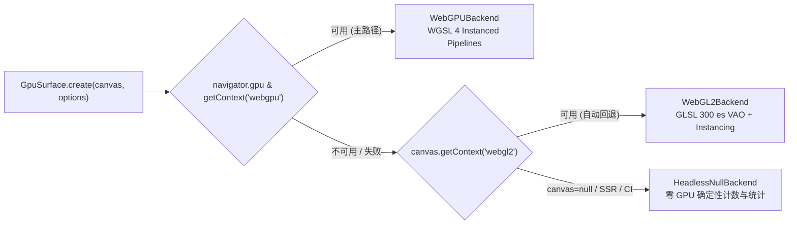

# WebGPU / WebGL2 与虚拟列表 UI SDK 指南（L2 全 6 包）

Jiange L2 渲染层彻底摒弃传统 HTML5 Canvas 2D，基于 **`@jiange/render-gpu`** 统一提供硬件加速 2D SDF 渲染与稀疏虚拟列表池化机制，并在此之上构建了 5 个独立可安装的极轻 UI 包。

> **Zero Canvas 2D 铁律**：`benchmarks/run-benchmarks.mjs` 在每次 CI 中扫描 `@jiange/render-gpu` 与全部 5 个 `@jiange/*-ui` 的编译产物，强制断言代码中**零** `getContext("2d")` 调用。

---

## 1. `@jiange/render-gpu` 核心架构

- **安装**：`npm install @jiange/render-gpu`（0 依赖，17.5 KB gzip）
- **子路径**：`.`、`./gpu-surface`、`./instance-buffer`、`./glyph-atlas`、`./shaders`、`./fenwick`、`./virtual-pool`、`./spatial-index`

### 1.1 自动后端降级链（`GpuSurface`）

`GpuSurface.create(canvas, options)` 按严格优先级初始化后端，应用层业务代码无需编写任何分支：



- **帧调度与遥测**：支持 `resize(widthPx, heightPx, dpr)`、`setFrameProducer(fn)`、`markDirty()`（将高频状态变更合并到下一帧 `requestAnimationFrame`），每帧返回 `GpuFrameStats`（`backend`, `drawCalls`, `rectInstances`, `lineInstances`, `arcInstances`, `glyphInstances`, `frameTimeMs`）。

### 1.2 4 条 Instanced SDF / Glyph 渲染管线（WGSL + GLSL 300 es）

所有图元通过零 GC 的预分配 `Float32Array` 批次缓冲 **`InstanceBatch`** 打包提交（调用 `batch.reset()` 复用底层内存，帧间零堆分配）：

| 管线 | 常量步长 | 单实例字节 | 打包布局 | 用途 |
| --- | --- | ---: | --- | --- |
| **Rect SDF** | `RECT_STRIDE = 16` | 64 B | `x, y, w, h, r, g, b, a, radius, borderW, br, bg, bb, ba, rotRad, flags` | 单元格背景、选区框、卡片、圆角矩形、柱状图、甘特条 |
| **Line SDF** | `LINE_STRIDE = 12` | 48 B | `x1, y1, x2, y2, thickness, r, g, b, a, dashLen, gapLen, flags` | 抗锯齿网格线、流程图连线（支持虚线 `dashLen`/`gapLen`）、折线图、笔迹 |
| **Arc SDF** | `ARC_STRIDE = 12` | 48 B | `cx, cy, rx, ry, startAngle, endAngle, innerRatio, r, g, b, a, borderW` | 椭圆、圆环、饼图/环形图扇区（`innerRatio` 控制内径比） |
| **Glyph Atlas** | `GLYPH_STRIDE = 12` | 48 B | `x, y, w, h, u0, v0, u1, v1, r, g, b, a` | 配合 `GlyphAtlas`（R8 单通道程序化 5×7 位图字库，零 Canvas 2D 光栅化）通过 `batch.pushText(...)` 绘制 GPU 文本 |

### 1.3 百万行稀疏虚拟化与空间索引

| 原语 | 复杂度 | 核心特性 |
| --- | --- | --- |
| **`FenwickVirtualizer`** | `O(overrides)` 内存，`O(log N)` 查询 | 百万行/列仅存非默认尺寸覆盖值；`indexToOffset`（前缀和）、`offsetToIndex`（Binary Lifting 逆查）、`visibleRange(scrollPx, viewportPx, overscan)` |
| **`DomNodePool`** | 恒定 DOM 数量 | 帧间 key 差分回收，仅使用 GPU 合成层 `transform: translate3d(x, y, 0)` + `contain: strict`，滚动零节点增删 |
| **`VirtualList1D`** | `O(log N)` + 池化 | 组合 `FenwickVirtualizer` 与 `DomNodePool`，用于长文档块列表与幻灯片缩略图栏 |
| **`VirtualGrid2D`** | 4 象限冻结支持 | 支持 `top-left` / `top-right` / `bottom-left` / `bottom-right` 冻结窗格切分与池化可见单元格 |
| **`SpatialIndex<T>`** | 均摊 `O(1)` 视锥剔除 | 均匀二维网格哈希（默认 `cellSize = 256`），提供 `insert`/`update`/`remove`/`queryRect`/`hitTest`，支撑万级白板节点实时裁剪 |

---

## 2. 五大独立 `@jiange/*-ui` 包总览

所有 UI 包采用完全一致的三重接入模式，且**彼此零交叉依赖**：

| UI 包 | Gzip 体积 | 底层模型 | 挂载 API | React 适配器 (`./react`) | Web Component 标签 & 注册函数 |
| --- | ---: | --- | --- | --- | --- |
| `@jiange/sheet-ui` | 7.4 KB | `Workbook` | `await mountSheetView(el, wb, opts)` | `createSheetViewComponent(React)` (`workbook`) | `<jiange-sheet>` / `defineSheetElement()` (`el.workbook`) |
| `@jiange/doc-ui` | 2.8 KB | `Document` | `mountDocView(el, doc, opts)` *(同步)* | `createDocViewComponent(React)` (`document`) | `<jiange-doc>` / `defineDocElement()` (`el.document`) |
| `@jiange/slides-ui` | 4.2 KB | `Presentation` | `await mountSlidesView(el, deck, opts)` | `createSlidesViewComponent(React)` (`presentation`) | `<jiange-slides>` / `defineSlidesElement()` (`el.presentation`) |
| `@jiange/whiteboard-ui` | 4.5 KB | `Board` | `await mountWhiteboardView(el, board, opts)` | `createWhiteboardViewComponent(React)` (`board`) | `<jiange-whiteboard>` / `defineWhiteboardElement()` (`el.board`) |
| `@jiange/base-ui` | 4.3 KB | `Base` | `await mountBaseView(el, base, opts)` | `createBaseViewComponent(React)` (`base`) | `<jiange-base>` / `defineBaseElement()` (`el.base`) |

---

## 3. 各 UI 包特性与嵌入式范例

### 3.1 `@jiange/sheet-ui`（4 象限冻结窗格 + 单例 IME 编辑器）

- **架构**：WebGPU/WebGL2 Scissor 分 4 象限渲染网格/填色/边框/选区/协作者光标与内嵌图表 + 池化 2D 虚拟 DOM 文本层（确保 CJK、IME 输入法与无障碍完美兼容）+ 单例浮动 `<input>` 编辑器。
- **核心控制器 (`SheetViewController`)**：`setActiveSheet`、`selectCell`、`moveSelection`、`beginEdit`/`updateEditValue`/`commitEdit`/`cancelEdit`、`resizeRow`/`resizeCol`、`scrollBy`、`setCollaborators`、`handlePointerDown`/`handleKeyDown`。

```ts
import { Workbook } from "@jiange/sheet-sdk";
import { mountSheetView } from "@jiange/sheet-ui";

const wb = Workbook.fromCsv("Item,Qty,Price\nPen,10,2\nBook,5,18\n", "Order");
const view = await mountSheetView(document.getElementById("sheet")!, wb, {
  sheet: "Order",
  gpu: { prefer: "webgpu" },
});
view.controller.setCollaborators([
  { id: "ai-1", name: "Jiange AI", color: "#3370ff", row: 1, col: 2 },
]);
```

### 3.2 `@jiange/doc-ui`（动态块高虚拟文档视图）

- **架构**：`VirtualList1D` + `reportBlockHeight(blockId, heightPx)`（将 `ResizeObserver` 真实高度回写 `FenwickVirtualizer`）+ `jumpToHeading(headingIdOrText)` 大纲跳转 + 快捷键撤销重做。
- **注意**：`mountDocView` 为**同步**函数（无需初始化 WebGPU 上下文），首屏 5,000 块文档实测仅 `0.40 ms`、DOM 节点池恒定 `22` 个。

```ts
import { Document } from "@jiange/doc-sdk";
import { mountDocView } from "@jiange/doc-ui";

const doc = Document.fromMarkdown("# Spec\n\n## API\n\nFast virtual list.\n");
const view = mountDocView(document.getElementById("doc")!, doc);
view.controller.jumpToHeading("API");
```

### 3.3 `@jiange/slides-ui`（GPU SDF 16:9 舞台 + 虚拟缩略图栏）

- **架构**：居中 16:9 WebGPU/WebGL2 舞台渲染背景、矢量图形、箭头连线、选中外框与 4 角缩放控制柄 + 左侧 `VirtualList1D` 缩略图栏 + 一键放映模式 `setPresenterMode(true)`。

```ts
import { Presentation } from "@jiange/slides-sdk";
import { mountSlidesView } from "@jiange/slides-ui";

const deck = Presentation.create({ title: "Keynote" });
const view = await mountSlidesView(document.getElementById("slides")!, deck, {
  initialSlide: 0,
  onSlideChange: (idx) => console.log("Slide:", idx),
});
view.controller.setPresenterMode(true);
```

### 3.4 `@jiange/whiteboard-ui`（无限画布 + `SpatialIndex` 剔除）

- **架构**：`Camera2D` 平移缩放 + `SpatialIndex` 视锥剔除（10,000 节点仅 `0.0326 ms/frame`）+ GPU SDF 绘制流程图节点、连线、脑图分支与自由笔迹 + 池化标签层。

```ts
import { Board } from "@jiange/whiteboard-sdk";
import { mountWhiteboardView } from "@jiange/whiteboard-ui";

const board = Board.fromMermaid("flowchart LR\n  A[Input] --> B[Model] --> C[Output]\n");
board.autoLayout({ direction: "LR" });
const view = await mountWhiteboardView(document.getElementById("board")!, board);
```

### 3.5 `@jiange/base-ui`（网格 / 看板 / 甘特图 / 仪表盘四合一 GPU 视图）

- **架构**：同一 `BaseViewController` 支持动态切换 4 种视图模式 `setMode("grid" | "kanban" | "gantt" | "dashboard")`，支持条件填色 `setFills`、视图筛选 `setQuery` 与内联单元格修改 `updateCell`；100,000 条记录虚拟网格滚动实测仅 `0.062 ms/frame`。

```ts
import { Base } from "@jiange/base-sdk";
import { mountBaseView } from "@jiange/base-ui";

const base = Base.create({ name: "Tasks" });
base.addRecord(undefined, { Name: "Ship v0.2.0" });
const view = await mountBaseView(document.getElementById("base")!, base, { mode: "grid" });
view.controller.setMode("dashboard");
```

---

## 4. 统一 React 适配器与 Web Component 规范

### React 工厂模式（零 React 打包膨胀）

```tsx
import * as React from "react";
import { createSheetViewComponent } from "@jiange/sheet-ui/react";
import { createDocViewComponent } from "@jiange/doc-ui/react";
import { createSlidesViewComponent } from "@jiange/slides-ui/react";
import { createWhiteboardViewComponent } from "@jiange/whiteboard-ui/react";
import { createBaseViewComponent } from "@jiange/base-ui/react";

export const SheetView = createSheetViewComponent(React);
export const DocView = createDocViewComponent(React);
export const SlidesView = createSlidesViewComponent(React);
export const WhiteboardView = createWhiteboardViewComponent(React);
export const BaseView = createBaseViewComponent(React);
```

### SSR 安全的 Web Components

每个 `define*Element(tagName?)` 都会先检测 `typeof customElements !== "undefined" && typeof HTMLElement !== "undefined"`：在 Node.js / SSR 中静默返回 `false`，在浏览器中幂等注册自定义元素，并在 `disconnectedCallback()` 自动调用 `dispose()` 释放 GPU 上下文。

---

## 5. 交互式零打包器 UI Playground

仓库自带零构建工具、原生浏览器 `<script type="importmap">` 驱动的交互式 UI Playground（[`examples/ui-playground/`](../examples/ui-playground/)），直接加载 `packages/*/dist/` 真实编译产物，内置 6 个交互标签页（`Sheet`、`Doc`、`Slides`、`Whiteboard`、`Base`、`GPU GlyphAtlas Lab`）、实时 GPU 遥测条（`Backend` / `Draws` / `Instances` / `Frame` / `Zero Canvas 2D`）及 AI Tool 演练抽屉：

```bash
# 1. 构建全部 13 个 TS 包
pnpm -r build

# 2. 启动零依赖本地静态服务（默认 http://127.0.0.1:4173，可通过 HOST / PORT 覆盖）
node examples/ui-playground/serve.mjs
```
